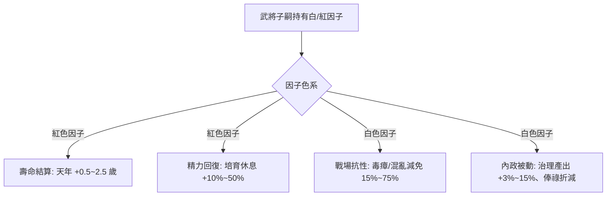

<!-- doc_id: doc_spec_0642 -->
# 白色性格抗性因子與紅色壽命精力因子數值模型規格書

> **規格代碼**：`FBR-11`
> **版本**：v1.0 (Single Source of Truth)
> **狀態**：正式定案 (Approved)
> **檔案大小限制**：嚴格 <6144 bytes

---

## 1. 系統定位與數值架構

本規格補齊血統系統中白色（性格/抗性）與紅色（壽命/精力）遺傳因子之全量數值模型與業務消費介面。
徹底裁決過往「白因子效果未做、規格數值未定」之空白，建立單一真相來源。



---

## 2. 紅色因子（氣血與天年）數值配置

```typescript
export interface RedFactorBonus {
  starLevel: 1 | 2 | 3 | 4 | 5;
  extraLifespanYears: number; // 延長自然壽命 (歲)
  vigorRestMultiplier: number;// 培育休息精力回復倍率
  lastStandHpRecover: number; // 戰場根性觸發後回血率
}

export const RED_FACTOR_LEVELS: Record<number, RedFactorBonus> = {
  1: { starLevel: 1, extraLifespanYears: 0.5, vigorRestMultiplier: 1.10, lastStandHpRecover: 0.04 },
  2: { starLevel: 2, extraLifespanYears: 1.0, vigorRestMultiplier: 1.20, lastStandHpRecover: 0.08 },
  3: { starLevel: 3, extraLifespanYears: 1.5, vigorRestMultiplier: 1.30, lastStandHpRecover: 0.12 },
  4: { starLevel: 4, extraLifespanYears: 2.0, vigorRestMultiplier: 1.40, lastStandHpRecover: 0.16 },
  5: { starLevel: 5, extraLifespanYears: 2.5, vigorRestMultiplier: 1.50, lastStandHpRecover: 0.20 },
};
```

---

## 3. 白色因子（性格與抗性）數值配置

| 因子代碼 | 因子名稱 | 每星階梯效果 (1★ ~ 5★) | 消費系統與生效時機 |
|---|---|---|---|
| `FACTOR_WHITE_POISON_RES` | **辟瘴靈草** | 毒瘴/疫病傷害減免 **+15% ~ +75%** | 戰場天候與地格結算 |
| `FACTOR_WHITE_CHAOS_RES` | **泰山磐心** | 抵抗離間/混亂恐慌機率 **+12% ~ +60%** | 敵方控制計謀檢定時 |
| `FACTOR_WHITE_DILIGENT` | **夙夜在公** | 內政治理任務基礎產出 **+3% ~ +15%** | 季度內政產出計算公式 |
| `FACTOR_WHITE_FRUGAL` | **崇簡寡慾** | 該武將季度俸祿消耗折減 **-5% ~ -25%** | 季度國庫俸祿發放結算 |

---

## 4. 系統消費與公式乘區契約

1. **自然壽命計算**：
   $$\text{FinalLifespan} = \text{BaseLifespan} + \text{RedFactorBonus.extraLifespanYears} + \text{LongevityPillBonus}$$
2. **培育精力回復**：
   $$\text{RestRecoveredVigor} = \text{BaseVigorRest} \times \text{RedFactorBonus.vigorRestMultiplier}$$
3. **俸祿結算折減**：
   $$\text{ActualSalary} = \text{StandardSalary} \times (1 - \text{WhiteFactorFrugalRate})$$
