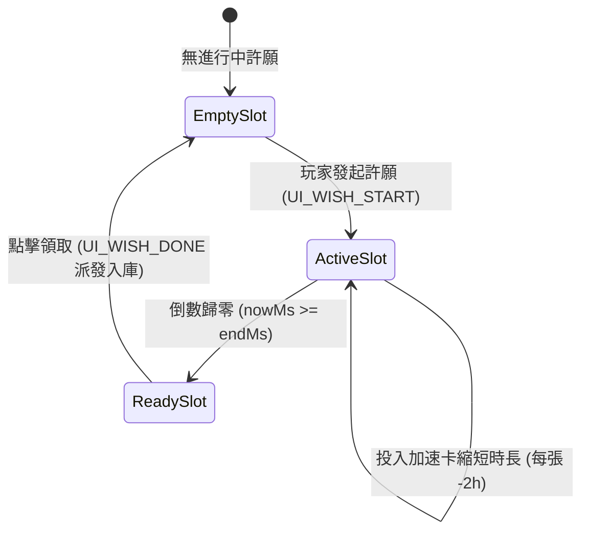

<!-- doc_id: doc_spec_0420 -->
# 百寶閣商城與許願祭壇介面狀態切換與多語規格書

> 本規格書為 3KLife 大廳百寶閣商城與許願祭壇 UI 狀態機、插槽三態切換、文案與多語系鍵值之唯一真相來源（Single Source of Truth）。
> 相關實作對齊：`assets/scripts/ui/core/WishAltarController.ts`、`WishPool.ts`、`shop-main-screen.json`。

---

## 1. 系統定位與架構分層

1. **Presenter 層純邏輯控制器（WishAltarController）**：
   - 負責將底層經濟模型（`WishPoolState`、`ItemShopPricing`）對映為平鋪之視圖資料結構（`WishAltarFlowView`），元件自身不依賴 Cocos 引擎原生節點。
   - 所有顯示文案、節點啟用狀態（`actives`）與點擊互動可用性（`enabled`）均在此處決定，保證邏輯與表現解耦。
2. **多語系鍵值契約對齊**：
   - UI 綁定標準 i18n 鍵值，保障正體中文、簡體中文與英文在地化時排版穩定。

---

## 2. 許願祭壇五槽位三態狀態機（Slot Tri-State）

祭壇固定設有 5 個插槽（`WISH_ALTAR_SLOTS = 5`，對齊全域最大並行數），每個插槽呈現三種動態狀態：



| 插槽狀態 | 視覺反饋與標籤 | 點擊互動行為 |
|---|---|---|
| **空位（Empty）** | 顯示空槽底框與預設加號圖示 | 導向當前選中商品之許願發起流程 |
| **進行中（Active）** | 顯示道具圖示、名稱、倒數計時（時:分:秒） | 點擊消耗 1 張加速卡（折減 2 小時） |
| **完成待領取（Ready）** | 顯示金色流光特效、完成字樣 | 點擊直接提領道具至背包，插槽恢復為空位 |

---

## 3. 系統文案與拒絕原因多語對照表

### 3.1 許願發起拒絕原因映射（WISH_START_REASON_LABEL）

| 拒絕原因列舉 (`WishStartReason`) | 多語鍵值代碼 | 正體中文文案（預設真相） | 觸發防護條件 |
|---|---|---|---|
| **`unknown-item`** | `UI_WISH_ERR_UNKNOWN` | 此商品無法許願。 | 傳入無效或未配置於許願表之道具 ID |
| **`round-full`** | `UI_WISH_ERR_ROUND_FULL` | 本巡許願次數已用完，請等下一巡。 | 當前巡次已許願達 3 次上限 |
| **`concurrent-full`** | `UI_WISH_ERR_CONCURRENT_FULL` | 進行中的許願已滿，請先領取。 | 當前 5 個插槽均處於進行或待領狀態 |

### 3.2 巡次與操作系統提示文案

| 功能情境 | 系統標識 | 正體中文文案 | 說明 |
|---|---|---|---|
| **巡次顯示** | `UI_WISH_ROUND` | 第 {round} 巡（早/中/晚） | 早巡 06:00、中巡 12:00、晚巡 18:00 |
| **發起成功** | `UI_WISH_START` | 祈願已立，靜候靈驗 | 進入倒數時鐘 |
| **領取成功** | `UI_WISH_DONE` | 願力圓滿，收納庫存 | 結算產物入背包 |
| **貧困補貼提示** | `UI_RES_SUBSIDY` | 府庫告急，已發放每日救濟物資 | 滿足 ECO-06 時動態展示之橫幅 |

---

## 4. 介面型別契約

```typescript
export interface WishAltarFlowView {
    readonly texts: Record<string, string>;
    readonly actives: Record<string, boolean>;
    readonly enabled: Record<string, boolean>;
}

export class WishAltarController {
    constructor(deps: WishAltarDeps);
    public reset(): void;
    public prevItem(): void;
    public nextItem(): void;
    public getFlowView(): WishAltarFlowView;
}
```
