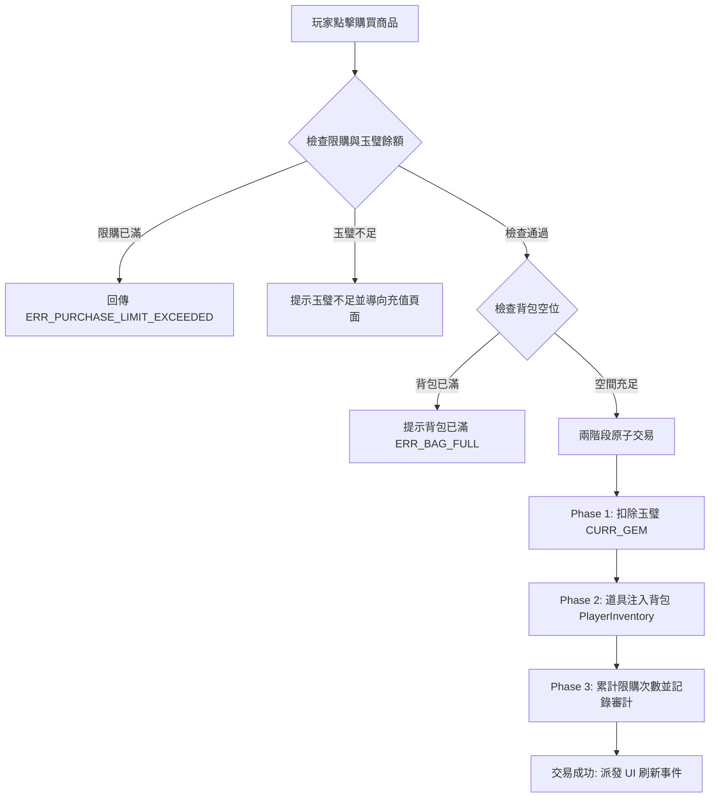

<!-- doc_id: doc_spec_0628 -->
# 百寶閣玉璧貨幣定價與道具扣款購買流程規格書

> **規格代碼**：`ITM-11`
> **版本**：v1.0 (Single Source of Truth)
> **狀態**：正式定案 (Approved)
> **檔案大小限制**：嚴格 <6144 bytes

---

## 1. 系統定位與架構

本規格定義遊戲內高階商城「百寶閣」使用硬貨幣「玉璧 (`CURR_GEM`)」購買稀有功能性道具與禮盒的交易規格。
補齊過往僅有抽卡錢包而缺乏道具商城玉璧購買介面與兩階段原子扣款協議的缺口。



---

## 2. 百寶閣玉璧商品定價目錄

```typescript
export interface GemShopOffer {
  offerId: string;
  targetItemId: string;
  itemCount: number;
  gemPrice: number;
  originalPrice?: number;
  limitType: "DAILY" | "WEEKLY" | "LIFETIME" | "UNLIMITED";
  limitCount?: number;
  requiredPlayerRank?: number; // 官職限制
}

export const GEM_SHOP_CATALOG: GemShopOffer[] = [
  {
    offerId: "GEM_OFFER_TOKEN_PACK",
    targetItemId: "ITEM_LOT_TOKEN",
    itemCount: 10,
    gemPrice: 900,
    originalPrice: 1000,
    limitType: "WEEKLY",
    limitCount: 3,
  },
  {
    offerId: "GEM_OFFER_RENAME",
    targetItemId: "ITEM_NAME_CHANGE_TOKEN",
    itemCount: 1,
    gemPrice: 300,
    limitType: "UNLIMITED",
  },
  {
    offerId: "GEM_OFFER_RESET_STATS",
    targetItemId: "ITEM_RESET_BONE_PILL",
    itemCount: 1,
    gemPrice: 500,
    limitType: "MONTHLY" as any,
    limitCount: 2,
  },
  {
    offerId: "GEM_OFFER_BLUEPRINT_BOX",
    targetItemId: "ITEM_ANCIENT_BLUEPRINT_CHEST",
    itemCount: 1,
    gemPrice: 1200,
    limitType: "LIFETIME",
    limitCount: 1,
  },
];
```

---

## 3. 兩階段原子購買協議

為防止網路抖動、斷電或客戶端崩潰造成「扣除玉璧但未獲得道具」或「刷取道具」之嚴重漏洞，交易執行嚴格兩階段協議：

```typescript
export interface PurchaseRequest {
  offerId: string;
  purchaseCount: number;
  clientTimestamp: number;
}

export interface PurchaseResult {
  success: boolean;
  offerId: string;
  gemsDeducted: number;
  remainingGems: number;
  itemsDelivered: Array<{ itemId: string; count: number }>;
  errorCode?: "INSUFFICIENT_GEMS" | "LIMIT_EXCEEDED" | "BAG_FULL" | "INVALID_OFFER";
}
```

### 3.1 執行順序
1. **驗證階段（Validate）**：
   - 檢查 `offerId` 是否存在於商品目錄中。
   - 檢查限購次數（`currentPurchasedCount + purchaseCount <= limitCount`）。
   - 檢查背包容量是否能容納目標道具（含堆疊計算）。
   - 檢查玉璧總額：`requiredGems = offer.gemPrice * purchaseCount`，若 `balance < requiredGems`，交易中止。
2. **扣款與發貨階段（Commit）**：
   - 呼叫 `GachaWallet.deductGems(requiredGems, reason: "SHOP_BUY_" + offerId)`。
   - 成功後立即呼叫 `PlayerInventory.addItem(offer.targetItemId, offer.itemCount * purchaseCount)`。
   - 更新本地購買記錄（`PurchaseRecord`）。
3. **異常回滾（Rollback）**：
   - 若發貨過程拋出異常，啟動補償流程（Compensating Transaction），全額返還已扣除之玉璧，並記錄警告日誌 `CRITICAL_SHOP_ROLLBACK`。
