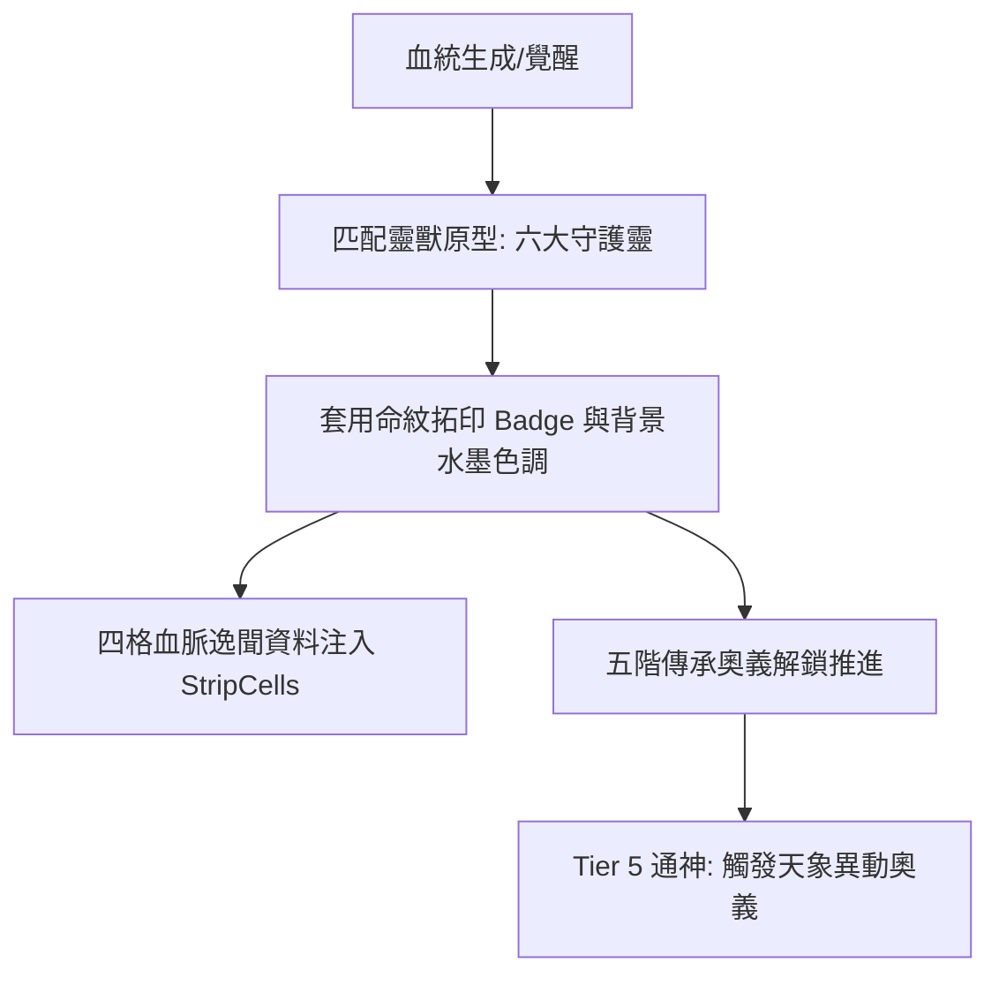

<!-- doc_id: doc_spec_0639 -->
# 祖紋命篆視覺契約與靈獸六原型徽章映射規格書

> **規格代碼**：`BLT-12`
> **版本**：v1.0 (Single Source of Truth)
> **狀態**：正式定案 (Approved)
> **檔案大小限制**：嚴格 <6144 bytes

---

## 1. 系統定位與架構

本規格確立世家血脈系統之「祖紋命篆（Totem Seal）」視覺母語、六大靈獸原型徽章映射、四格逸聞漫畫資料結構以及五階奧義傳承階梯。
補齊過往「視覺契約與血脈逸聞未定案」之遺留缺口，實現血脈深度敘事與視覺統一。



---

## 2. 六大靈獸原型視覺與人格映射矩陣

```typescript
export enum TotemBeastArchetype {
  QINGLONG = "QINGLONG", // 青龍: 仁德治世
  BAIHU = "BAIHU",       // 白虎: 征伐殺戮
  ZHUQUE = "ZHUQUE",     // 朱雀: 智謀神算
  XUANWU = "XUANWU",     // 玄武: 磐石堅壁
  QILIN = "QILIN",       // 麒麟: 帝胄真命
  YINGLONG = "YINGLONG", // 應龍: 變革破局
}

export interface TotemBeastVisualDef {
  archetype: TotemBeastArchetype;
  name: string;
  watermarkColor: string; // 水墨底紋色
  badgeSpriteFrame: string;
  personalityTrait: string;
  preferredFactorColor: string;
}
```

| 靈獸原型 | 哲學象徵 | 命篆色調 | 徽章紋樣 | 人格與屬性傾向 |
|---|---|---|---|---|
| **青龍** | 仁道生機 | 碧青 `#2E8B57` | 蒼龍銜珠圖騰 | 仁德寬厚、政治與民望加成 |
| **白虎** | 破軍殺伐 | 素銀 `#E6E6FA` | 猛虎裂金圖騰 | 剛烈決絕、武力與穿甲暴擊 |
| **朱雀** | 焚天奇策 | 緋紅 `#DC143C` | 朱羽凌霄圖騰 | 機變無雙、智力與策論策謀 |
| **玄武** | 負重如嶽 | 黛黑 `#2F4F4F` | 靈龜盤蛇圖騰 | 沉穩堅定、統領與城防減傷 |
| **麒麟** | 仁厚天命 | 鎦金 `#DAA520` | 踏雲麒麟圖騰 | 帝胄貴冑、五維全能均衡發展 |
| **應龍** | 逆命展翼 | 蒼藍 `#4169E1` | 雲雷雙翼圖騰 | 桀驁反骨、高運氣與逆境爆發 |

---

## 3. 四格血脈逸聞與五階奧義傳承階梯

### 3.1 四格逸聞資料結構（Four-Panel Strips）
```typescript
export interface BloodlineStoryStrip {
  generalId: string;
  beastArchetype: TotemBeastArchetype;
  cells: [StoryCell, StoryCell, StoryCell, StoryCell]; // 固定 4 格
}

export interface StoryCell {
  panelIndex: 1 | 2 | 3 | 4;
  caption: string;         // 繁中文案 (限 30 字內)
  illustrationKey: string; // 水墨漫畫背景圖
}
```

### 3.2 五階奧義傳承軌（Five-Stage Awakening）
1. **一階·入門（Initiate）**：解鎖基礎主動奧義，造成 $150\%$ 物理/謀略傷害。
2. **二階·登堂（Adept）**：攻擊範圍增加 1 格，命中率提升 $+10\%$。
3. **三階·入室（Expert）**：附加靈獸專屬效果（例：青龍驅散友軍減益、白虎破防 $25\%$）。
4. **四階·宗師（Master）**：奧義冷卻時間減少 1 回合，SP 消耗降低 $20\%$。
5. **五階·通神（Divine）**：突破傷害上限，斬殺敵將時全軍士氣回滿並觸發全屏天象特效。
