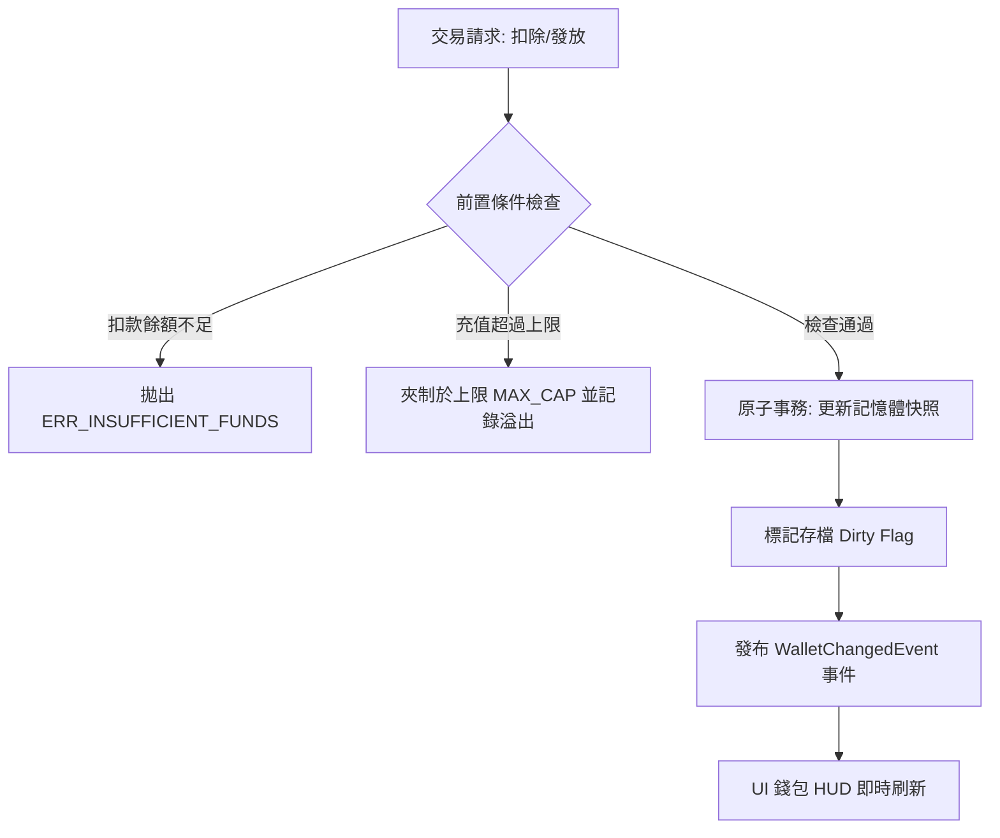

<!-- doc_id: doc_spec_0626 -->
# 稀缺貨幣精元與結義點數錢包增扣原子交易規格書

> **規格代碼**：`ECO-03`
> **版本**：v1.0 (Single Source of Truth)
> **狀態**：正式定案 (Approved)
> **檔案大小限制**：嚴格 <6144 bytes

---

## 1. 系統定位與架構

本規格為 3KLife 經濟系統之稀缺貨幣交易核心，確立「精元 (`JING_YUAN`)」與「結義點數 (`BOND_POINTS`)」的資料模型、錢包原子交易介面、防負數穿透保護與持久化協議。
徹底解決過往僅有本地簡易貨幣（gems/gold），缺乏高階養成與社交傭兵結拜專用稀缺貨幣錢包的問題。



---

## 2. 貨幣枚舉與數值邊界

```typescript
export enum RareCurrencyType {
  JING_YUAN = "JING_YUAN",       // 精元: 用於書院特訓、高階丹藥購買、許願加速
  BOND_POINTS = "BOND_POINTS",   // 結義點數: 用於酒館傭兵轉正、結拜、解鎖第二固有槽
}

export interface RareCurrencyConfig {
  initialAmount: number;
  maxCap: number;
  allowNegative: false; // 嚴格禁止透支
}

export const RARE_CURRENCY_CONFIG: Record<RareCurrencyType, RareCurrencyConfig> = {
  [RareCurrencyType.JING_YUAN]: {
    initialAmount: 0,
    maxCap: 999999,
    allowNegative: false,
  },
  [RareCurrencyType.BOND_POINTS]: {
    initialAmount: 0,
    maxCap: 50000,
    allowNegative: false,
  },
};
```

---

## 3. 錢包原子交易介面契約

交易必須具備原子性（All-or-Nothing），任何一步驗證失敗均不產生資料變更。

```typescript
export interface CurrencyTransaction {
  txId: string;
  type: RareCurrencyType;
  amount: number;             // 正數表示發放，負數表示扣除
  reason: string;             // 扣除業務碼 (例: SHOP_BUY, ENROLL_FEE, MERCENARY_BOND)
  timestamp: number;
}

export interface TransactionResult {
  success: boolean;
  type: RareCurrencyType;
  prevBalance: number;
  newBalance: number;
  delta: number;
  errorCode?: string;
  errorMessage?: string;
}

export interface IRareCurrencyWallet {
  getBalance(type: RareCurrencyType): number;
  canAfford(type: RareCurrencyType, cost: number): boolean;
  deduct(type: RareCurrencyType, cost: number, reason: string): TransactionResult;
  grant(type: RareCurrencyType, amount: number, source: string): TransactionResult;
}
```

---

## 4. 核心交易業務邏輯與防負數穿透

### 4.1 扣款演算（Deduct）
1. **防禦性檢查**：若傳入 `cost <= 0`，拋出 `ERR_INVALID_AMOUNT`。
2. **餘額驗證**：若 `currentBalance < cost`，直接拒絕，回傳 `success: false`，錯誤代碼 `ERR_INSUFFICIENT_FUNDS`，餘額保持原值。
3. **原子扣除**：`newBalance = currentBalance - cost`。
4. **存檔通知**：標記 `PlayerSaveService` 髒標記（Dirty Flag），派發全域事件 `ON_RARE_CURRENCY_CHANGED`。

### 4.2 發放演算（Grant）
1. **合法性檢查**：若 `amount <= 0`，拋出 `ERR_INVALID_AMOUNT`。
2. **上限夾制**：若 `currentBalance + amount > maxCap`：
   - `newBalance = maxCap`。
   - 記錄日誌 `AUDIT_CURRENCY_OVERFLOW`，記錄溢出丟棄量。
3. **發放結算**：`newBalance = currentBalance + amount`。

---

## 5. 本地持久化與同步機制

1. **存檔結構對齊**：
   ```json
   {
     "rareWallet": {
       "jingYuan": 1250,
       "bondPoints": 320,
       "lastUpdateTimestamp": 1772841600000
     }
   }
   ```
2. **原子保存協議**：
   - 錢包變更不觸發整檔同步寫盤，寫入記憶體鏡像快照並設置 `_isDirty = true`。
   - 在遊戲每回合結束、場景切換或每 30 秒自動備份時執行寫入。
   - 若發生意外崩潰，以最後一次保存之快照為準，客戶端絕不接受未經驗證之修改。
