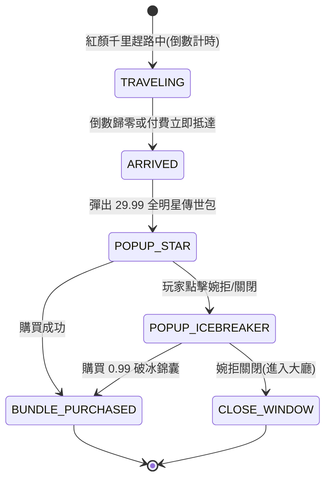

# 紅顏千里趕路與雙階商業化提示文案規格書

<!-- doc_id: doc_spec_0623 -->

> 本規格書依據 WBS `COPY-04`（紅顏趕路與商業化提示：0.99/29.99/倒數文案資料化）制定，為新手開局紅顏奔赴與商業化禮包文案之單一真相來源（Single Source of Truth）。
> 核心約束：無副作用純邏輯架構、配置表驅動四段文案、階梯式商業化心理引導、時區與時間差動態插槽、全繁體中文台灣慣用術語。

---

## 1. 業務定位與四段情境文案

在新手開局階段，系統透過「紅顏千里相會倒數」建立玩家持續留存期待，並在重要心理節點提供階梯式商業化破冰禮包（`0.99 錦囊` 與 `29.99 全明星包`）：



---

## 2. 四段文案詳細結構與動態插槽

### 2.1 紅顏千里趕路倒數文案（Traveling Countdown）
- **觸發節點**：開場宿命選秀結束後，紅顏自長安／鄴城／建業啟程奔赴玩家主城（預設倒數 2 小時）。
- **常駐標籤**：「紅顏兼程：{heroineName} 正策馬奔赴幕府，尚餘 {remainTime} 抵達！」
- **點擊詳情**：「『聽聞使君開府納賢，妾身特自江東星夜兼程而來。縱有千山萬水，亦難阻相見之心。』」

### 2.2 倒數抵達相會文案（Arrival Moment）
- **觸發節點**：倒數結束或使用靈玉加速抵達。
- **正文**：「『使君久候！妾身已至城下，願奉薄禮相助，助使君平定亂世！』」

### 2.3 29.99 傳世名將全明星包（29.99 All-Star Bundle）
- **文案標題**：「【天下歸心】傳世霸業全明星特惠」
- **宣傳語**：「『千軍易得，一將難求！三國頂級名將任君驅策，開疆拓土如虎添翼！』」
- **內含物提示**：「自選 SSR 初始名將 $\times 1$ ｜ 靈玉 $\times 3,000$ ｜ 頂級虎符 $\times 2$」

### 2.4 0.99 首儲破冰錦囊（0.99 Icebreaker Pouch）
- **觸發節點**：玩家婉拒 29.99 禮包後觸發二次挽留。
- **文案標題**：「【結緣見面禮】微服出巡破冰錦囊」
- **宣傳語**：「『路遙知馬力，初會結同心。僅需一枚銅錢，願伴使君共歷風雨。』」
- **內含物提示**：「求籤令 $\times 10$ ｜ 糧草 $\times 2,000$ ｜ 突破精元 $\times 50$」

---

## 3. 資料模型與文案格式化純函式

```typescript
export interface ICountdownCopyParams {
    readonly heroineName: string;
    readonly remainingSeconds: number;
}

export function formatCountdownNotice(params: ICountdownCopyParams): string {
    if (params.remainingSeconds <= 0) {
        return `${params.heroineName} 已抵達幕府城門！`;
    }
    const mins = Math.floor(params.remainingSeconds / 60);
    const secs = params.remainingSeconds % 60;
    const timeStr = `${mins}分${secs}秒`;
    return `紅顏兼程：${params.heroineName} 正策馬奔赴幕府，尚餘 ${timeStr} 抵達！`;
}

export interface ICommercialPrompt {
    readonly bundleId: 'BUNDLE_ALL_STAR_2999' | 'BUNDLE_ICEBREAKER_099';
    readonly title: string;
    readonly subtitle: string;
    readonly priceLabel: string;
}

export function resolveCommercialPrompt(bundleId: ICommercialPrompt['bundleId']): ICommercialPrompt {
    if (bundleId === 'BUNDLE_ALL_STAR_2999') {
        return {
            bundleId,
            title: '【天下歸心】傳世霸業全明星特惠',
            subtitle: '千軍易得，一將難求！三國頂級名將任君驅策，開疆拓土如虎添翼！',
            priceLabel: 'NT$ 990 / US$ 29.99',
        };
    }
    return {
        bundleId,
        title: '【結緣見面禮】微服出巡破冰錦囊',
        subtitle: '路遙知馬力，初會結同心。僅需一枚銅錢，願伴使君共歷風雨。',
        priceLabel: 'NT$ 33 / US$ 0.99',
    };
}
```

---

## 4. 驗收測試案例（Test Cases）

| 測試編號 | 測試情境 | 輸入條件 | 預期輸出 |
|---|---|---|---|
| `TC-COPY-01` | 倒數進行中文案格式化 | 貂蟬，尚餘 3661 秒（61分1秒） | 輸出「紅顏兼程：貂蟬 正策馬奔赴幕府，尚餘 61分1秒 抵達！」 |
| `TC-COPY-02` | 倒數歸零抵達文案 | 甄姬，剩餘 0 秒 | 輸出「甄姬 已抵達幕府城門！」 |
| `TC-COPY-03` | 29.99 全明星包文案匹配 | 請求 `BUNDLE_ALL_STAR_2999` | 標題含「天下歸心」，定價含 US$ 29.99 |
| `TC-COPY-04` | 0.99 破冰錦囊文案匹配 | 請求 `BUNDLE_ICEBREAKER_099` | 標題含「結緣見面禮」，定價含 US$ 0.99 |
