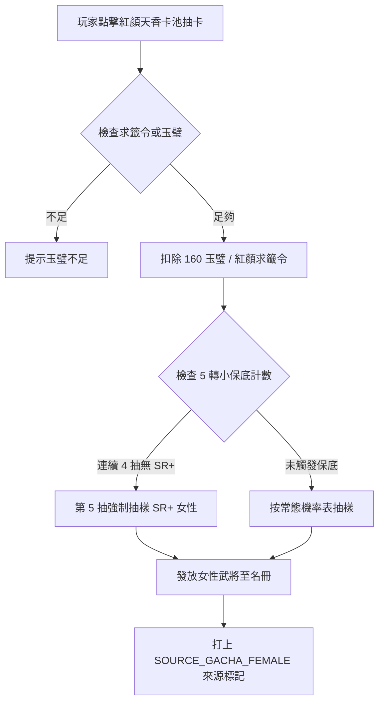

<!-- doc_id: doc_spec_0645 -->
# 紅顏天香轉蛋女將卡池五轉小保底與來源名冊規格書

> **規格代碼**：`FEM-03`
> **版本**：v1.0 (Single Source of Truth)
> **狀態**：正式定案 (Approved)
> **檔案大小限制**：嚴格 <6144 bytes

---

## 1. 系統定位與架構

本規格為轉蛋系統新增獨立之「紅顏天香（Female Heroines）專屬抽卡池」，確立其抽卡貨幣、機率分佈、5 抽小保底狀態機以及女性武將名冊來源標記契約。
解決過往 `LocalGachaService.ts` 僅有常規大池而缺乏專屬女性卡池與保底分離的缺陷。



---

## 2. 卡池機率與雙階保底模型

```typescript
export interface FemaleGachaConfig {
  poolId: string;
  poolName: string;
  singleCostGems: number;      // 單抽 160 玉璧
  tenCostGems: number;         // 十連 1440 玉璧 (9折)
  shortPityThreshold: number;  // 5 轉小保底 (必得 SR+)
  grandPityThreshold: number;  // 50 轉大保底 (必得當期 UP SSR)
  baseRates: {
    ssr: number; // 2.5%
    sr: number;  // 12.5%
    r: number;   // 85.0%
  };
}

export const FEMALE_GACHA_DEFAULTS: FemaleGachaConfig = {
  poolId: "GACHA_POOL_FEMALE_HEROINES",
  poolName: "紅顏天香限定池",
  singleCostGems: 160,
  tenCostGems: 1440,
  shortPityThreshold: 5,
  grandPityThreshold: 50,
  baseRates: { ssr: 0.025, sr: 0.125, r: 0.85 },
};
```

---

## 3. 抽樣狀態機與來源名冊序列化

1. **小保底狀態維護**：
   - 本地存檔記帳：`femaleGachaShortPityCounter`（0~5）與 `femaleGachaGrandPityCounter`（0~50）。
   - 每抽未得 SR 以上武將，小保底計數 $+1$；當計數達 4 時，第 5 抽強制將 R 卡機率歸零，按 $SSR:SR = 1:5$ 重定權重。
   - 獲得 SR 或 SSR 武將時，小保底計數歸零；獲得 UP SSR 時，大保底計數歸零。
2. **來源名冊登記契約**：
   - 抽出的武將注入 `FemaleProfile`：
     ```json
     {
       "generalId": "diao_chan",
       "sourceType": "GACHA_FEMALE",
       "qualityGrade": "SSR",
       "initialAffection": 60,
       "acquireTimestamp": 1772841600000
     }
     ```
   - 抽卡獲得之女性武將起始好感度保底為 $60$ 點，可立即進行結緣。
