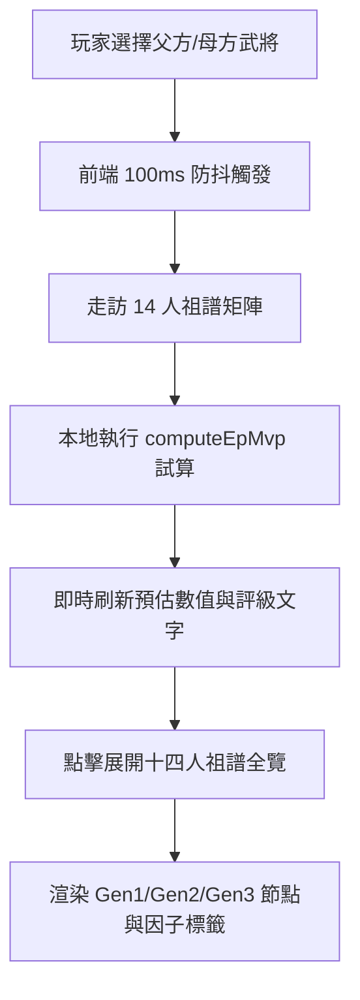

<!-- doc_id: doc_spec_0637 -->
# 結緣介面十四人血統樹展開與實時EP評級演算規格書

> **規格代碼**：`BRD-06`
> **版本**：v1.0 (Single Source of Truth)
> **狀態**：正式定案 (Approved)
> **檔案大小限制**：嚴格 <6144 bytes

---

## 1. 系統定位與介面架構

本規格定義遊戲內武將「結緣介面（BondingSetupView）」之 UI 佈局、十四人血統樹摺疊/展開互動，以及雙親變更時之即時 EP 評級推導契約。
補齊過往「EP 預估與評級文字未逐項核對」之規格缺口，確立前端與底層遺傳算法之純前端響應規範。



---

## 2. 介面視覺佈局與組件契約

```typescript
export interface BondingSetupViewModel {
  fatherGeneralId: string | null;
  motherGeneralId: string | null;
  predictedEp: number;           // 預估 EP 數值 (例: 78.5)
  epTierRating: "S" | "A" | "B" | "C"; // 評級階梯
  epRatingText: string;          // 本地化繁中文案
  isTreeExpanded: boolean;       // 是否展開 14 人全覽
}

export const EP_TIER_CONFIG = {
  S: { minEp: 85, label: "UI_EP_TIER_S", color: "#FFD700" }, // 冠絕當世 (金)
  A: { minEp: 70, label: "UI_EP_TIER_A", color: "#BA55D3" }, // 龍鳳之姿 (紫)
  B: { minEp: 55, label: "UI_EP_TIER_B", color: "#1E90FF" }, // 棟樑之材 (藍)
  C: { minEp: 0,  label: "UI_EP_TIER_C", color: "#808080" }, // 平庸之資 (灰)
};
```

---

## 3. 即時 EP 試算與因子預覽規範

1. **純客戶端無感運算**：
   - 雙親槽位變更時，直接於前端主執行緒呼叫 `computeEpMvp(father.ancestors, mother.ancestors)`。
   - 計算耗時必須低於 2ms，嚴禁向伺服器發送非必要之 HTTP 查詢請求。
2. **預覽公式**：
   $$\text{EP}_{\text{predicted}} = 50 + \text{Bonus}_{\text{共鳴}} + \text{Bonus}_{\text{異脈}} + \text{Bonus}_{\text{契合}}$$
   - 暫不計入不可預知的「天命隨機波動（$\pm 15$）」，界面明確標註「天命未卜，以出生時實測為準」。
3. **近親警告**：
   - 若三代內存在共同祖先，界面立即置紅提示 `UI_INBREEDING_WARNING`（「三代近親，精魂受損！」），並將確認結緣按鈕置灰阻斷。
