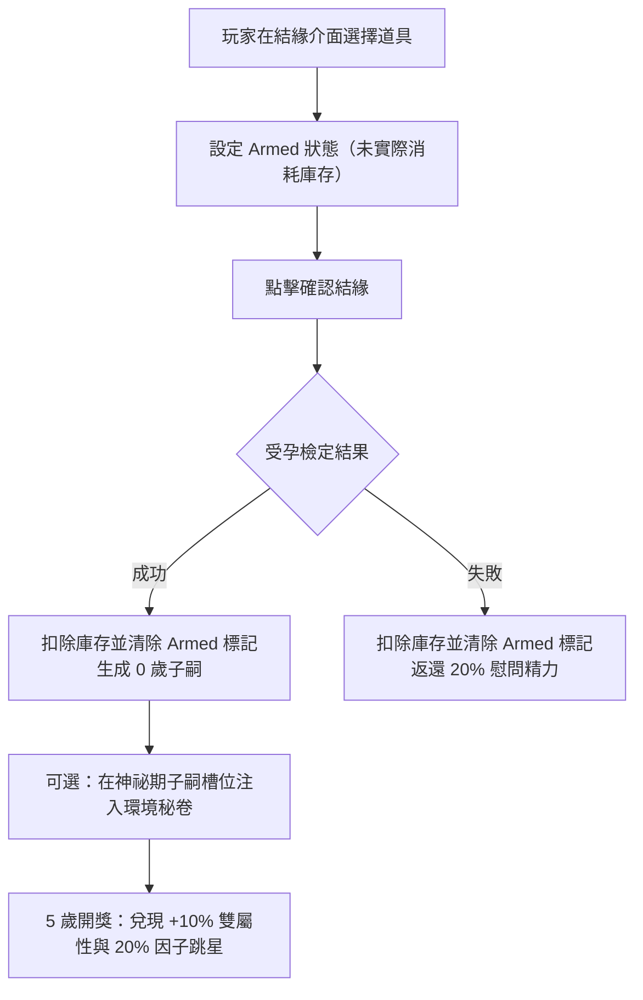

<!-- doc_id: doc_spec_0315 -->
# 結緣生育輔助道具與幼年環境功能規格書 (Breeding Auxiliary Items & Early Childhood Environment)

> **所屬分類**：系統規格書 (System Spec)  
> **關聯總目錄**：[`docs/cross-ref/cross-ref-進度.md (doc_index_0017)`](file:///c:/Users/User/3KLife/docs/cross-ref/cross-ref-進度.md)、[`docs/cross-ref/wbs-progress-inventory-matrix.md (doc_index_1054)`](file:///c:/Users/User/3KLife/docs/cross-ref/wbs-progress-inventory-matrix.md)  
> **對應 WBS 工作包**：`BRD-13`（結緣商業道具：補元散、安胎藥/送子符、求籤令、成長環境）、`FBR-09`（因子變異與微調）  
> **關聯母規格**：[`結緣系統（配種）.md (doc_spec_0028)`](file:///c:/Users/User/3KLife/docs/遊戲規格文件/系統規格書/結緣系統（配種）.md)、[`子嗣開獎天象與職能宿命分流規格書.md (doc_spec_0312)`](file:///c:/Users/User/3KLife/docs/遊戲規格文件/系統規格書/子嗣開獎天象與職能宿命分流規格書.md)、[`道具系統（付費免費道具）.md (doc_spec_0019)`](file:///c:/Users/User/3KLife/docs/遊戲規格文件/系統規格書/道具系統（付費免費道具）.md)  
> **制定版本**：v1.0（權威定案，裁決補齊成長環境道具來源與微調幅度）

---

## 1. 系統目標與設計哲學

結緣繁衍是長線血統傳承的發動機。為消除高齡、精力耗盡、受孕失敗與資質不確定帶來的挫折感，本規格確立「結緣四大輔助道具體系」：
1. **補元散（精力充盈）**：快速回補武將精力，支持連續征戰與世代繁衍。
2. **安胎藥與送子符（生育保底）**：大幅拉升受孕率，並提供天命底線守護。
3. **求籤令（定向天命）**：指定名士專屬批語，並支援譜牒密考暗線細查。
4. **幼年成長環境秘卷（解決 BRD-13 核心懸缺）**：裁決定案藏經閣與演武場秘卷，0~5 歲指定定向成長福祉。

---

## 2. 結緣四大核心輔助道具清單 (BRD-13 裁決標準)

| 道具代號 | 道具名稱 | 取得途徑 | 使用時機 | 具體數值與戰略效果 |
|:---|:---|:---|:---|:---|
| **ITEM_ELIXIR** | **補元散** | 家族祠堂每日供奉、名將挑戰賽、商城 | 結緣前或出征前 | 立即為指定武將恢復 **50 點精力**；解除疲憊狀態。 |
| **ITEM_FERTILITY**| **安胎藥** | 領地商貿、名士贈禮、商城 | 結緣前 Armed 預載 | 該次結緣受孕率直接乘上 **$\times 1.50$ 倍**（上限鎖定 95%）。 |
| **ITEM_CHARM** | **送子符** | 高級任務、限時活動、商城 | 結緣前 Armed 預載 | 本次結緣 **$100\%$ 保證受孕**，且子嗣天命 $EP$ 保底 $\ge 60$。 |
| **ITEM_ORACLE** | **求籤令** | 季度季末禮包、日常任務、商城 | 結緣介面或名士館 | 消耗 1 枚指定名士進行深層占卜，或解鎖隱藏血脈密考。 |

---

## 3. 幼年成長環境道具與微調幅度 (Childhood Environment)

子嗣出生（0 歲）至開獎（5 歲）期間，玩家可於神祕期槽位注入 1 份環境修業秘卷：

| 環境道具代號 | 環境名稱 | 適用傾向 | 5 歲開獎兌現數值福祉 | 因子微調效益 (FBR-09) |
|:---|:---|:---|:---|:---|
| **ITEM_ENV_LIBRARY** | **藏經閣修業秘卷** | 智力 / 政治 | 開獎時智力與政治基礎屬性額外 **$+10\%$**。 | 有 $20\%$ 機率將智力型因子星等向上提升 $+1$ 星（不跨色）。 |
| **ITEM_ENV_ARENA** | **演武場破陣圖** | 武力 / 統率 | 開獎時武力與統率基礎屬性額外 **$+10\%$**。 | 有 $20\%$ 機率將武藝型因子星等向上提升 $+1$ 星（不跨色）。 |
| **ITEM_ENV_ACADEMY**| **名門私塾筆記** | 魅力 / 德行 | 開獎時魅力額外 **$+15\%$**；入學書院起始羈絆 $+10$ 點。 | 有 $20\%$ 機率將人際型因子星等向上提升 $+1$ 星（不跨色）。 |

---

## 4. 道具生命週期與狀態機 (Lifecycle & Consumption)



---

## 5. TypeScript 介面契約與驗收

```typescript
export interface BreedingItemUsage {
  useElixirGeneralId?: string; // 使用補元散武將
  useFertilityDrug?: boolean;  // 使用安胎藥 (x1.5)
  useChildCharm?: boolean;     // 使用送子符 (100% + 保底60)
  oracleTokensSpent?: number;  // 求籤令消耗
  childEnvironmentItem?: 'ITEM_ENV_LIBRARY' | 'ITEM_ENV_ARENA' | 'ITEM_ENV_ACADEMY';
}

export interface BreedingItemResolution {
  finalConceptionRate: number;
  epFloorApplied: boolean;
  environmentApplied?: string;
  statsBonusPct: { [stat: string]: number };
}
```

### 驗收條件 (Acceptance Criteria)
- [ ] **TC-BREED-ITEM-01**：補元散精準回復 50 點精力並即時寫回存檔。
- [ ] **TC-BREED-ITEM-02**：安胎藥正確套用受孕率 $\times 1.5$；送子符保證 $100\%$ 受孕且 $EP \ge 60$。
- [ ] **TC-BREED-ITEM-03**：藏經閣/演武場秘卷於 5 歲開獎精準提供對應屬性 $+10\%$ 與 $20\%$ 跳星判定。
- [ ] **TC-BREED-ITEM-04**：結緣流程 Armed 標記於執行後精準扣除庫存，無重複扣減。
