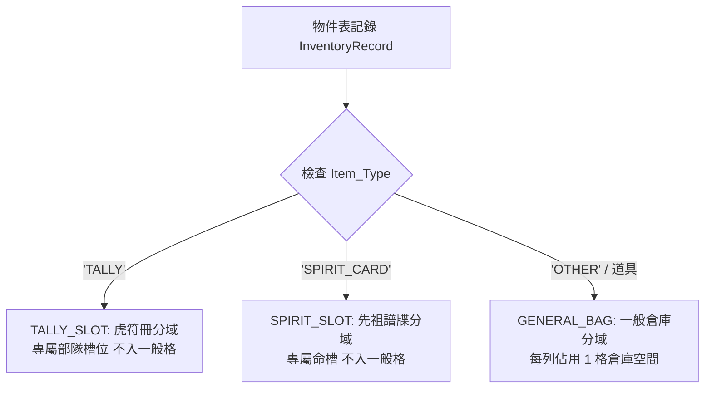

<!-- doc_id: doc_spec_0438 -->
# 統一物件庫DisplayBucket顯示分域與格數計算規格書

## 1. 核心定位與職責範圍

本規格書定義統一物件庫（Inventory Service）的顯示分域標記（`Display_Bucket`）與主城倉庫格數計算規則，對應 WBS **BAG-10**。
遊戲內各類資產（一般裝備、消耗品、材料、虎符卡、英靈卡）統一收斂於同一張物件庫記錄表（`InventoryRecord`）。
為了防止高價值核心戰略資產（虎符與先祖英靈卡）擠佔有限的主城倉庫空間，系統透過純邏輯分域服務（`BagDomain.ts`）執行視圖隔離與精確的格數計量。

---

## 2. 顯示分域（BagDomain）三態模型



### 2.1 分域代碼枚舉與行為約束
| 分域代碼（`BagDomain`） | 對應物品類型（`Item_Type`） | 倉庫計格 | 丟棄/販售限制 | 畫面呈現容器 |
|---|---|:---:|:---:|---|
| **`TALLY_SLOT`** | `TALLY`（部隊虎符卡） | **不計格（0 格）** | **嚴格禁止販賣或丟棄** | 專屬虎符冊、部隊編制頁 |
| **`SPIRIT_SLOT`** | `SPIRIT_CARD`（先祖英靈卡） | **不計格（0 格）** | **嚴格禁止販賣或丟棄** | 先祖祠堂、命頁命鏡槽 |
| **`GENERAL_BAG`** | `OTHER`（裝備、消耗品、材料） | **計格（1 列 1 格）** | 允許正常出售或分解 | 主城倉庫面板、武將背包頁 |

---

## 3. 主城倉庫佔用格數計算（`countGeneralBagSlots`）

### 3.1 依列計格原則（Row-Based Slot Counting）
- 主城倉庫容量（上限 200 格）**僅計算所屬分域為 `GENERAL_BAG` 的表記錄列數**。
- 同類消耗品或材料之數量累加於同一記錄列之 `Quantity` 欄位中，**無論數量為 1 還是 999，均僅佔用 1 格倉庫空間**。
- 虎符與英靈卡記錄雖然存在於同一張統一物件庫中，但在計算倉庫格數時自動被 `bagDomainOf` 濾除，完全不計入已用格數。

### 3.2 演算法實現契約
```typescript
export function countGeneralBagSlots(records: readonly InventoryRecord[]): number {
    let count = 0;
    for (const record of records) {
        if (bagDomainOf(record) === 'GENERAL_BAG') count += 1;
    }
    return count;
}
```
- 時間複雜度為嚴格 $O(N)$，且不產生任何物件分配，保證高頻調用下的零 GC 開銷。

---

## 4. 前端視圖投影與分流保證

1. **Tab 容器分域隔離**：
   - 倉庫主介面僅呈現 `GENERAL_BAG` 內容，並顯示「已用格數 / 最大容量」（如 `45/70`）。
   - 虎符與英靈卡透過專屬按鈕跳轉至對應獨立視圖（`TallySlotCard` / `SpiritArchive`），避免介面資訊雜亂。
2. **防呆與資料保護**：
   - 試圖對 `TALLY_SLOT` 或 `SPIRIT_SLOT` 呼叫倉庫分解或出售命令時，底層 API 直接阻擋並回報 `NOT_GEAR` 拒絕代碼。

---

## 5. 驗收標準與單元測試契約

1. **零格佔用驗證**：
   - 物件庫中同時注入 50 張虎符卡與 30 張英靈卡，`countGeneralBagSlots` 計算結果必須為 `0`。
2. **堆疊計格驗證**：
   - 注入 10 瓶金創藥（單列 `Quantity: 10`）與 5 件一般裝備（5 列），`countGeneralBagSlots` 結果必須為 `6`。
3. **分域判定冪等性**：
   - 連續重複調用 `bagDomainOf` 必須得出恆等之分域列舉值。
