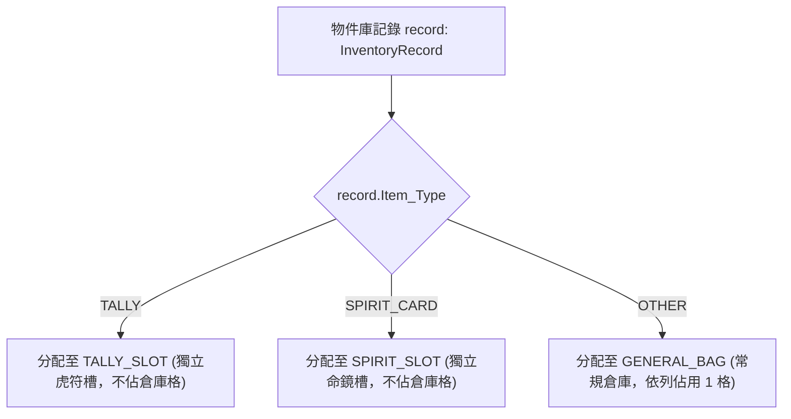
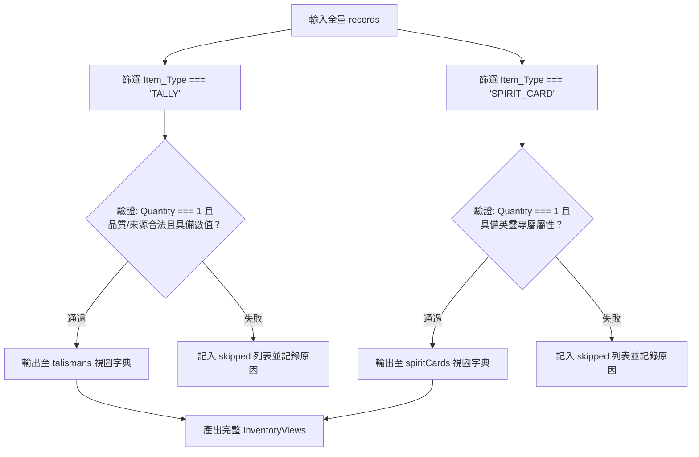

<!-- doc_id: doc_spec_0421 -->
# 統一物件庫InventoryService資料層與投影視圖規格書

> 本規格書為 3KLife 統一物件庫資料層（`InventoryRecord`）、四大類別投影推導與分域隔離機制之唯一真相來源（Single Source of Truth）。
> 相關實作對齊：`assets/scripts/core/systems/InventoryProjection.ts`、`BagDomain.ts`、`ReadModelValidators.ts`。

---

## 1. 系統定位與架構設計

1. **唯一真相來源資料層（Canonical Source of Truth）**：
   - 專案所有可持有物（道具、一般裝備、虎符、英靈卡）統一由底層 `InventoryRecord` 表格維護。
   - 虎符清單（`talismans`）與英靈卡集合（`spiritCards`）均為自統一物件庫即時推導之「投影唯讀視圖」（Read Projections），嚴禁另存獨立實體以杜絕雙重維護與資料不一致。
2. **無預設值補真相原則（Fail-Fast Projection）**：
   - 當物件庫記錄欄位遺失、品質不符或缺少必要來源數值時，推導引擎一律跳過該筆記錄並記入 `skipped` 清單，絕不使用預設值虛構資料。

---

## 2. 統一物件庫結構模型（InventoryRecord）

```typescript
export type InventoryItemType = 'TALLY' | 'SPIRIT_CARD' | 'OTHER';

export interface InventoryRecord {
    readonly Inventory_ID: string;        // 唯一實體識別碼
    readonly Item_Type: InventoryItemType; // 物件根類別
    readonly Slot_Type: string;           // 槽位類型
    readonly Bound_General_UID: string | null; // 綁定之武將 UID
    readonly Quantity: number;            // 持有數量（TALLY 與 SPIRIT_CARD 恆為 1）
    readonly Quality: string;             // 品質階級 (R / SR / SSR / UR)
    readonly Source_Type: string;         // 產出來源類型
    readonly Display_Bucket: string;      // 顯示分桶
    readonly Is_Displayed: boolean;       // 是否於介面展示
    readonly Attributes: Readonly<Record<string, unknown>>; // 類型專屬擴充屬性
    readonly equippedBy?: string | null;  // 裝備者武將 UID
    readonly slotId?: string | null;      // 六槽裝備格位代碼
    readonly Gear_ID?: string | null;     // 裝備規格 ID
    readonly expiresAt?: number | null;   // 限時過期戳記
    readonly isLocked?: boolean | null;   // 物品鎖定防分解標記
}
```

---

## 3. 分域隔離與容量計算（BagDomain）



1. **獨立槽位免佔容量**：虎符（`TALLY`）與英靈卡（`SPIRIT_CARD`）擁有專屬系統槽位，完全不佔用玩家一般倉庫格數。
2. **依列計格原則**：一般道具與裝備（`OTHER`）以「列」為單位計算格數（`countGeneralBagSlots`），數量堆疊於列內不額外消耗格位。

---

## 4. 視圖投影推導狀態機（projectInventoryViews）



---

## 5. 驗收標準與測試用例

1. **投影純粹性驗收**：
   - 虎符數量不為 1 或品質非 `R/SR/SSR/UR` 時，嚴格跳過並登錄原因。
2. **容量計算驗收**：
   - 包含 10 個虎符、5 張英靈卡與 3 樣一般道具之庫存，`countGeneralBagSlots` 回傳值精確為 3。
