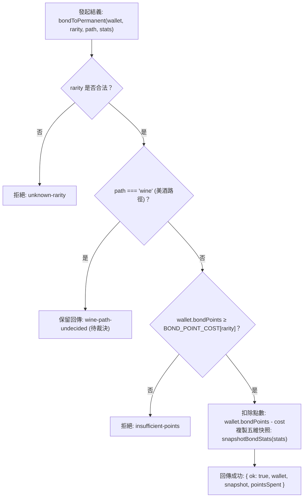

<!-- doc_id: doc_spec_0419 -->
# 美酒社交結義消耗與俘虜送禮好感度數值規格書

> 本規格書為 3KLife 傭兵結義轉正消耗、美酒社交路徑與女俘虜送禮提升好感度機制之唯一真相來源（Single Source of Truth）。
> 相關實作對齊：`assets/scripts/core/systems/MercenaryBondPermanent.ts`、`PrisonerGift.ts`、`GiftAffection.ts`。

---

## 1. 系統定位與架構設計

1. **社交羈絆與永久留存轉換樞紐**：
   - 傭兵系統允許玩家透過試用契約結交名將，並藉由結義儀式將其永久轉正納入家臣家譜。
   - 俘虜系統提供送禮軟化態度之非暴力降伏機制，好感度轉化為勸降成功率加成。
2. **純邏輯解耦契約（Side-Effect Free）**：
   - 不直接突變外部存檔，僅接受錢包或當前數值，輸出扣款後錢包與武將數值快照（`BondStats`）。

---

## 2. 傭兵結義轉正數值模型（MERC-04 / MERC-12）

### 2.1 稀有度結義點數成本階梯（BOND_POINT_COST）
結義點數（`bondPoints`）依傭兵初始稀有度劃分階梯：

| 傭兵品階 (`rarity`) | 結義點數消耗 (`cost`) | 轉正後地位 | 數值快照機制 |
|:---:|:---:|---|---|
| **R** | **100 點** | 基礎門客 | 結義當下五維永久凍結為武將初始面板 |
| **SR** | **300 點** | 精銳部曲 | 結義當下五維永久凍結為武將初始面板 |
| **SSR** | **600 點** | 柱石良臣 | 結義當下五維永久凍結為武將初始面板 |
| **UR** | **1200 點** | 傳奇天將 | 結義當下五維永久凍結為武將初始面板 |

### 2.2 結義路徑判定流程


---

## 3. 俘虜送禮與好感度轉換模型（PrisonerGift）

### 3.1 核心數值常數
- **單次禮物黃金代價**：`PRISONER_GIFT_GOLD = 200` 黃金。
- **單次好感度增量**：`PRISONER_GIFT_AFFECTION = 10` 點。
- **好感度上限**：`GIFT_AFFECTION_MAX = 100` 點。

### 3.2 勸降成功率提升演算法（persuadeRateAfterGift）
好感度增益以非線性邊際遞減方式轉換為額外勸降加成：
$$\text{persuadeRate}' = \min\left(100, \text{round}\left(\text{rate} + (\text{conversionBonusOf}(\text{after}) - \text{conversionBonusOf}(\text{before})) \times 100\right)\right)$$

### 3.3 演出文本與系統字串
- **送禮成功（UI_GIFT_SUCCESS）**：
  > `{name} 收下了你的珍寶，態度似乎軟化了幾分。{name} 好感度 +{gained}`
- **送禮無效或好感已滿（UI_GIFT_FAIL）**：
  > `{name} 不為所動`

---

## 4. 介面型別契約

```typescript
export interface BondStats {
    readonly STR: number;
    readonly INT: number;
    readonly POL: number;
    readonly CHR: number;
    readonly LUK: number;
}

export interface BondPointsWallet {
    readonly bondPoints: number;
}

export function bondToPermanent(
    wallet: Readonly<BondPointsWallet>,
    rarity: string,
    path: 'points' | 'wine',
    stats: Readonly<BondStats>
): BondPermanentResult;

export function resolvePrisonerGift(
    rate: number,
    affection: number,
    gold: number
): PrisonerGiftResult;
```
