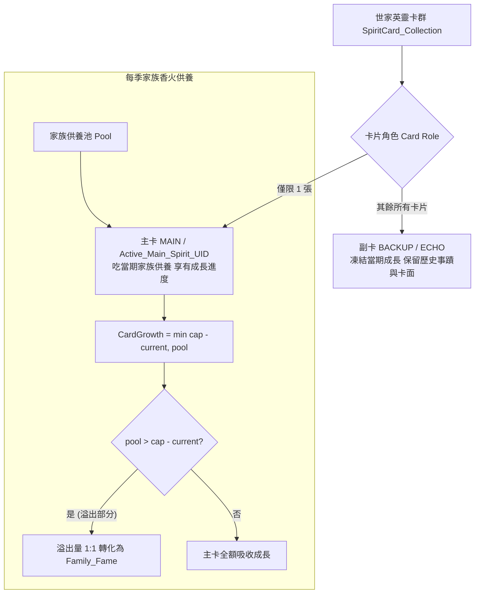

<!-- doc_id: doc_spec_0445 -->
# 英靈主副卡供養模型與溢出轉化世家名聲規格書

## 1. 核心定位與職責範圍

本規格書定義世家英靈卡的主副卡管理模型、香火供養集中機制，以及達到滿階後的數值溢出轉化演算法，對應 WBS **SPI-06**。
當一個歷史名門誕生多位英靈名將（如弘農楊氏、汝南袁氏）時，同一家族的英靈卡會形成家族卡群。
為了避免資源分散與玩家養成負擔過載，系統推行「一族一主卡」策略：當期供養資源 100% 灌注於當前選定之主卡（Main Spirit），而主卡成長達到當前階位上限後的溢出部分，以 1:1 比例自動轉換為全族共享的世家名聲（`Family_Fame`）與家族深度（`Family_Depth`）。

---

## 2. 主卡與副卡模型（Card Role Architecture）

### 2.1 主副卡狀態與權益矩陣
| 權益維度 | 主卡（`cardRole: 'MAIN'`） | 副卡（`cardRole: 'BACKUP'`） |
|---|:---:|:---:|
| **集合層數量限制** | **嚴格限定 1 張**（`Active_Main_Spirit_UID`） | 無限制（保留全部家族先祖） |
| **當期供養吸收** | **100% 享有**家族香火修為灌注 | **不參與吸收**（成長鎖定） |
| **世家陳列室展示** | 置於家族首位，標註金色「主奉先祖」 | 依取得時間或事蹟依序陳列 |
| **命鏡槽裝配** | 允許後代武將正常裝配 | 允許後代武將正常裝配 |

---

## 3. 供養成長與溢出轉化數學模型

### 3.1 主卡成長公式（`CardGrowth`）
設當期注入的家族香火資源池為 $Pool$，當前主卡進度為 $Current$，主卡階位硬上限為 $Cap$：
$$\text{CardGrowth} = \min(Cap - Current, Pool)$$
- 主卡最新修為進度更新為：
  $$Current_{\text{next}} = Current + \text{CardGrowth}$$

### 3.2 溢出資源轉化（`Overflow Conversion`）
當供養資源超出主卡當前上限需求（$Pool > Cap - Current$）時，超出之能量絕對不被截斷銷毀，自動 100% 迴流世家總庫：
$$\text{Overflow} = Pool - \text{CardGrowth}$$
$$\Delta \text{Family\_Fame} = \text{Overflow} \times 1.0$$
$$\Delta \text{Family\_Depth} = \lfloor \text{Overflow} \times 0.2 \rfloor$$
- 轉換之名聲值（`Family_Fame`）可直接用於提升世家門閥階級（解鎖更高的封頂上限）；家族深度（`Family_Depth`）則提升全體族人的內政執行基礎成功率。

---

## 4. 主卡切換交互與安全約束

1. **切換操作入口限制**：
   - 僅允許在「大廳 · 世家總覽」、「英靈陳列室」或出征前的編制準備頁進行「設為主卡」切換。
2. **戰鬥強制鎖定（Battle Lock）**：
   - 出征戰鬥進行中，世家總覽視圖切換為主卡按鈕變灰（Disabled），並提示「戰事未歇，祖宗祭奉不可遽易」。
3. **二次確認防呆**：
   - 玩家切換主卡時，前端彈出確認對話框：「切換後，家族香火供養將全數轉向【${NewMainName}】，原主卡修為保留不變，是否確認？」

---

## 5. 驗收標準與單元測試契約

1. **唯一主卡約束**：
   - 同一家族卡群中，呼叫 `setMainCard(uid)` 後，舊主卡自動降為 `BACKUP`，集合層中 `isMain` 為 true 的卡片永遠僅有 1 張。
2. **零溢出損耗驗證**：
   - 注入 500 點供養池，主卡離滿階尚差 300 點。結算後驗證：主卡進度 $+300$ 達到滿額，世家名聲準確增長 $+200$。
3. **副卡進度凍結驗證**：
   - 進行多次供養結算，副卡之數值進度與經驗值維持恆定，不受干擾。
