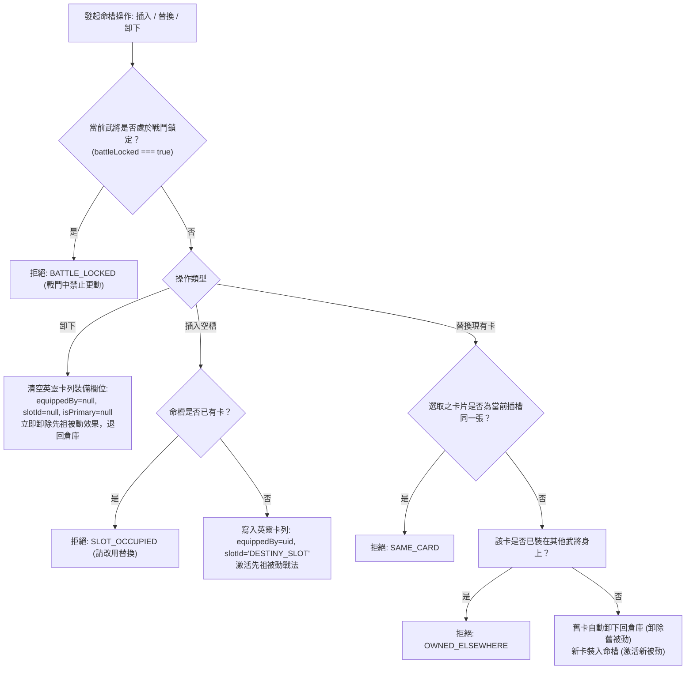

<!-- doc_id: doc_spec_0426 -->
# 英靈卡命鏡槽單插與替換被動卸除規則規格書

> 本規格書為 3KLife 武將人物頁「命 / Bloodline」英靈卡命鏡槽單插約束、戰鬥鎖定與替換卸除被動效果之唯一真相來源（Single Source of Truth）。
> 相關實作對齊：`assets/scripts/core/systems/SpiritSlotFlow.ts`、`SpiritSlotState.ts`、`InventoryProjection.ts`。

---

## 1. 系統定位與命槽鐵律

1. **先祖血脈與英靈庇護核心（Ancestral Spirit Core）**：
   - 每位武將於「命」頁面具備唯一之「命鏡槽」（`SPIRIT_SLOT_ID = 'DESTINY_SLOT'`）。
   - **單插約束（Single-Slot Rule）**：一名武將在任意時刻僅能插嵌 **1 張** 英靈卡，獲取其專屬被動光環與先祖奧義引導。
2. **戰鬥鎖定保護（Battle Locked Invariant）**：
   - 處於出征戰鬥狀態之武將，其命槽強制進入唯讀鎖定狀態（`BATTLE_LOCKED`），僅允許檢視卡面詳情，嚴禁卸下、替換或變更主卡。

---

## 2. 命槽更動與替換狀態機（SpiritSlotFlow）



---

## 3. 被動效果掛載與主卡權威（Primary Spirit Card）

### 3.1 主卡標記（`isPrimary`）
- 命槽中裝備之英靈卡預設自動標記為主卡（`isPrimary = true`）。
- 戰鬥系統與血脈共鳴引擎僅檢索 `isPrimary === true` 之英靈卡被動詞條，未裝備或已卸回倉庫之英靈卡，其數值與被動光環立即歸零失效。

### 3.2 統一物件庫狀態同步
- 命槽操作為無副作用純運算，不直接修改資料庫，一律輸出更新後之全新 `InventoryRecord[]` 陣列供上層服務原子落盤。

---

## 4. 介面型別契約

```typescript
export const SPIRIT_SLOT_ID = 'DESTINY_SLOT';

export type SpiritSlotFlowRejectReason =
    | 'NOT_FOUND'
    | 'BATTLE_LOCKED'
    | 'ALREADY_PRIMARY'
    | 'NOT_SPIRIT_CARD'
    | 'OWNED_ELSEWHERE'
    | 'SLOT_OCCUPIED'
    | 'SAME_CARD';

export type SpiritSlotFlowResult =
    | { readonly ok: true; readonly records: InventoryRecord[] }
    | { readonly ok: false; readonly reason: SpiritSlotFlowRejectReason };

export function unequipSpiritCard(
    records: readonly InventoryRecord[],
    generalUid: string,
    battleLocked: boolean
): SpiritSlotFlowResult;
```

---

## 5. 驗收標準

1. **單插與互斥性驗證**：
   - 武將命槽已有英靈卡 S1 時，發起插入操作必然回傳 `SLOT_OCCUPIED`。
   - 英靈卡已裝配於武將 A，武將 B 嘗試替換裝備該卡，必然回傳 `OWNED_ELSEWHERE`。
2. **戰鬥鎖定驗證**：
   - `battleLocked = true` 狀態下呼叫卸下，必然回傳 `BATTLE_LOCKED` 且記錄完全不變。
