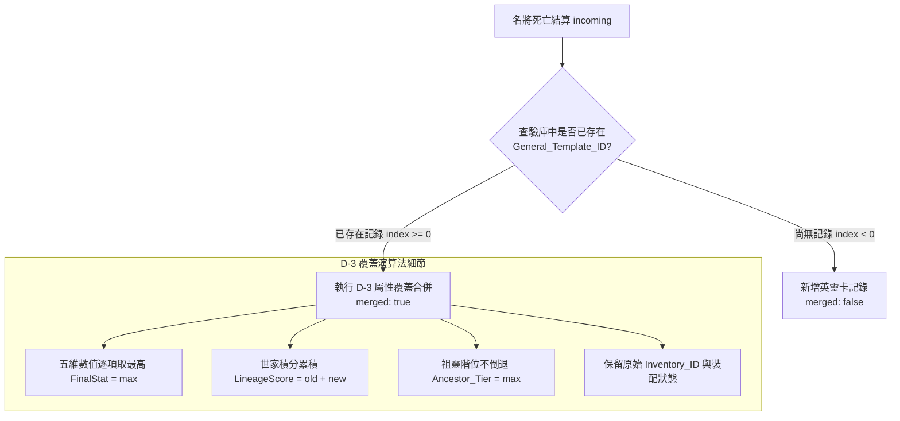

<!-- doc_id: doc_spec_0441 -->
# 英靈卡唯一性原則與輪迴覆蓋演算法規格書

## 1. 核心定位與職責範圍

本規格書定義世家譜牒中英靈卡（Spirit Card）的單一實體原則與輪迴再死亡時之屬性覆蓋合併演算法，對應 WBS **SPI-02**。
在長局多週目或轉生輪迴體系下，同一歷史名將可能歷經多次招募、培育與死亡結算。
為了避免先祖譜牒中充斥大量重複之名將複製品，系統依據「英靈世家系統 D-2 / D-3 規範」，以純邏輯模組（`SpiritCardMerge.ts`）實施單一模板唯一性約束與向優覆蓋合併（Upsert Merge）機制。

---

## 2. 唯一性原則（D-2）與 Upsert 模型



---

## 3. D-3 屬性覆蓋演算法數學模型

### 3.1 核心五維屬性逐項向優取值（`FinalStat = max`）
對於五維屬性集合中的每一個維度 $k \in \{\text{lea}, \text{str}, \text{int}, \text{pol}, \text{cha}\}$：
$$\text{FinalStat}[k] = \max(\text{OldStat}[k], \text{NewStat}[k])$$
- 保證名將在任何一輪歷史中最為巔峰的戰略資質得以永久封存，絕不因某一輪育成失誤而退化。

### 3.2 世家血脈功勳線性累加（`LineageScore`）
武將多次輪迴所立下的戰功與生平貢獻持續回流世家：
$$\text{LineageScore}_{\text{merged}} = \text{LineageScore}_{\text{existing}} + \text{LineageScore}_{\text{incoming}}$$
- 累加所得之家族積分直接轉化為世家門閥等級升階之核心動能。

### 3.3 祖靈階位不倒退原則（`Ancestor_Tier`）
先祖在祠堂中的祭祀位階與神位等級只升不降：
$$\text{Ancestor\_Tier}_{\text{merged}} = \max(\text{Tier}_{\text{old}}, \text{Tier}_{\text{new}})$$

---

## 4. 身分識別保持與裝配安全

在 `mergeSpiritCard` 與 `upsertSpiritCard` 運算過程中，嚴格遵守以下保全守則：
1. **識別碼保持不變**：覆蓋合併後，保留原英靈卡的 `Inventory_ID`，防止外鍵關聯斷裂。
2. **裝配態無感熱更新**：
   - 原卡的裝配者（`equippedBy`）、命鏡槽位（`slotId`）與主卡標記（`isPrimary`）**完全維持不變**。
   - 正在佩戴該先祖庇佑的後代武將立即享受更新後的更強數值加成，無須手動卸下重裝。

---

## 5. 介面契約與驗收條件

### 5.1 函式簽名定義
```typescript
export function upsertSpiritCard(
    records: readonly InventoryRecord[],
    incoming: Readonly<InventoryRecord>,
): { records: InventoryRecord[]; merged: boolean };
```

### 5.2 驗收測試規範（PROG-2-1922）
1. **新卡插入測試**：在庫中無趙雲時結算趙雲死亡，`merged` 為 `false`，記錄數 $+1$。
2. **向優覆蓋測試**：
   - 舊卡武力 95、智力 80；新快照武力 92、智力 88。
   - 合併後驗證：武力為 95、智力為 88。
3. **積分累加測試**：
   - 舊卡 `LineageScore: 120`，新快照貢獻 `80`。
   - 合併後驗證：`LineageScore` 準確變為 `200`。
4. **階位保護測試**：
   - 舊階位 3 階，新結算為 2 階，合併後維持 3 階不倒退。
