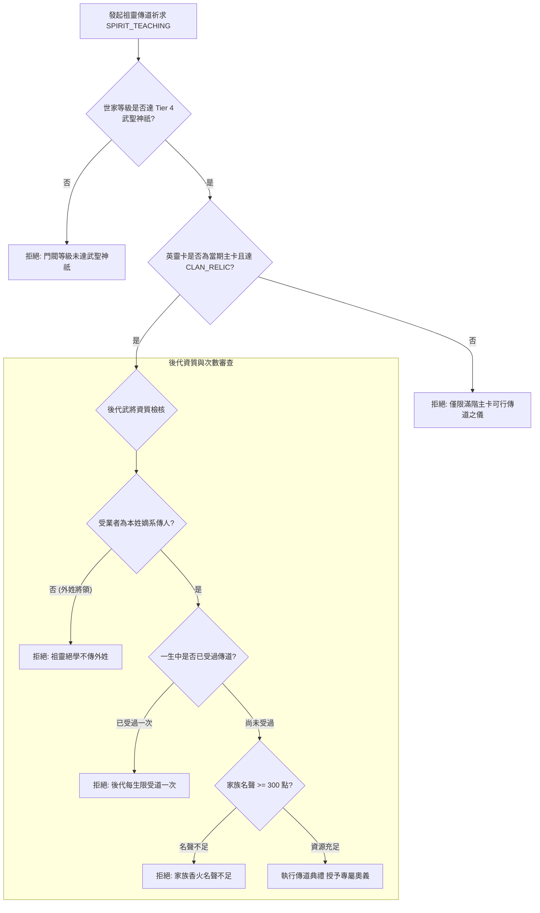
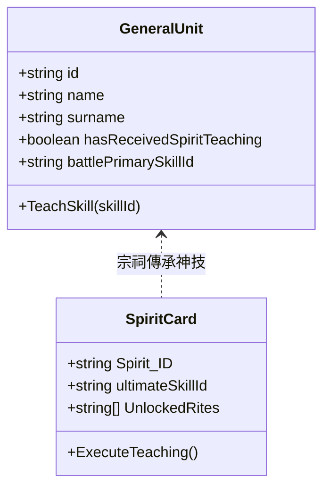

<!-- doc_id: doc_spec_0450 -->
# 英靈卡祖靈傳道受業與專屬奧義繼承權限規格書

## 1. 核心定位與職責範圍

本規格書定義世家體系中最高階神祇特權——「祖靈傳道（Spirit Teaching）」儀軌、受業資質檢核與專屬戰法奧義傳承流程，對應 WBS **SPI-11**。
當世家門閥晉升至巔峰階位，先祖英靈卡將解鎖顯化傳道能力（`UnlockedRites: ['SPIRIT_TEACHING']`）。
透過家族宗祠的傳道典禮，先祖英靈可將其生前所掌握之絕頂神技（如神武奧義、奇門遁甲）直接傳授給當代極具慧根之青年後輩，實現世代相傳之武道薪火。

---

## 2. 祖靈傳道儀軌解鎖狀態機

---

## 3. 傳道消耗與冷卻模型

### 3.1 資源消耗清單
祖靈顯化傳道屬於逆奪造化之神聖儀軌，每執行一次傳道儀式需消耗：
- **家族名聲值（`Family_Fame`）**：固定消耗 `300` 點。
- **傳承精元（`LegacyEssence`）**：固定消耗 `50` 點。
- **季度頻率限制**：同一世家每季**僅限舉辦 1 次**祖靈傳道大典（`teachingCooldownSeason`）。

### 3.2 後代受業硬限制（One-Time Blessing）
- **一生一次鐵律**：任何後代武將在整個生命週期內，**嚴格限定只能接受 1 次祖靈傳道**。
- 傳承完成後，該武將之資料結構永久寫入標記：`hasReceivedSpiritTeaching: true`，不可被後續重置或頂替。

---

## 4. 專屬奧義登錄與宗族權限綁定

### 4.1 技能登錄機制
- 傳道成功後，先祖英靈卡之專屬奧義 ID（`ultimateSkillId`）直接寫入後代武將之戰鬥技能槽（`battlePrimarySkillId`）。
- 該技能自動享受該世家姓氏之 100% 完整發揮權限，觸發無視防禦、專屬連攜等質變特權。

---

## 5. 驗收標準與單元測試契約

1. **門閥門檻阻擋驗證**：
   - 世家處於 Tier 3【萬世宗親】時嘗試發起傳道，系統必須明確攔截並提示門閥等級不足。
2. **異姓外將排他驗證**：
   - 嘗試對異姓武將執行趙家先祖傳道，系統直接報錯攔截，杜絕家傳神學外流。
3. **一生一次防刷驗證**：
   - 武將 A 成功受業後，次季再次發起傳道指派同一武將，回傳 `ALREADY_BLESSED` 拒絕代碼。
4. **名聲扣款與冷卻驗證**：
   - 傳道完成後，家族名聲精確扣除 300 點，且同季內無法再次舉行第二次傳道。
