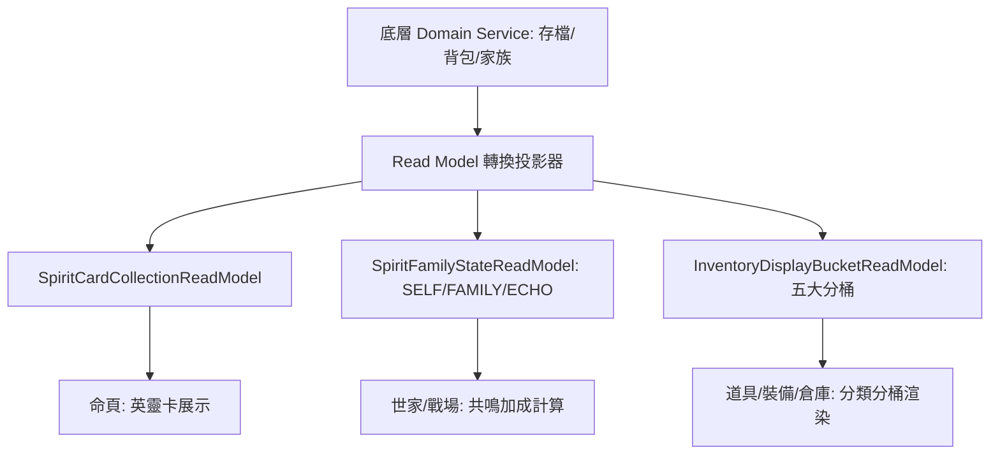

<!-- doc_id: doc_spec_0631 -->
# 英靈卡虎符與庫存分桶資料讀取模型規格書

> **規格代碼**：`TSK-09`
> **版本**：v1.0 (Single Source of Truth)
> **狀態**：正式定案 (Approved)
> **檔案大小限制**：嚴格 <6144 bytes

---

## 1. 系統定位與架構

本規格為 UI 視圖層提供專用之唯讀資料模型（Read Model），解決跨模組資料聚合開銷與渲染卡頓問題。
提供 `SpiritCardCollection`、`SpiritFamilyState` 與 `InventoryDisplayBucket` 三大前端只讀視圖模型，落實 UI 與 Domain 實體之解耦。



---

## 2. 英靈卡集合與家族共鳴讀取模型

```typescript
export type ResonanceType = "SELF" | "FAMILY" | "ECHO" | "NONE";

export interface SpiritCardViewItem {
  cardId: string;
  sourceGeneralId: string;
  rarityTier: number;         // 1~5 星
  innateSkillId: string;      // 固有技能
  statBonuses: { lead?: number; war?: number; int?: number; pol?: number; cha?: number };
  equippedToGeneralId?: string;
}

export interface SpiritFamilyStateReadModel {
  targetGeneralId: string;
  spiritCardId: string;
  resonanceType: ResonanceType;
  resonanceMultiplier: number; // SELF: 1.25, FAMILY: 1.10, ECHO: 1.05, NONE: 1.0
  activeBuffSummary: string;
}
```

### 2.1 共鳴型態判定演算
1. **SELF（本人直系先祖）**：若英靈卡之 `sourceGeneralId` 為目標武將父代或母代直系先祖，判定為 `SELF`，提供 $1.25$ 倍效果加成。
2. **FAMILY（世家同宗激發）**：若為同家族門閥三代內親族，判定為 `FAMILY`，提供 $1.10$ 倍效果加成。
3. **ECHO（宿命回響）**：若非同族但符合歷史宿命羈絆配方（例：趙雲配備劉備英靈），判定為 `ECHO`，提供 $1.05$ 倍效果加成。
4. **NONE（常規配戴）**：無特殊淵源，加成倍率為 $1.00$。

---

## 3. 背包與倉庫分桶讀取模型（InventoryDisplayBucket）

統一物件資料庫按業務領域投影為五大展示分桶：

```typescript
export enum DisplayBucketType {
  CONSUMABLE = "CONSUMABLE",   // 消耗品 (補元散、求籤令、入學令)
  EQUIPMENT = "EQUIPMENT",     // 常規裝備 (武器、防具、飾品、傳家寶)
  TIGER_TALLY = "TIGER_TALLY", // 虎符
  SPIRIT_CARD = "SPIRIT_CARD", // 英靈卡
  MATERIAL = "MATERIAL",       // 材料 (強化石、玄鐵、圖紙)
}

export interface BucketSummary {
  bucketType: DisplayBucketType;
  usedCount: number;
  maxCap: number;
  items: Array<{ id: string; name: string; count: number; quality: number; isEquipped: boolean }>;
}

export interface InventoryDisplayBucketReadModel {
  totalOccupiedSlots: number;
  totalCapacity: number;
  buckets: Record<DisplayBucketType, BucketSummary>;
}
```

- **快照效能保障**：每次背包異動僅針對受影響分桶重算 `BucketSummary`，保證在大於 200 件道具時 UI 滾動更新延遲低於 16ms。
