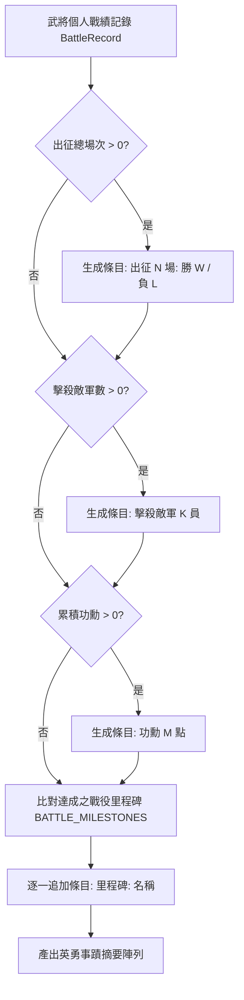

<!-- doc_id: doc_spec_0442 -->
# 英靈死亡快照結構與英勇事蹟摘要規格書

## 1. 核心定位與職責範圍

本規格書定義武將離世時英靈死亡快照的資料結構規範、英勇事蹟字串摘要生成演算法與展示權重計算模型，對應 WBS **SPI-03**。
當武將步入生命終點時，系統保存「當年強在哪裡」的歷史檔案，涵蓋戎馬一生的出征勝負、斬敵功績、戰役里程碑、臨終五圍、掌握之頂尖戰法與生平遺言。
模組由純邏輯服務（`SpiritArchiveSnapshot.ts`）實現，快照實體**只讀不變、不直接回寫遊戲主運算數值**，專供「英靈陳列室（Hall of Spirits）」與武將詳情頁展示使用。

---

## 2. 快照資料結構契約（`SpiritArchiveSnapshot`）

```typescript
export interface SpiritArchiveSnapshot {
    readonly Spirit_ID: string;                   // 魂卡識別碼（沿用武將 UID）
    readonly Death_Season: number;                // 離世季數（遊戲時間錨點）
    readonly Heroic_Deeds_Summary: string[];      // 生平英勇事蹟條目清單
    readonly Final_Stats_Snapshot: {              // 臨終五維屬性快照
        readonly str: number; readonly int: number;
        readonly lea: number; readonly pol: number; readonly luk: number;
    };
    readonly Final_Skills_Snapshot: string[];     // 臨終戰法技能 ID 列表（去重）
    readonly Final_Equipment_Snapshot: string[];  // 臨終佩戴裝備名稱清單
    readonly Battle_Record_Ref: string;          // 完整戰報歷史 L5 參照指針
    readonly Legacy_Quote: string;                // 武將生平名言或臨終遺訓
    readonly Display_Weight: number;              // 陳列室預設展示權重排序分數
}
```

---

## 3. 英勇事蹟摘要生成演算法（`summarizeHeroicDeeds`）



- **里程碑對齊**：依專案預設標準（百人斬、百戰名將、破軍拔寨等）轉換為繁體中文官方顯示名稱。
- **無戰功容錯**：純文職官員若無出戰記錄，出征與斬敵條目自動安全隱蔽，僅保留內政功勳或文會事蹟。

---

## 4. 展示權重與快照完整度計算

### 4.1 展示權重排序模型（`computeDisplayWeight`）
英靈陳列室預設依功勳與全能資質進行宏觀排序，越是功勳卓著的先祖排名越靠前：
$$\text{Display\_Weight} = (\text{str} + \text{int} + \text{lea} + \text{pol} + \text{luk}) + \text{Merit}$$

### 4.2 快照完整度指標（`snapshotCompleteness`）
在展示權重平分時，評估事蹟、屬性、技能三大維度之健全度（區間 $[0, 1]$）：
$$\text{Completeness} = \frac{\mathbb{I}(\text{Deeds} \neq \emptyset) + \mathbb{I}(\text{Stats} \neq \mathbf{0}) + \mathbb{I}(\text{Skills} \neq \emptyset)}{3}$$
- 優先將生平歷程記載最為詳實的傳奇名將排在陳列室顯眼位置。

---

## 5. 唯讀特性與驗收條件

1. **L5 歸檔層指針參照**：`Battle_Record_Ref` 固定附加前綴 `generals_archive_l5:${id}`，引導至深度歷史存檔，不污染記憶體快取。
2. **單元測試驗收**（PROG-2-0313）：
   - 驗證空戰績下建立快照，不拋異常且各項屬性安全兜底為 0。
   - 驗證技能快照自動去除主技能與戰鬥技能的重複項。
   - 驗證 `computeDisplayWeight` 正確加總五維與功勳。
