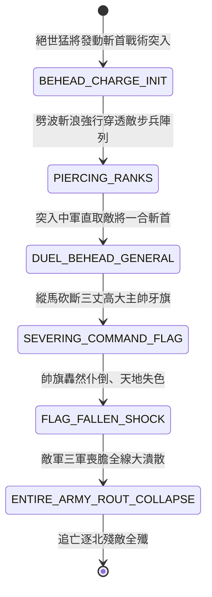

<!-- doc_id: doc_spec_0817 -->
# 3KLife 萬軍叢中斬將奪旗敵軍大陣帥旗傾倒全軍大潰散狀態機規格書

## 模組基本資訊
- **模組代號**：`BEHEAD-FLAG-COLLAPSE01`
- **系統定位**：三國絕世猛將斬首突擊與全軍陣列崩潰系統，負責單騎萬軍穿透、敵中軍主將單挑斬首、帥旗揮刀砍倒與全線大潰逃之完整狀態流。
- **架構依賴**：`BattleGridSystem`、`DuelSystem`、`MoraleSystem`、`VFXBlockRegistry`。

---

## 核心設計概念
三國英雄之巔峰浪漫（如關羽白馬坡策馬刺顏良於萬眾之中斬其首還、張飛當陽橋萬人敵、趙雲長坂坡七進七出）。當敵方大軍布陣嚴整、正攻難以撼動之際，武力極致之絕世武聖可發動「單騎斬首」突襲。猛將躍馬衝過密密麻麻之兵戟陣列，直插中軍指揮樞紐，手起刀落斬殺敵軍主帥，並一刀斬斷三丈黑底織錦主帥大旗。帥旗轟然倒塌之際，敵軍各營將士誤認主力已滅，瞬間引發不可遏止之大崩盤。



---

## 狀態機定義與轉換條件

### 1. `BEHEAD_CHARGE_INIT`（斬首啟動狀態）
- **進入條件**：猛將武力 >= 95 且具備「萬人敵/神將」特技，目標鎖定敵主將中軍。
- **行為表現**：
  - 猛將進入「霸體無阻」狀態，免疫常規步兵 ZOC 阻截。
  - 移動速度暴增 100%，拖曳雷霆戰意金色刀光軌跡。
- **轉換**：衝刺直線路徑 -> 轉移至 `PIERCING_RANKS`。

### 2. `PIERCING_RANKS`（破陣穿透狀態）
- **行為表現**：
  - 連續撞開沿途 3 格敵軍步兵，所經之處敵兵擊飛倒地。
  - 猛將耐久僅承受 15% 輕微擦傷，氣勢計量條達到峰值。
- **轉換**：抵達敵中軍主帥相鄰格 -> 轉移至 `DUEL_BEHEAD_GENERAL`。

### 3. `DUEL_BEHEAD_GENERAL`（一合斬將狀態）
- **行為表現**：
  - 觸發陣前極速單挑特寫：寒芒閃過，敵主將甚至未及招架即被梟首。
  - 將首懸於馬項，播放敵軍全場驚恐抽氣音效。
- **轉換**：斬首判定完成（延遲 0.2 秒） -> 轉移至 `SEVERING_COMMAND_FLAG`。

### 4. `SEVERING_COMMAND_FLAG`（斬斷牙旗狀態）
- **行為表現**：
  - 猛將揮刀劈向主帥金頂牙旗旗桿，木柱應聲斷裂。
  - 象徵三軍最高指揮之帥旗在風中搖晃傾斜。
- **轉換**：旗桿完全折斷 -> 轉移至 `FLAG_FALLEN_SHOCK`。

### 5. `FLAG_FALLEN_SHOCK`（帥旗倒塌震懾狀態）
- **行為表現**：
  - 帥旗落地揚起巨大煙塵，戰場全圖廣播「主帥顏良已被斬殺！牙旗已倒！」。
  - 敵軍所有作戰單位的指揮連繫線全部斷裂，全體士氣扣減 60 點。
- **轉換**：震懾波席捲全場 -> 轉移至 `ENTIRE_ARMY_ROUT_COLLAPSE`。

### 6. `ENTIRE_ARMY_ROUT_COLLAPSE`（全軍雪崩大潰退狀態）
- **行為表現**：
  - 敵軍無論殘存兵力多寡，全體放棄武器掉頭狂奔，防禦力歸零。
  - 己方全軍獲得「追殺狂暴」狀態（攻擊力 +50%，移動力 +2）。
- **轉換**：敵部隊全部逃出戰場或被俘殲滅 -> 結束退出。

---

## 數值公式與配置契約

```typescript
export interface BeheadFlagCollapseConfig {
  tacticId: string;
  minMartialRequirement: number;  // 武力最低要求 (95)
  pierceZOCImmunity: boolean;     // 穿透破陣無視 ZOC
  flagFallMoraleDropGlobal: number;// 帥旗倒塌全軍士氣暴跌值
  pursuitAttackBonusPercent: number;// 追擊狂暴加成比
  enemyRoutChance: number;        // 全線潰敗機率 (0.0 ~ 1.0)
}

export const BEHEAD_PRESETS: Record<string, BeheadFlagCollapseConfig> = {
  GUANYU_WHITE_HORSE_STRIKE: {
    tacticId: 'BEHEAD_GUAN_01',
    minMartialRequirement: 95,
    pierceZOCImmunity: true,
    flagFallMoraleDropGlobal: -60,
    pursuitAttackBonusPercent: 0.50,
    enemyRoutChance: 0.90,
  }
};
```

---

## 單元測試與驗收標準
1. **ZOC 穿透免疫檢定**：武力 98 猛將衝刺過程中，穿越相鄰 3 隊重步兵方陣無任何阻滯截停，直線抵達中軍。
2. **帥旗折斷全域士氣雪崩**：帥旗倒塌後，戰場上所有敵部隊士氣強制扣除 60 點，士氣跌破 0 者 100% 觸發逃亡潰散。
3. **追擊狂暴速度加成**：敵全軍潰散後，己方各軍攻擊力提升 50%，移動力提升 2 格，追殺結算無異常。
