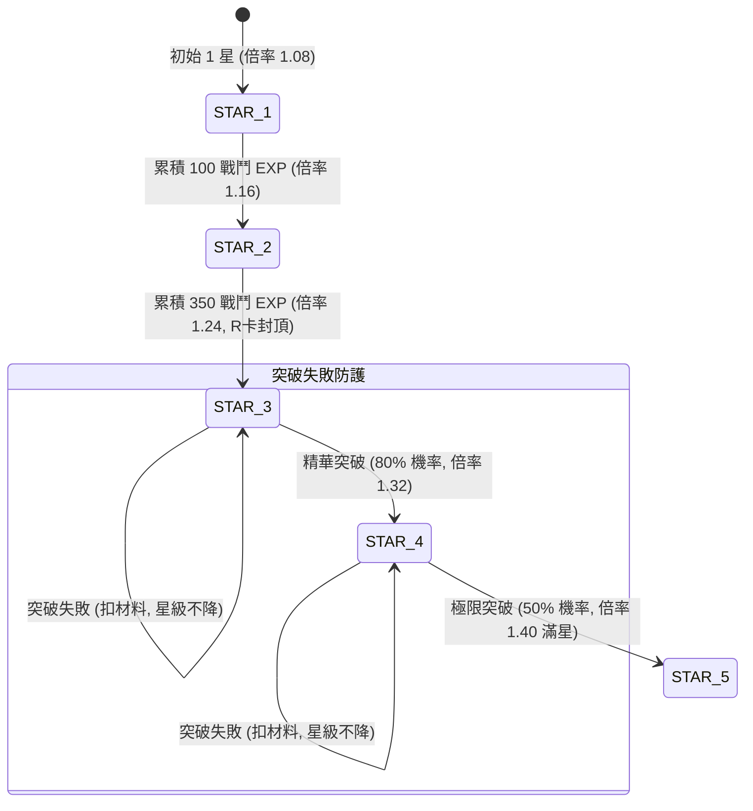

<!-- doc_id: doc_spec_0597 -->
# 虎符一至五星經驗升星與精華突破狀態機規格書

> 標記：Single Source of Truth（單一真相來源）  
> 涵蓋工作包：`TRP-10`、`TRP-11`  
> 狀態：正式發布 / 核心邏輯規格

---

## 1. 系統定位與架構

本模組規範兵種虎符在獲得後的「星級養成狀態機（Star Level State Machine）」。全體系分為兩大培育階段：
1. **初階戰鬥經驗升星（1 ~ 3 星，TRP-10）**：武將攜帶虎符出征獲勝即可累積經驗值（`battleExp`），累積滿額自動躍升，每星等提供 $+8\%$ 的全屬性戰鬥倍率。R 品質最高封頂於 3 星。
2. **高階虎符精華突破（4 ~ 5 星，TRP-11）**：超越 3 星後進入瓶頸，必須消耗「將魂精華」與「百鍊神金」進行突破擲骰。支援「天工保底符（100% 成功）」與「UR 品質天賦加成（$+10\%$）」，突破失敗星級不倒退。



---

## 2. 初階戰鬥經驗升星（TRP-10）

### 2.1 經驗與星級倍率對照表
| 星等 | 必備累計戰鬥經驗 | 星級戰鬥倍率（`StarMultiplier`） | 品質階級限制 |
|:---:|:---:|:---:|:---:|
| **1 星** | 初始預設 | $\times 1.08$（$+8\%$） | 全品質可達 |
| **2 星** | 100 點 EXP | $\times 1.16$（$+16\%$） | 全品質可達 |
| **3 星** | 350 點 EXP | $\times 1.24$（$+24\%$） | **R 品質封頂** |
| **4 星** | 突破解鎖 | $\times 1.32$（$+32\%$） | 僅 SR / SSR / UR |
| **5 星** | 突破解鎖 | $\times 1.40$（$+40\%$ 滿額） | 僅 SSR / UR |

---

## 3. 高階虎符精華突破（TRP-11）

### 3.1 突破機率與消耗標準
- **3 星 $\rightarrow$ 4 星**：
  - 基礎成功率：$80\%$。
  - 材料消耗：黃金 5,000 + 虎符精華 $\times 10$。
- **4 星 $\rightarrow$ 5 星（終極）**：
  - 基礎成功率：$50\%$。
  - 材料消耗：黃金 15,000 + 虎符精華 $\times 30$。

### 3.2 成功率修正與保底機制
1. **UR 傳奇天賦加成**：若虎符為 `UR` 品質，突破成功率額外提高 $+10\%$（即 4 星突破為 $90\%$，5 星突破為 $60\%$）。
2. **天工保底符（TallyBlessingCharm）**：玩家可選擇消耗 1 張保底符，強制將成功率鎖定為 **$100\%$**。
3. **失敗保護原則**：突破失敗時僅扣除材料與金幣，星等與經驗絕對不倒退。

---

## 4. 狀態機核心介面與函式

```typescript
export interface IBreakthroughResult {
  success: boolean;
  newStarLevel: number;
  consumedGold: number;
  consumedEssence: number;
}

export function attemptBreakthrough(
  currentStar: number,
  quality: 'R' | 'SR' | 'SSR' | 'UR',
  useBlessingCharm: boolean,
  rngRoll: number // 0.0 ~ 1.0
): IBreakthroughResult {
  if (currentStar === 3 && quality === 'R') {
    throw new Error('R quality cannot exceed 3 stars');
  }

  const baseRate = currentStar === 3 ? 0.80 : 0.50;
  const qualityBonus = quality === 'UR' ? 0.10 : 0.0;
  const finalRate = useBlessingCharm ? 1.0 : Math.min(0.95, baseRate + qualityBonus);

  const success = rngRoll <= finalRate;
  return {
    success,
    newStarLevel: success ? currentStar + 1 : currentStar,
    consumedGold: currentStar === 3 ? 5000 : 15000,
    consumedEssence: currentStar === 3 ? 10 : 30,
  };
}
```

---

## 5. 驗收與測試標準

1. **經驗升星自動化（TC-TRP-10-01）**：
   - 虎符經驗自 99 加至 100 點時，檢核自動升至 2 星；達 350 點自動升至 3 星。
2. **品質封頂檢驗（TC-TRP-10-02）**：
   - R 品質虎符達到 3 星後，嘗試進行突破時拋出受阻保護。
3. **突破機率與保底符校驗（TC-TRP-11-01）**：
   - 啟用保底符時，即使隨機骰數為 0.99，檢核突破結果必然為 `success = true`。
