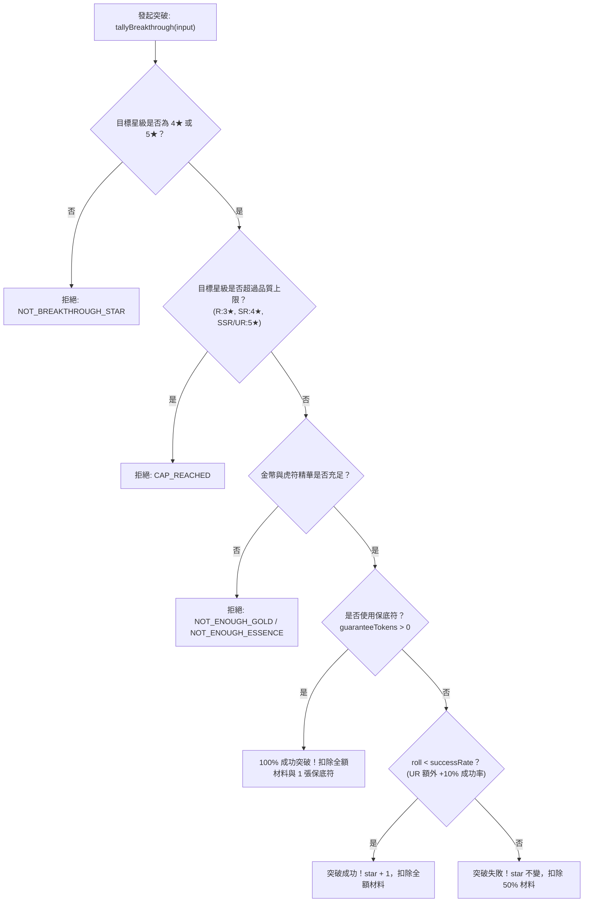

<!-- doc_id: doc_spec_0425 -->
# 虎符升星經驗與突破精華消耗數值規格書

> 本規格書為 3KLife 虎符 1~3★ 戰鬥經驗累積升星、4~5★ 虎符精華突破消耗與成功率模型之唯一真相來源（Single Source of Truth）。
> 相關實作對齊：`assets/scripts/core/systems/TigerTallyStar.ts`、`TigerTallyBreakthrough.ts`、`TigerTallyCard.ts`。

---

## 1. 系統定位與兩階段養成架構

1. **戰鬥沉澱與精華突破雙階段**：
   - **第一階段（1★ ～ 3★）**：純粹依賴出戰積累戰鬥經驗，達到門檻自動升星，無耗材負擔。
   - **第二階段（4★ ～ 5★）**：需消耗稀缺資源「虎符精華」與金幣執行極限突破，具備機率與保底機制。
2. **純邏輯解耦契約**：
   - 數值計算為無副作用純函式，隨機擲骰值（`roll` $\in [0, 1)$）由外部注入，支援確定性測試。

---

## 2. 1★ ～ 3★ 戰鬥經驗升星模型（TigerTallyStar）

### 2.1 戰後經驗獲取與星級門檻
- **戰果經驗產出**：基礎 15 點經驗，依勝負結算：
  - 勝利（`win`）：$+15$ 點（倍率 1.0）
  - 平手（`draw`）：$+10$ 點（倍率 0.67，四捨五入）
  - 失敗（`lose`）：$+8$ 點（倍率 0.53，四捨五入）
- **升星經驗門檻（`TALLY_STAR_EXP`）**：
  - $1\star \to 2\star$：累計經驗達 **100 點** 自動晉升。
  - $2\star \to 3\star$：累計經驗達 **350 點** 自動晉升。
- **戰鬥養成上限**：戰鬥經驗僅支援升至 $3\star$（`BATTLE_GROWTH_STAR_LIMIT = 3`），超過後不再透過戰鬥升星。

### 2.2 星級攻防倍率公式（starStatMultiplier）
$$\text{statMultiplier} = 1 + \text{star} \times 0.08$$
- $1\star$：1.08 倍（$+8\%$）
- $2\star$：1.16 倍（$+16\%$）
- $3\star$：1.24 倍（$+24\%$）
- $4\star$：1.32 倍（$+32\%$）
- $5\star$：1.40 倍（$+40\%$）

---

## 3. 4★ ～ 5★ 虎符精華突破模型（TigerTallyBreakthrough）



### 3.1 突破消耗與成功率全表（TALLY_BREAKTHROUGH_TABLE）

| 目標星級 | 所需金幣 | 虎符精華消耗 | 基礎成功率 | UR 專屬成功率 (+10%) | 失敗扣除補償 (50%) |
|:---:|:---:|:---:|:---:|:---:|:---:|
| **$3\star \to 4\star$** | **3,000** | **50** | **80%** | **90%** | 扣金 1,500、精華 25 |
| **$4\star \to 5\star$** | **10,000** | **200** | **50%** | **60%** | 扣金 5,000、精華 100 |

- **品質封頂鐵律**：R 級上限 $3\star$（不可突破）；SR 級上限 $4\star$；SSR 與 UR 級上限 $5\star$。

---

## 4. 介面型別契約

```typescript
export interface TallyBreakthroughCost {
    readonly gold: number;
    readonly essence: number;
    readonly successRate: number;
}

export function starStatMultiplier(star: number): number;
export function applyBattleExp(state: TallyStarState, outcome: 'win' | 'lose' | 'draw'): TallyStarState;
export function breakthroughSuccessRate(quality: TigerTallyQuality, targetStar: 4 | 5): number;
```
