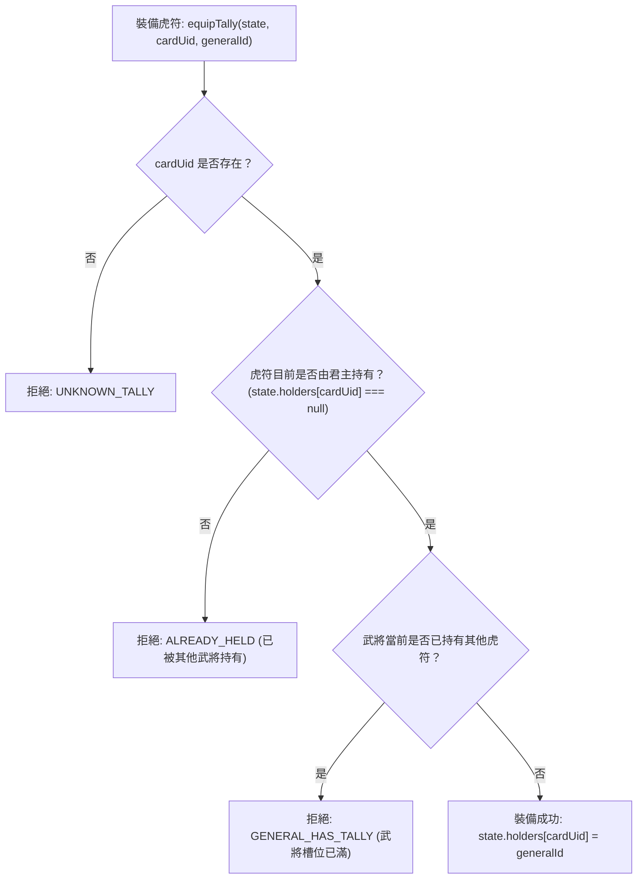

<!-- doc_id: doc_spec_0424 -->
# 虎符唯一持有性與強制拔除降忠誠規則規格書

> 本規格書為 3KLife 虎符「一將一符、一符一將」唯一持有約束、強制卸裝/沒收忠誠度懲罰與反洗機制之唯一真相來源（Single Source of Truth）。
> 相關實作對齊：`assets/scripts/core/systems/TigerTallyHoldings.ts`、`TigerTallyLoyalty.ts`。

---

## 1. 系統定位與核心鐵律

1. **一將一符，一符一將唯一性（Exclusive Binding Principle）**：
   - 每一張虎符在全專案任意時刻，至多只能被單一武將裝備持有，未裝備之虎符統一歸屬於君主倉庫（`holder = null`）。
   - 每位武將同時至多僅能裝備一枚虎符，嚴禁複數虎符重疊裝備。
2. **權利轉移與忠誠度制約（Loyalty Consequences）**：
   - 虎符象徵軍權與部曲統率資格，任意剝奪或更動將直接衝擊武將忠誠度。
   - 轉蛋召喚之歷史名將忠誠度恆久鎖定為 100（`isGachaHero = true`），不受任何變更扣減。

---

## 2. 虎符裝卸與轉交狀態機（TigerTallyHoldings）



- **強制卸裝/退回（unequipTally）**：將 `cardUid` 對應之持有者重設為 `null`（收回君主府庫）。

---

## 3. 忠誠度變更與懲罰數值模型（TigerTallyLoyalty）

### 3.1 裝卸忠誠度浮動階梯

| 虎符品質階級 | 拔除卸下忠誠度懲罰 (`TALLY_REMOVE_LOYALTY_PENALTY`) | 賜予裝備忠誠度獎勵 (`TALLY_EQUIP_LOYALTY_BONUS`) |
|:---:|:---:|:---:|
| **UR** | **$-25$ 點** | **$+8$ 點** |
| **SSR** | **$-20$ 點** | **$+5$ 點** |
| **SR** | **$-12$ 點** | **$+3$ 點** |
| **R** | **$-5$ 點** | **$+1$ 點** |

- **君主沒收固定懲罰**：若直接強制沒收，忠誠度固定下降 **$-30$ 點**（`TALLY_CONFISCATE_LOYALTY_DROP = 30`）。
- **忠誠度邊界夾制**：變更後忠誠度強制截斷於 $[0, 100]$ 區間內。

### 3.2 連續季次更動加罰（Anti-Abuse Mechanism）
- **單季變更硬上限**：同一武將每季僅允許進行 **1 次** 虎符變更（裝上、拔除、轉交均算）。同季第 2 次嘗試直接拒絕（`SEASON_LIMIT`）。
- **連續季次懲罰加成**：若連續 2 季（或以上）對同一武將執行拔除操作，該次拔除之忠誠懲罰乘以 **$1.5$ 倍**（`TALLY_CONSECUTIVE_PENALTY_MULT = 1.5`）。賜予裝備獎勵不受此加成。

---

## 4. 介面型別契約

```typescript
export interface TallyHoldings {
    readonly holders: Readonly<Record<string, string | null>>;
}

export function equipTally(
    state: TallyHoldings,
    cardUid: string,
    generalId: string
): TallyHoldingsResult;

export function unequipTally(
    state: TallyHoldings,
    cardUid: string
): TallyHoldingsResult;

export const TALLY_REMOVE_LOYALTY_PENALTY: Readonly<Record<TigerTallyQuality, number>>;
export const TALLY_EQUIP_LOYALTY_BONUS: Readonly<Record<TigerTallyQuality, number>>;
export const TALLY_CONFISCATE_LOYALTY_DROP = 30;
export const TALLY_CONSECUTIVE_PENALTY_MULT = 1.5;
```

---

## 5. 驗收標準與測試用例

1. **唯一性互斥驗收**：
   - 武將 A 裝備虎符 T1 後，嘗試將 T1 裝備給武將 B，必然回傳 `ALREADY_HELD` 失敗。
   - 武將 A 已持有 T1 時，嘗試將 T2 裝給武將 A，必然回傳 `GENERAL_HAS_TALLY` 失敗。
2. **名將忠誠防護**：
   - 轉蛋名將（`isGachaHero = true`）被拔除 UR 虎符，忠誠度維持 100 絕不扣除。
