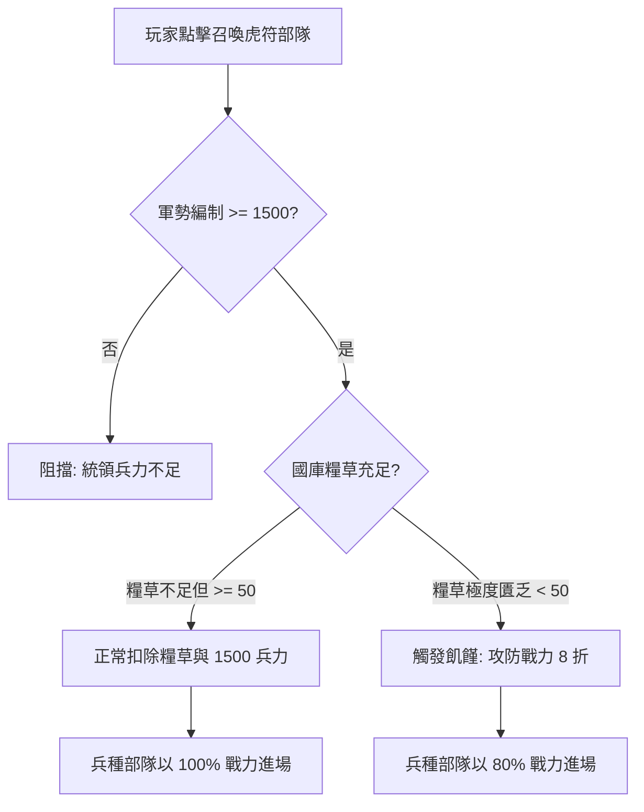

<!-- doc_id: doc_spec_0598 -->
# 虎符戰場召喚糧草消耗矩陣與軍勢兵力扣減規格書

> 標記：Single Source of Truth（單一真相來源）  
> 涵蓋工作包：`TRP-12`  
> 狀態：正式發布 / 核心邏輯規格

---

## 1. 系統定位與架構

本模組規範戰場實時作戰中「兵種虎符部隊（Tally Troops）」入場召喚時的物資消耗規則。虎符部隊並非無限調派之幻影，每次入場召喚均受兩項實物資源硬約束：
1. **國家出征糧草儲備（Grain Cost）**：依虎符「品質」與「星級」查表扣除。
2. **武將個人統領軍勢（Troop Pool）**：原子扣減對應兵力額度（標準營編制 1,500 人）。

此外，若出征時國家領地陷入糧荒（糧草 $< 50$ 單位），虎符部隊將承受「飢饉懲罰（Starving Penalty）」，實戰攻防戰力強制降為 $80\%$（8 折）。



---

## 2. 糧草消耗矩陣查表（TRP-12）

每次召喚虎符部隊進場，需消耗之戰役糧草數值如下矩陣（單位：斛）：

| 品質階級 | 1 星消耗 | 2 星消耗 | 3 星消耗 | 4 星消耗 | 5 星消耗 |
|:---:|:---:|:---:|:---:|:---:|:---:|
| **R** | 50 | 60 | 75 | — | — |
| **SR** | 80 | 95 | 115 | 140 | — |
| **SSR** | 120 | 145 | 175 | 210 | 250 |
| **UR** | 180 | 220 | 265 | 320 | 380 |

---

## 3. 軍勢兵力扣減與飢饉狀態機

### 3.1 軍勢兵力原子扣減
- 每召喚 1 個虎符營隊，武將個人的當前帶兵額度扣減：
  $$\text{TroopPool}_{\text{new}} = \text{TroopPool}_{\text{current}} - 1500$$
- 若 $\text{TroopPool}_{\text{current}} < 1500$，系統攔截召喚並彈出提示 `UI_TROOP_POOL_EXHAUSTED`。

### 3.2 糧荒 8 折懲罰（Starving Penalty）
- 在出征或戰鬥判定時，若玩家國家庫存糧草總量 $< 50$：
  1. 允許部隊以哀兵之姿勉強出陣，糧草扣至 0。
  2. 該部隊全場掛載 `STARVING_DEBUFF` 狀態。
  3. 部隊之攻擊力、防禦力與機動速度全數乘上 **$0.80$** 懲罰係數。

---

## 4. 核心介面與計算函式

```typescript
export interface ITallySummonCost {
  grainCost: number;
  troopCost: number;
  isStarving: boolean;
  powerMultiplier: number;
}

export function calculateTallySummonCost(
  quality: 'R' | 'SR' | 'SSR' | 'UR',
  starLevel: number,
  currentNationGrain: number,
  generalTroopPool: number
): ITallySummonCost {
  const table: Record<string, number[]> = {
    R: [50, 60, 75],
    SR: [80, 95, 115, 140],
    SSR: [120, 145, 175, 210, 250],
    UR: [180, 220, 265, 320, 380],
  };

  const clampedStar = Math.min(starLevel, table[quality].length);
  const grainCost = table[quality][clampedStar - 1] || 100;

  if (generalTroopPool < 1500) {
    throw new Error('Troop pool insufficient (minimum 1500)');
  }

  const isStarving = currentNationGrain < 50;
  return {
    grainCost: isStarving ? currentNationGrain : grainCost,
    troopCost: 1500,
    isStarving,
    powerMultiplier: isStarving ? 0.80 : 1.0,
  };
}
```

---

## 5. 驗收與測試標準

1. **糧草查表精確性測試（TC-TRP-12-01）**：
   - 檢核 SSR 1 星消耗 120 糧；SSR 5 星消耗 250 糧；UR 5 星消耗 380 糧。
2. **軍勢兵力不足攔截（TC-TRP-12-02）**：
   - 當武將帶兵額度為 1,499 時嘗試召喚，檢核拋出兵力不足錯誤。
3. **糧荒 8 折係數檢驗（TC-TRP-12-03）**：
   - 當糧草為 49 單位時發動召喚，檢核 `isStarving === true` 且 `powerMultiplier === 0.80`。
