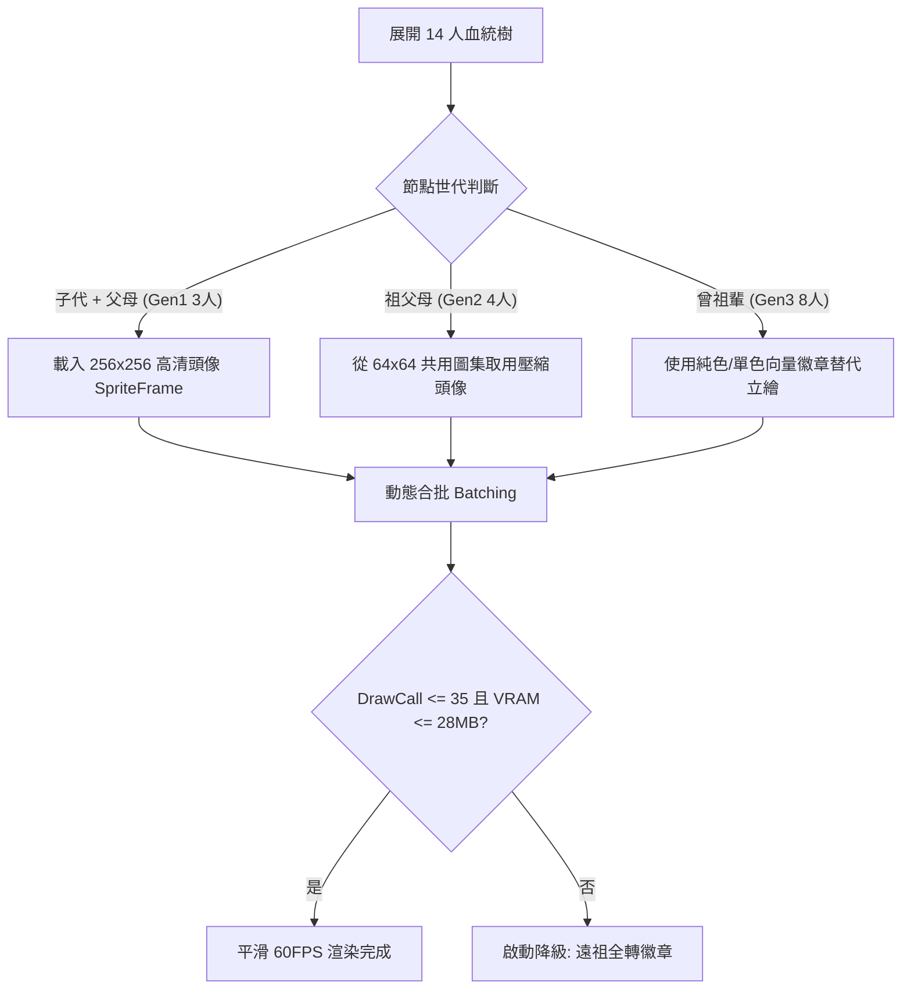

<!-- doc_id: doc_spec_0638 -->
# 血統樹十四人祖譜渲染效能防呆與貼圖DrawCall預算規格書

> **規格代碼**：`BUI-07`
> **版本**：v1.0 (Single Source of Truth)
> **狀態**：正式定案 (Approved)
> **檔案大小限制**：嚴格 <6144 bytes

---

## 1. 系統定位與效能瓶頸

本規格確立十四人血統樹（BloodlineTreePanel）之多層級紋理渲染策略、共用圖集規範與 DrawCall 預算邊界。
徹底解決 14 人祖譜全覽展開時，因全量載入高清獨立立繪導致的 GPU 紋理暴增、記憶體外溢（OOM）與掉幀問題。



---

## 2. 三級紋理階梯配置與預算矩陣

```typescript
export enum AncestorRenderTier {
  TIER_HIGH = "TIER_HIGH", // 子代 + 父母 (Gen1)
  TIER_MID = "TIER_MID",   // 祖父母 (Gen2)
  TIER_LOW = "TIER_LOW",   // 曾祖輩 (Gen3)
}

export interface AncestorRenderPolicy {
  tier: AncestorRenderTier;
  maxResolution: number;   // 像素尺寸
  useAtlas: boolean;       // 是否強制共用圖集
  hasDetailedStats: boolean;
}

export const BLOODLINE_RENDER_BUDGET = {
  maxDrawCalls: 35,
  maxTextureMemoryMB: 28,
  targetFrameRate: 60,
};
```

| 世代節點 | 節點數量 | 渲染規格 | 紋理來源 | 記憶體預算 |
|---|:---:|---|---|---|
| **子代 (Target)** | 1 | 256×256 高清立繪 | 獨立動態 SpriteFrame | 4 MB |
| **Gen1 (父母)** | 2 | 128×128 中清頭像 | `avatar_parents_atlas` | 6 MB |
| **Gen2 (祖輩)** | 4 | 64×64 壓縮頭像 | `ancestor_compact_atlas` | 8 MB |
| **Gen3 (曾祖輩)** | 8 | 32×32 單色剪影/徽章 | 全域共用符號圖集 (單合批) | 4 MB |

---

## 3. 合批優化與動態降級防呆

1. **圖層 Z-Index 聚合**：
   - 連線層（`UIBloodlineConnections`）：單一 Graphics 組件繪製全部 14 條貝茲曲線，強制壓至 1 個 DrawCall。
   - 卡框背景層：全部 14 個節點採用同一 9-slice 背景底圖，共享 1 個合批。
   - 文字標籤層：使用 BitmapFont 或共用動態字型圖集，禁止跨層穿插 Sprite。
2. **記憶體動態守護（Degrade Mode）**：
   - 於低階行動端（系統 RAM $\le 2\text{GB}$）偵測時，自動將 `Gen2` 祖輩降級為 32×32 剪影。
   - 關閉血統樹面板時，立即釋放 `avatar_parents_atlas` 顯存快取，杜絕洩漏。
