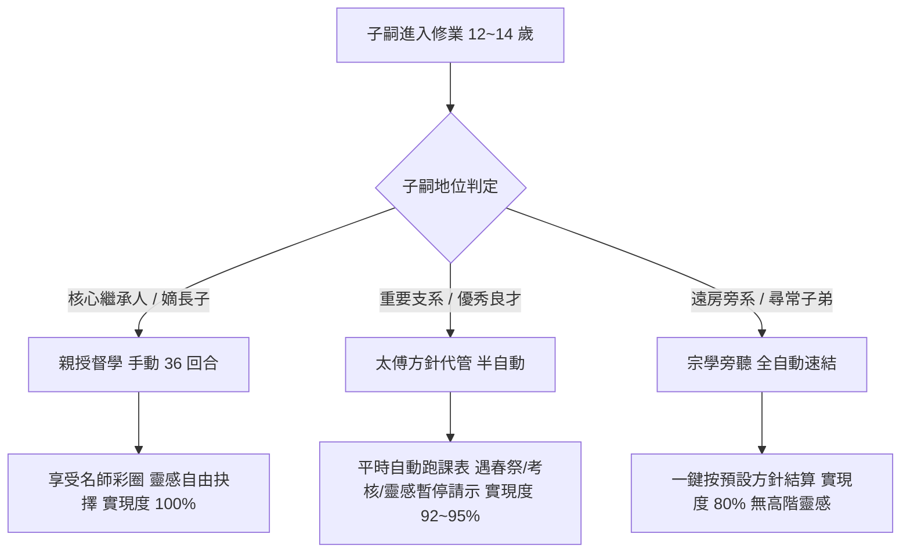
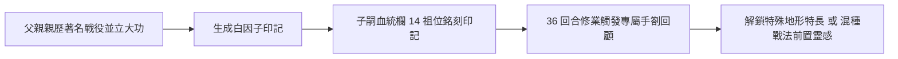

<!-- doc_id: doc_spec_0288 -->
# C2 R5 遊戲性決策拍板與體驗強化增補規格書

> **文件狀態**：正式拍板增補稿（APPROVED_GAMEPLAY_EXPANSION）  
> **關聯基準**：已入庫 R5 全套 63 份規格包（`doc_spec_0186`～`0244`）、五份漸進揭露里程碑（`doc_spec_0181`～`0185`）、工作補全包（`doc_spec_0245`～`0251`）  
> **核心目標**：在不破壞 R5 數學不變量（Fail-Closed、不破 $P$ 硬上限 100、保留三擋純化倍率 $m \in \{1.0, 1.3, 1.6\}$）前提下，全面落實《賽馬娘》二次繼承開獎與彩圈博弈、《Winning Post 10》開宗立派與百年門閥金因子、名戰役白因子印記、太傅三態代管與三國文化外戚純化機制。

---

## 1. 核心玩法決策拍板總表（解鎖 DEC-R4 與 DEC-R5-S）

針對 R5 原文中處於 Pending / Blocked 狀態的關鍵遊戲性決策，本規格書正式確立收斂與平衡邊界：

| 決策編號 | 決策主題 | 拍板定案規則 | 平衡度與防無底洞收斂邊界 |
| :--- | :--- | :--- | :--- |
| **DEC-R4-01** | 天賦潛能 $P$ 與 $m$-only 純化 | 嚴格維持 $P \in [0, 100]$，純化倍率 $m \in \{1.0, 1.3, 1.6\}$ 僅作為世代貢獻權重 $w_g$ 的乘數，**禁止直接放大或突破 $P$**。 | 保證全維度數值永不通膨，三代培育上限由 14 祖位真天賦收斂，絕無數值溢位。 |
| **DEC-R4-02** | 學院 36 回合與女神像開獎 | 36 回合每回合精力上限 100，第 1 回合「開蒙禮」與第 24 回合「加冠祭祖」觸發**「宗祠先祖血脈開獎（二次女神像開獎）」**。 | 僅檢定 14 祖位之紅/綠/白因子啟動（適性階級提升、戰法靈感解鎖），**不提供額外 $P$ 點數**。 |
| **DEC-R4-03** | 世交契合度 $K$ 收益與邊界 | 世交點數 $K \in \{0, 5, 10, 15\}$，僅在聯姻時提供「變異度收斂保護（降低惡性低 Roll 機率）」與「婚禮聘禮/彩禮資源減免」。 | **嚴禁 $K$ 直接提供 $P$ 保底加成**，防止玩家透過無限聯姻刷出全滿神童。 |
| **DEC-R4-04** | 28 祖位近親懲罰曲線 | 28 真祖位重疊深度 $D \ge 3$（如 $2\times 3$ 兄妹、表兄妹重婚）觸發健康缺陷檢定；同姓同宗族禁婚。 | 懲罰落實為「先天體弱（體力上限 -20%）」或「壽命減損」，不直接歸零技能，提供真實遺傳風險。 |
| **DEC-R4-05** | 職業壽命與衰退曲線 | 武將型（武/統）45 歲起進入物理衰退期（每年 -2%）；文官型（智/政/魅）晚成者老而彌堅，至 60 歲仍保 100% 巔峰。 | 文武分軌，避免高智老臣無用化，符合三國「賈詡、司馬懿晚年掌權」歷史感。 |
| **DEC-R4-06** | 相馬與月旦評情報市場 | 每季產出固定查券（世譜令）6～10 張，提供模糊分箱（S/A/B/C 四級），僅能查得公開範圍，絕不免費揭露隱藏 LUK。 | 封閉經濟循環，杜絕無底洞洗券與旁路洩漏，維持探索樂趣。 |
| **DEC-R4-07** | 漸進揭露教學分級 | G1 僅見五維直覺評語；G2 揭露三代譜牒與 EP 功業；G3 揭露 14 祖位星級；G4 揭露自創宗脈特權。但 G1 近親風險立即警告。 | 認知負擔按代遞進，新手前 3 小時不被複雜表格淹沒。 |
| **DEC-R5-S01** | 首次統一天下榮譽結算 | 玩家勢力統一天下時，強制生成永久「統一天下榮譽快照」，結算「天下定鼎榮譽榜」，並給予首通紀念虎符。 | **不強制刪存檔**；結算後玩家可自由選擇「原世界自由探索」或「攜帶家系進入主題賽季」。 |
| **DEC-R5-S03** | 主題賽季跨季延續規則 | 換季時，玩家與敵方存活人物、婚姻關係、14 祖位血統與家族譜牒 **100% 完整保留並結轉**。 | 資源（糧草/金錢）與城池重置為主題起點，徹底解決三國世家養不到四代人的結構矛盾。 |
| **DEC-R5-S05** | 祖地存續與敵方再起機制 | 勢力領地全失後轉入「祖地避難（Ancestral Refuge）」狀態，祖地不可攻打，但人員需耗費精力與人脈動員民兵。 | 嚴禁無底洞無敵生兵；動員部隊進入地圖可被攔截，防止無限惡意騷擾。 |
| **DEC-R5-S08** | 開宗立派與自創門閥金因子 | 扶正為 G4 終局核心！四代名門＋累計 3 位一品官/名將即可向朝廷「開宗立派」，晉升郡望並獲得【自創門閥金因子】。 | 金因子**不加 $P$ 上限**，而是賦予「專屬宗脈固有戰法一段靈感」與「開蒙初始實現度 $C_0$ 保底提升」。 |

---

## 2. 36 回合開蒙修業：高潮演出與三態代管

### 2.1 宗祠血脈共鳴（女神像開獎演出）
子嗣在 12～14 歲的 36 回合修業期間，於兩個神聖節點觸發宗祠血脈共鳴：
1. **第 1 回合【開蒙禮（首次共鳴）】**：
   - 檢定父母與祖父之**紅因子（兵種適性）**與**藍因子（主屬性天賦）**。
   - 若祖位帶有三星紅因子，對應兵種適性有 35% 機率直接提升一階（例如騎兵 A $\rightarrow$ S）。
   - 彈出宗祠祭祀動畫：「**子嗣跪拜先祖，於靈前感悟先烈騎射遺風，騎兵適性突破至 S！**」
2. **第 24 回合【加冠禮／及笄禮（二次共鳴）】**：
   - 檢定全 14 祖位之**綠因子（家傳固有戰法）**與**白因子（名戰役印記）**。
   - 觸發戰法靈感爆發：若祖輩曾獲【赤壁火攻】白因子，高機率領悟高階混種戰法「烈焰神火」的一段靈感。
   - 提供玩家情感回饋：「**虎父無犬子！子嗣研讀先父手抄赤壁兵法，領悟戰法奧義！**」

### 2.2 太傅三態代管模式（拒絕無腦懲罰，平衡手動與放置）
為兼顧 SLG 長線大局與繁衍深度，徹底重構 R5 原本殘廢且嚴苛的 Auto 模式：

- **模式一【親授督學（手動模式）】**：
  - 玩家每回合親自配置課表與太傅請教。
  - 觸發太傅彩圈加乘（對應屬性太傅駐留時，訓練效果 $+25\%$）。
- **模式二【太傅方針代管（半自動請示模式，建議第二名子嗣起開放）】**：
  - 玩家指定大方針（【重文修德】、【重武習勇】、【王佐全能】）。
  - 平時 36 回合自動推進，實現度效率為手動的 $95\%$（不再是 R5 的 7 折懲罰）。
  - **關鍵中斷機制（Smart Interrupt）**：在遇到「第 12 回合春祭共鳴」、「第 24 回合加冠禮」、以及「太傅頓悟戰法靈感 3 選 1」時，遊戲自動暫停並彈出【太傅請示函】，由家主做關鍵決策！
- **模式三【宗學旁聽（全自動速結模式）】**：
  - 用於旁系非核心子弟，一鍵直接結算畢業，實現度固定為 $0.80$，無混種戰法覺醒。

---

## 3. WP10 終局浪漫：開宗立派與自創門閥金因子（扶正 R5F-S08）

### 3.1 開宗立派（郡望晉升）門檻
當玩家家族繁衍至第 4 代（G4）以上，且滿足下列三國歷史世家條件時，可於洛陽或許昌朝廷上奏「自立宗脈」：
1. **傳承代數**：連續繁衍 4 代以上且未曾斷絕。
2. **功業累積**：家族歷史中累計出仕過至少 2 位三公九卿（一品高官）或 2 位大將軍（戰功百勝）。
3. **血脈純化**：主系連續兩代完成外戚名門聯姻（平均契合度 $K \ge 10$）。

### 3.2 自創門閥金因子（非破頂型特權）
通過「開宗立派」後，玩家可由家族名義自訂宗脈稱號（例如：`隴西李氏·飛將宗脈`、`潁川荀氏·王佐清流`），並將家主當前的核心特長凝聚為**【自創門閥金因子】**：
- **邊界保護（不破上限）**：金因子**絕不提供超出 100 的天賦 $P$**，而是提供：
  1. **家族專屬固有戰法**：該宗脈所有後代出生時，自動於戰法槽中帶有專屬金因子的「宗脈固有奧義（一段靈感保底）」。
  2. **修業初始實現度保底（$C_0$ 提升）**：該宗脈主修維度，入學起始實現度由 $0.38$ 提升至 $0.48$（使子孫更容易達到滿潛能，但潛能上限依然受遺傳決定）。
  3. **朝廷威望特權**：每季宗族聲望自動增加，且在求親市場中面對同郡名門時，求親成功率 $+25\%$。

---

## 4. 名戰役白因子印記（Battle Epitaphs）傳承

父輩在戰場上的具體功勳，將在子嗣血統表上具象化為三國戰役印記：

- **印記生成條件**：武將在達成歷史名戰役勝利（如赤壁、官渡、夷陵、襄樊）且個人貢獻達前 3 名時，生平功業紀錄自動解鎖對應印記。
- **白因子效果列表**：
  - 【白因子：赤壁先鋒】：水戰地形懲罰免疫，火計抵抗 $+15\%$。
  - 【白因子：官渡老兵】：糧道被斷時士氣衰減降低 $30\%$。
  - 【白因子：虎牢破軍】：單挑觸發機率 $+10\%$，起始怒氣 $+1$ 格。
  - 【白因子：長坂忠勇】：撤退時防禦力提升 $40\%$，護衛友軍突圍。

---

## 5. 跨局賽季與祖地存續閉環（模組 05～07 整合）

1. **天下歸一（首通結算 E01/E02）**：
   - 統一天下時，展示「百年世家興衰錄」與「歷代名將列傳」。
   - 生成存檔紀念封裝包，給予唯一首通成就識別碼，嚴防重覆刷取獎勵。
2. **賽季轉換（主題季 S01/S03）**：
   - 進入新賽季（例如從「群雄割據」進入「赤壁烽煙」），玩家與敵方存活人物、婚姻關係與 14 祖位族譜完全不洗掉。
   - 地盤與民兵重新依照新賽季歷史劇本佈署，世家人物在新舞台繼續繁衍對決！
3. **退守祖地（祖地避難 A01/A02）**：
   - 勢力滅亡時，家族殘存成員自動撤退至「郡縣祖地」。
   - 祖地不可被外敵直接攻破，家族可在此耕讀傳家、培育下一代；待時機成熟時，耗費地方人脈與軍糧發動民兵起義，奪回立足州府，重現三國世家沉浮百年的壯麗史詩！
