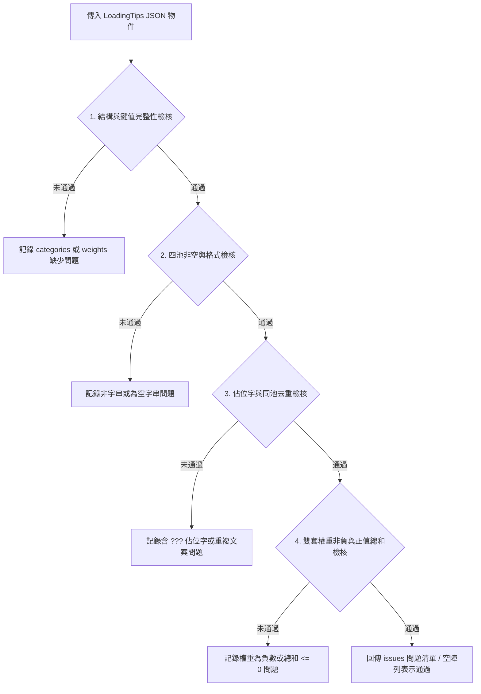

<!-- doc_id: doc_ui_0096 -->
<!-- spec_id: LT-05 -->
# 血脈命鏡載入提示內容Schema檢核與驗證閘門規格書

> 標籤：`系統規格` `大廳開場` `血脈命鏡` `LoadingTips` `測試閘門` `LT-05`
> 狀態：`正式生效` · 責任模組：`tools_node` · 參照：`LT-05` / `PROG-2-1382`

---

## 1. 檢核定位與品質目標

血脈命鏡載入提示直接呈現在所有玩家連線與資源載入的關鍵等待畫面中，文案疏漏、格式畸變或未定稿佔位字將嚴重損害遊戲品質形象。

本規格書定義 `tools_node/validate-loading-tips.js` 的驗證規則與閘門檢核標準，作為自動化 CI/CD 與建置流程中的確定性檢驗防線。
本模組為純 Node.js 工具函式庫，專注於靜態資料驗證，不依賴運行時環境。

---

## 2. 檢核項目與四大驗證法則

檢核中樞函式 `checkLoadingTips(content)` 接收自磁碟讀入之 JSON 物件，嚴格執行以下四道檢核防線：



### 2.1 法則一：結構與鍵值完整性 (Structural Completeness)
1. 根節點必須為純物件（`isRecord(content)`），不得為陣列或空值。
2. 根物件必須同時包含 `categories` 與 `weights` 兩個子物件。
3. `categories` 的鍵必須恰好等於 `['system', 'history', 'bloodline', 'tease']`（排序無關，鍵名嚴格相符）。
4. `weights` 必須包含 `owned` 與 `unowned` 兩個設定組，且兩組底下的鍵名皆必須與上述四池完全一致。

### 2.2 法則二：文案內容合規性 (Content Compliance)
1. 四個分類陣列（`categories[category]`）皆必須為非空陣列（`Array.isArray(tips) && tips.length > 0`）。
2. 陣列內每個項目必須為純文字（`string`），且呼叫 `trim()` 後不得為空字串。
3. 文本長度需符合基本可讀性原則，避免過短斷語或非人類可讀字元。

### 2.3 法則三：佔位符阻斷與同池去重 (Placeholder & Uniqueness)
1. **嚴禁佔位字**：任何提示文案嚴格禁止包含 `???`（`PLACEHOLDER`），防止未完成設定流出。
2. **同池去重**：單一分類池內的所有文字必須透過集合（`Set`）保證唯一性，同池重複文案將立即回報錯誤。

### 2.4 法則四：數值權重約束 (Weight Constraints)
1. `weights.owned` 與 `weights.unowned` 中的所有分類權重值，必須為非負有限數字：
   $$\forall c \in \{\text{system, history, bloodline, tease}\}, \quad w_c \ge 0 \quad \text{且} \quad \text{isFinite}(w_c)$$
2. 單套權重中各類別權重之總和必須大於 0（$\sum w_c > 0$），確保加權抽樣演算法不發生除以零或無池可挑之死鎖。

---

## 3. 介面契約與模組匯出

檢核模組對外匯出標準 JavaScript API，便於整合至各級檢驗工具：

```javascript
/**
 * 檢核 Loading Tips 內容合規性
 * @param {object} content 自 JSON 載入的完整物件
 * @returns {string[]} 問題描述清單；長度為 0 表示驗證通過
 */
function checkLoadingTips(content);

const LOADING_TIP_CATEGORIES = ['system', 'history', 'bloodline', 'tease'];
module.exports = { checkLoadingTips, LOADING_TIP_CATEGORIES };
```

---

## 4. 閘門整合與執行方式

1. **直接單元檢驗**：
   可於 Node.js 腳本中直接呼叫，或透過獨立測試驗證合法與非法案例（包含結構錯誤、含 `???` 佔位、權重全為 0 等負面案例）。
2. **納入 UI Spec 統一閘門**：
   納入 `tools_node/validate-ui-specs.js` 巡檢範圍。當執行靜態規範驗證時，自動讀取 `assets/resources/ui-spec/content/bloodline-mirror-loading-tips-v1.json` 並呼叫 `checkLoadingTips`。
3. **Fail-Fast 中斷原則**：
   若回傳之 `issues` 清單長度 $> 0$，驗證器以非 0 狀態碼退出並列印具體違規路徑（例如：`categories.history[2] 含佔位字 ???`），阻斷 PR 合併。
