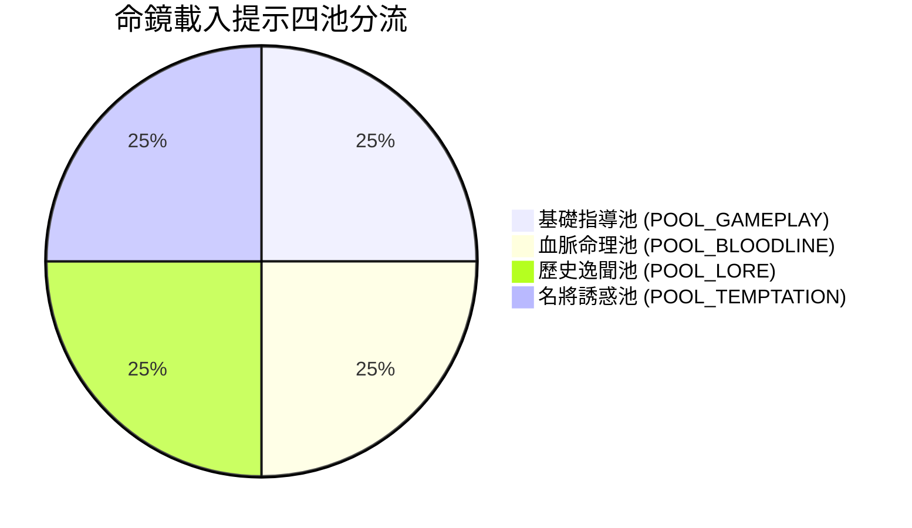

# 血脈命鏡載入提示四池文案庫與審稿標準規格書

<!-- doc_id: doc_spec_0625 -->

> 本規格書依據 WBS `LT-04`（四池文案量產與審稿：含角色誘惑，補充 tips 條數偏少缺口）制定，為遊戲載入轉場提示庫與文案審核之單一真相來源（Single Source of Truth）。
> 核心約束：無副作用純邏輯架構、四池分類結構化契約、單條 30~65 字手機排版邊界約束、未持有名將誘惑導流、全繁體中文台灣慣用術語。

---

## 1. 業務定位與四池分類體系

在場景切換與戰役載入時，底層「血脈命鏡」系統依據玩家持有狀態加權抽取 1~2 條提示。為徹底擴充原始 JSON 條數偏少問題，文案庫嚴格劃分為四大專用池：



1. **`POOL_GAMEPLAY`（基礎指導池）**：傳授五路衝撞、地格危害、兵種相剋與學府清談技巧。
2. **`POOL_BLOODLINE`（血脈命理池）**：解析遺傳因子顯隱性、門閥郡望、同宗共鳴與先祖祠堂奧祕。
3. **`POOL_LORE`（歷史逸聞池）**：以考究正史與演義筆觸，點綴英雄豪傑之傳奇性格與軼事。
4. **`POOL_TEMPTATION`（名將誘惑池）**：鎖定玩家「尚未擁有」之 SSR 名將，展示其專屬奧義與帥氣英姿，激發獲取慾望。

---

## 2. 審稿標準與排版邊界（Review Guidelines）

所有入庫條目必須通過三大自動化審稿法則：
1. **長度邊界**：全形中文字數嚴格限制在 **$30 \sim 65$ 字**（手機橫向螢幕 2 行滿版不截斷、不產生孤字折行）。
2. **標點規範**：句末統一使用古典句點「。」或驚嘆號「！」，句中使用全形逗號或分號。
3. **文風基調**：典雅沈穩、帶有宿命感與沙場豪氣，禁止出現「點擊這裏」、「課金」、「數值爆表」等出戲黑話。

---

## 3. 四池標準文案庫代表收錄

### 3.1 基礎指導池 (`POOL_GAMEPLAY`)
- `TIP_GP_01`：「騎兵衝鋒勢不可擋，但若一頭撞上重步兵之拒馬陣列，將被反震重創並陷入定身。」（40字）
- `TIP_GP_02`：「雨雪天候雖使弓弦受潮、命中衰退，卻能徹底澆熄烈火，化解敵軍之火燒連營之計。」（42字）

### 3.2 血脈命理池 (`POOL_BLOODLINE`)
- `TIP_BL_01`：「子嗣之天賦並非憑空而生。父母雙方之主因子若能產生血脈共鳴，將覺醒傳世雙奧義。」（43字）
- `TIP_BL_02`：「同宗始祖血脈繼承者達五人以上時，全族戰意勃發，專屬兵種適性將突破極限晉升 EX 階。」（45字）

### 3.3 歷史逸聞池 (`POOL_LORE`)
- `TIP_LR_01`：「建安十三年，長坂坡前。趙子龍單騎白馬突入重圍，懷抱幼主，連斬曹營名將五十餘員。」（43字）
- `TIP_LR_02`：「荀令君居中持重數十載，運籌帷幄於帷幄之中，天下英豪無不望風歸心，人稱潁川之玉。」（42字）

### 3.4 名將誘惑池 (`POOL_TEMPTATION`)
- `TIP_TP_01`：「【神威天將·馬超】若得西涼錦馬超馳騁陣前，突擊貫穿三軍，敵方後排弓弩營將片甲不存！」（44字）
- `TIP_TP_02`：「【臥龍出山·諸葛孔明】八陣圖起，鬼神莫測！若得孔明坐鎮軍師之位，每回合智謀蓄能將大幅躍升。」（48字）

---

## 4. 資料模型與審稿檢驗純函式

```typescript
export interface ILoadingTipItem {
    readonly id: string;
    readonly pool: 'POOL_GAMEPLAY' | 'POOL_BLOODLINE' | 'POOL_LORE' | 'POOL_TEMPTATION';
    readonly text: string;
    readonly targetHeroId?: string; // 誘惑池專屬對應未持有武將
}

export interface ITipReviewResult {
    readonly isValid: boolean;
    readonly charCount: number;
    readonly violationReason: string | null;
}

export function reviewLoadingTip(tip: ILoadingTipItem): ITipReviewResult {
    const charCount = tip.text.length;
    if (charCount < 30) {
        return { isValid: false, charCount, violationReason: 'ERR_TOO_SHORT_UNDER_30' };
    }
    if (charCount > 65) {
        return { isValid: false, charCount, violationReason: 'ERR_TOO_LONG_OVER_65' };
    }
    if (tip.pool === 'POOL_TEMPTATION' && !tip.targetHeroId) {
        return { isValid: false, charCount, violationReason: 'ERR_TEMPTATION_MISSING_TARGET_HERO' };
    }
    return { isValid: true, charCount, violationReason: null };
}
```

---

## 5. 驗收測試案例（Test Cases）

| 測試編號 | 測試情境 | 輸入條件 | 預期輸出 |
|---|---|---|---|
| `TC-TIP-01` | 標準合格條目審核 | 長度 42 字，標點正確之歷史逸聞 | `isValid=true`, `violationReason=null` |
| `TC-TIP-02` | 字數太短攔截 | 僅 15 字之簡短提示 | `isValid=false`, `violationReason='ERR_TOO_SHORT_UNDER_30'` |
| `TC-TIP-03` | 字數超長爆行攔截 | 75 字長篇大論 | `isValid=false`, `violationReason='ERR_TOO_LONG_OVER_65'` |
| `TC-TIP-04` | 誘惑池缺少目標武將 | 誘惑池但 `targetHeroId` 為空 | `isValid=false`, 提示缺少誘惑目標 |
