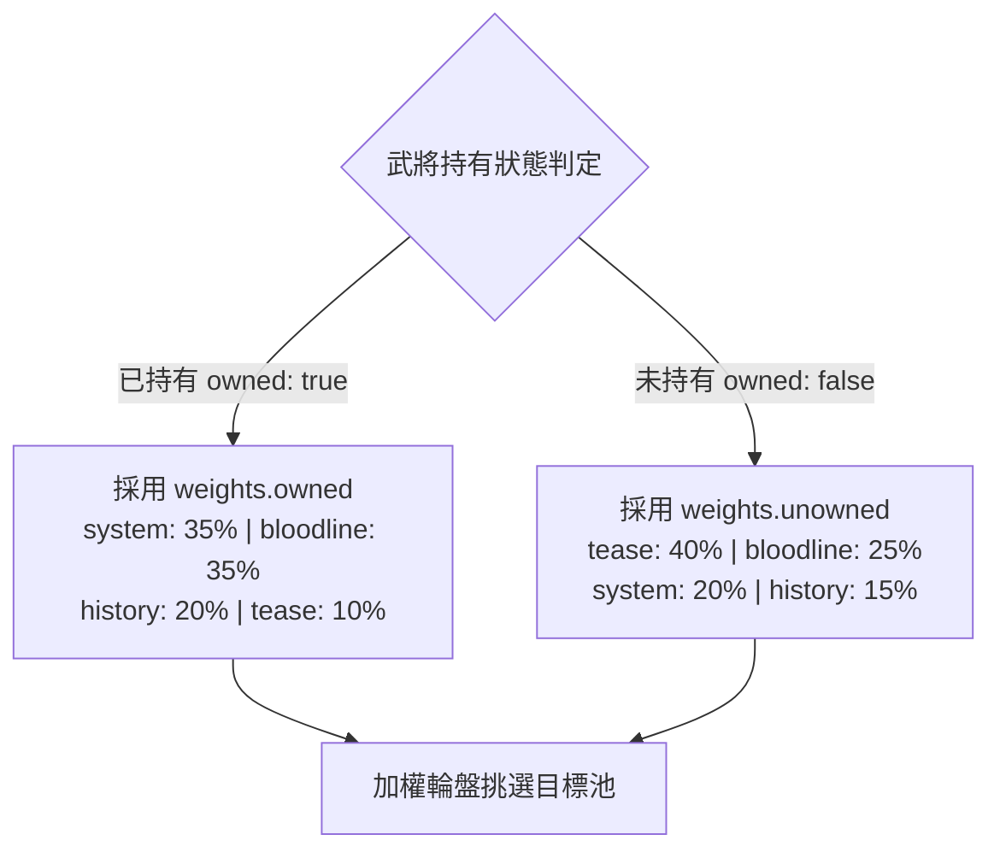

<!-- doc_id: doc_ui_0098 -->
<!-- spec_id: LT-01 -->
# 血脈命鏡載入提示四池資料結構與持有狀態雙權重規格書

> 標籤：`系統規格` `大廳開場` `血脈命鏡` `LoadingTips` `資料結構` `LT-01`
> 狀態：`正式生效` · 責任模組：`LoadingTips` · 參照：`LT-01` / `PROG-2-1378`

---

## 1. 模組定位與設計理念

血脈命鏡（Bloodline Mirror）為貫穿武將展示、血脈傳承與命格覺醒的核心介面。在場景載入、資料同步或切換武將的等待過程中，底部提示（Loading Tips）扮演動態傳達世界觀、玩法引導與付費抽卡誘因的關鍵角色。

本規格書定義血脈命鏡 Loading Tips 的核心資料結構與持有狀態雙權重矩陣，確保：
1. **資料與邏輯完全解耦**：所有文本與權重皆由獨立 JSON 配置驅動，無需修改程式碼即可動態熱插拔或調整營運文案。
2. **差異化訴求精準觸達**：依據玩家對當前武將的「已持有」或「未持有」狀態，自動切換截然不同的權重分佈，兼顧養成深度指引與招募吸引力。
3. **單一真相來源**：嚴格統一四池命名與兩組權重格式，消除歷史暫定或歧異欄位。

---

## 2. 四池資料結構定義 (Categories)

Loading Tips 內容劃分為四大主題池（Category），每池皆為字串陣列，各司其職：

| 池標識符 (Category) | 中文分類 | 核心職責與敘事重心 | 示例文案風格 |
|---|---|---|---|
| `system` | 系統提示 | 傳授遊戲核心機制、血脈系統規則、數值邊界與功能解鎖 | 「同名名將可選擇復生重練，或灌注為更強的英靈血脈。」 |
| `history` | 歷史趣聞 | 結合三國史實與演義典故，將知名事蹟昇華為血脈覺醒契機 | 「趙雲的七進七出，不只是膽識，也是血脈面對危局時的本能覺醒。」 |
| `bloodline` | 血脈傳聞 | 深化世界觀氛圍，詮釋命格雙面性、英靈虎符與靈獸伴靈 | 「每位名將心中都同時住著表象面與血脈面，只有定心者能看清兩者。」 |
| `tease` | 角色誘惑 | 激發收藏慾望與轉蛋動機，展現武將未解之謎與強烈魅力 | 「尚未結識的名將，往往最先在命鏡中留下令人難忘的輪廓。」 |

### 2.1 JSON Schema 結構規範
設定檔統一存放於 `assets/resources/ui-spec/content/bloodline-mirror-loading-tips-v1.json`：
```json
{
  "id": "bloodline-mirror-loading-tips-v1",
  "version": 1,
  "categories": {
    "system": [ "..." ],
    "history": [ "..." ],
    "bloodline": [ "..." ],
    "tease": [ "..." ]
  },
  "weights": {
    "owned": {
      "system": 35,
      "history": 20,
      "bloodline": 35,
      "tease": 10
    },
    "unowned": {
      "system": 20,
      "history": 15,
      "bloodline": 25,
      "tease": 40
    }
  }
}
```

---

## 3. 持有狀態雙套權重配置模型 (Weights)

針對玩家是否已解鎖/招募該武將，系統提供兩套獨立權重：



### 3.1 權重配置矩陣與比例分配
1. **已持有狀態 (`weights.owned`)**：
   - `system` (35%)：引導玩家深入掌握養成機制、軍勢組合與屬性繼承。
   - `bloodline` (35%)：增強當前角色的靈魂深度與情感認同。
   - `history` (20%)：提供文化趣味與演義背景。
   - `tease` (10%)：低比例保留，適度點綴未解之謎。
2. **未持有狀態 (`weights.unowned`)**：
   - `tease` (40%)：大幅提升焦點誘因，強調該角色的戰略獨特性與收藏價值，引導轉蛋。
   - `bloodline` (25%)：提前窺視其覺醒形態與英靈潛能。
   - `system` (20%)：普及未持有者也可在命鏡現影的基本規則。
   - `history` (15%)：基礎歷史色彩渲染。

---

## 4. 資料安全與邊界約束

1. **四池完整性**：`categories` 必須恰好包含 `system`、`history`、`bloodline`、`tease` 四個鍵，缺一不可。
2. **非空字串檢驗**：所有池內的每條提示文字長度必須 $\ge 5$ 字元，禁止空字串或純空白。
3. **禁止未定稿標記**：嚴格禁止包含 `???` 佔位符或測試痕跡。
4. **權重合規性**：權重值必須為非負實數（$\ge 0$），單套權重中至少有一項大於 0，避免除以零異常。
