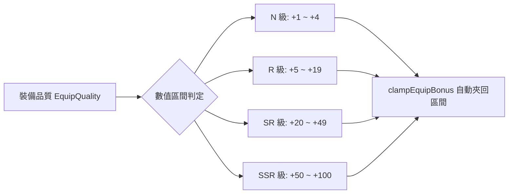

<!-- doc_id: doc_spec_0437 -->
# 裝備品質加成區間與武將面板屬性累加規格書

## 1. 核心定位與職責範圍

本規格書定義裝備各稀有階級之屬性加成區間，以及合入武將面板與戰場出征帳本之數值累加模型，對應 WBS **BAG-04**。
武將穿戴一般裝備後，裝備數值將直接堆疊至基礎五維（武力、智力、統率、政治、魅力）與生命上限（HP）。
模組由純函式架構（`EquipmentBonus.ts`）實現，不依賴 Cocos 畫面呈現層，支援無副作用不可變運算與越界自動夾回（Clamp）防禦機制。

---

## 2. 裝備品質加成區間模型（EQUIP_BONUS_RANGE）

### 2.1 品質區間常數定義
| 品質代碼 | 稀有度等級 | 屬性加成下限（`min`） | 屬性加成上限（`max`） | 適用裝備範例 |
|:---:|:---:|:---:|:---:|---|
| **SSR** | 傳世神兵 | `+50` | `+100` | 方天畫戟、青釭劍、倚天劍 |
| **SR** | 諸侯精裝 | `+20` | `+49` | 鐵脊蛇矛、古錠刀、思召劍 |
| **R** | 百夫良品 | `+5` | `+19` | 環首刀、精鋼劍、鐵胎弓 |
| **N** | 尋常行伍 | `+1` | `+4` | 樸刀、皮甲、粗鐵短刃 |

### 2.2 越界保護公式（`clampEquipBonus`）
當外部配置或動態詞條加成超出該品質之合理規格時，系統強制將數值夾回合法邊界：
$$\text{clamped} = \begin{cases} \text{min}, & \text{if } \text{bonus} \text{ is NaN or } < \text{min} \\ \text{max}, & \text{if } \text{bonus} > \text{max} \\ \text{bonus}, & \text{otherwise} \end{cases}$$

---

## 3. 槽位屬性映射矩陣（SLOT_STATS）

一般裝備六槽中，基礎三槽與進階三槽之屬性分派契約如下：

### 3.1 基礎三槽屬性映射
1. **武器（`WEAPON`）**：同步加成 **武力（`str`）** 與 **智力（`int`）**。
2. **防具（`ARMOR`）**：同步加成 **統率（`lea`）** 與 **生命上限（`hp`）**。
3. **飾品（`ACCESSORY`）**：同步加成 **政治（`pol`）** 與 **魅力（`cha`）**。

### 3.2 進階三槽規則
- **名馬（`MOUNT`）**、**古書（`TOME`）**、**傳家寶物（`TREASURE`）**：目前版本專注於特殊戰場被動、移動力增幅或戰術解鎖，在基礎五維面板上回傳空物件（`{}`），不產生額外五維加成。

---

## 4. 面板最終數值累加公式（`applyEquipBonuses`）

武將面板屬性計算嚴格遵循無衰減線性累加原則：
$$\text{final\_stat} = \text{base\_stat} + \sum_{i \in \text{EquippedItems}} \text{bonus}_i$$
- 函式接收唯讀基礎屬性字典與已穿戴裝備列表，以淺複製建立新字典並回傳，絕不原地修改輸入物件。
- 計算所得之最終屬性直接傳遞給 `SortieDeploy.ts` 用於推導出征軍勢上限與部隊戰鬥力。

---

## 5. 邊界保護與單元測試契約

1. **浮點數截斷保護**：所有加成最終合入面板時，計算結果保證為純整數，杜絕戰場計算產生微小浮點殘差。
2. **空裝容錯**：武將未穿戴任何裝備時，`applyEquipBonuses` 立即回傳與基礎數值完全相等的屬性快照。
3. **驗收測試覆蓋**：
   - 驗證 SSR 裝備 bonus 超過 100（如 120）時自動夾回 100。
   - 驗證同時穿戴 SSR 武器（+60）與 SR 武器（+30）時，武力與智力加成正確累加為 +90。
