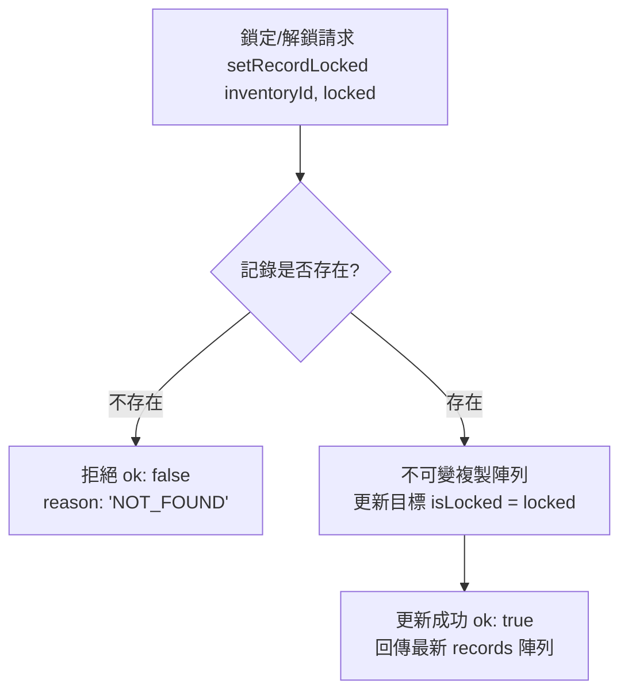
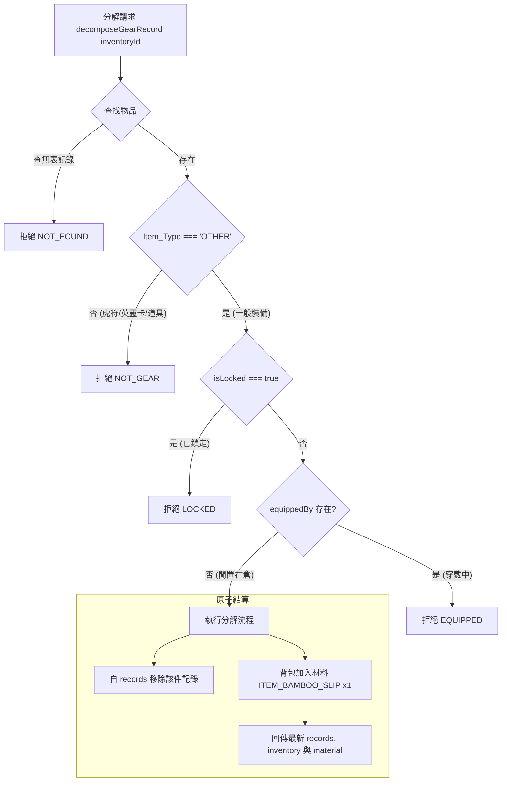

<!-- doc_id: doc_spec_0432 -->
# 裝備物品鎖定防護與分解回收鍛造材料規格書

## 1. 核心定位與職責範圍

本規格書定義裝備資產的安全鎖定機制與分解回收流程，對應 WBS **BAG-07**。
為了防止玩家誤售或誤分解珍貴戰略裝備，系統提供物品安全鎖定功能（`isLocked`）。同時，對於多餘的一般裝備提供回收分解途徑，轉換為基礎鍛造材料。
全套邏輯由純函式模組（`GearLockDecompose.ts`）提供，不依賴 Cocos 畫面層，所有更新操作保證不可變資料（Immutable Updates）流轉。

---

## 2. 裝備鎖定與解鎖狀態機

### 2.1 鎖定行為守則
- **防禦邊界**：鎖定狀態（`isLocked === true`）僅用於防止物品被分解、販賣或銷毀。
- **穿戴無障礙**：鎖定標記**完全不影響**武將穿戴、替換或卸下該裝備，確保戰術配置自由度。
- **純函式不可變性**：`setRecordLocked` 接收只讀記錄陣列，操作成功回傳深複製新陣列，絕不直接修改傳入陣列實體。

---

## 3. 裝備分解回收檢核狀態機

---

## 4. 數值模型與回收材料規範

### 4.1 分解資產白名單限制
- **允許分解**：僅限一般裝備（`Item_Type === 'OTHER'`）。
- **嚴格禁止分解**：
  - 虎符卡（`TALLY_SLOT`）：部隊調度核心信物，不可分解。
  - 英靈卡（`SPIRIT_SLOT`）：先祖傳家精神遺產，不可分解。
  - 消耗品與材料：應透過使用或交易途徑流轉。

### 4.2 回收材料產出定義
目前依系統基準配置固定回收基礎鍛造耗材：
- **材料代碼（`DECOMPOSE_MATERIAL_ID`）**：`ITEM_BAMBOO_SLIP`（竹簡，鍛造與技能參悟耗材）。
- **回收數量（`DECOMPOSE_MATERIAL_AMOUNT`）**：每件裝備固定產出 `1` 件。
- *註：未來稀有度進階加權（如 SSR 產出精粹玄鐵）將透過配置表平滑擴充，維持現行介面契約不變。*

---

## 5. 介面契約與拒絕原因多語化

### 5.1 拒絕原因枚舉（`GearLockRejectReason`）
- `NOT_FOUND`：倉庫中查無此裝備實體。
- `NOT_GEAR`：目標非一般可裝備物件（嘗試分解虎符或消耗品）。
- `LOCKED`：該裝備處於鎖定保護狀態，需先解鎖。
- `EQUIPPED`：該裝備正由武將穿戴中，需先於武將介面卸下至倉庫。

### 5.2 前端按鈕狀態映射
- 當選取之裝備處於穿戴中或已鎖定時，分解按鈕切換為不可點擊狀態（Disabled），並於 Tooltip 顯示對應原因。
- 點擊「鎖定/解鎖」開關立即觸發 `setRecordLocked`，介面即時刷新金鎖圖示（`UI_LOCK` / `UI_UNLOCK`）。
