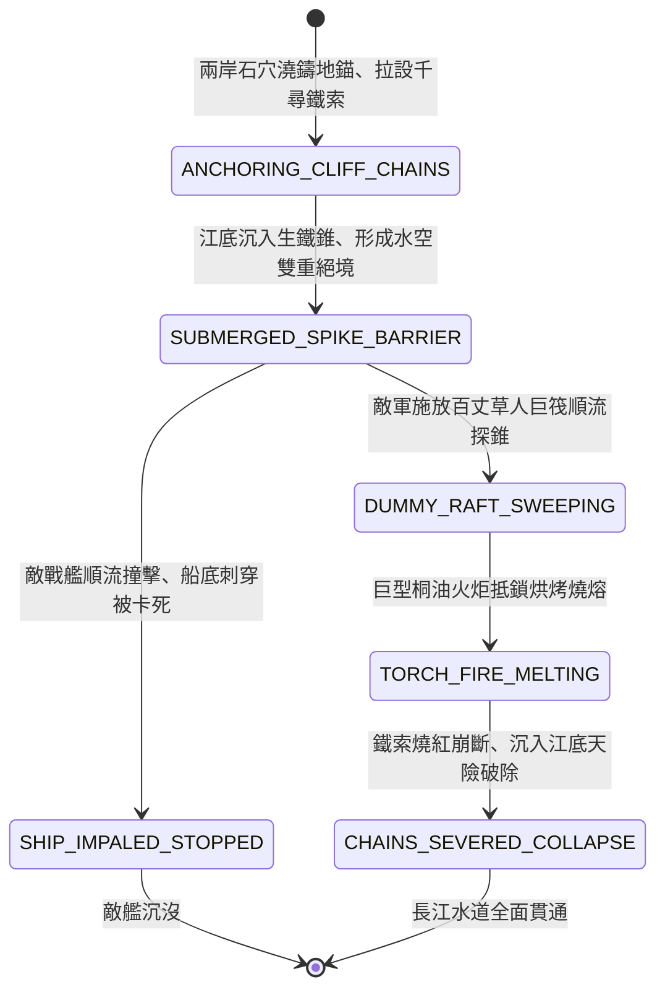

<!-- doc_id: doc_spec_0833 -->
# 3KLife 西陵峽口橫江重鐵索攔截順流戰艦與千尋鐵鎖沉江狀態機規格書

## 模組基本資訊
- **模組代號**：`GORGE-CHAIN-BARRIER01`
- **系統定位**：三國長江峽口水文要隘重型阻絕體系，負責兩岸岩壁地錨鎖定、千尋鐵鎖橫江攔截、水底暗置生鐵錐穿刺與高溫火炬燒熔破索之完整狀態流。
- **架構依賴**：`WaterGridSystem`、`NavalShipMovement`、`NavalHullDamageEngine`、`VFXBlockRegistry`。

---

## 核心設計概念
三國末期東吳防禦長江天險之終極工事「千尋鐵鎖橫江」：於西陵峽、巫峽等水流湍急狹隘處，在兩岸削壁深鑿石穴、澆鑄生鐵巨錨，拉設數十道重達萬斤之粗黑生鐵巨索橫貫江面。水底更密密麻麻打入尖銳生鐵錐（長達丈許，隱藏水面下數尺）。上游來襲之樓船戰艦一旦順流漂至，先遭鐵錐刺穿木底大漏水，復被橫江鐵鎖攔腰截斷，艦毀人亡。欲破此天塹，必須使用草人巨筏先行探錐排障，再以特製高溫油炬燒熔鐵索。



---

## 狀態機定義與轉換條件

### 1. `ANCHORING_CLIFF_CHAINS`（兩岸下錨張鎖狀態）
- **進入條件**：長江峽口水域（兩側為懸崖峭壁地格，水面寬度 <= 3 格），守軍工兵作業。
- **行為表現**：
  - 消耗 600 份生鐵與 100 份熔銅，橫向拉設 3 道萬斤鐵鎖。
  - 耐久度為 2500 點，阻斷一切水面船隻通行。
- **轉換**：鐵鎖張緊完成 -> 轉移至 `SUBMERGED_SPIKE_BARRIER`。

### 2. `SUBMERGED_SPIKE_BARRIER`（水底鐵錐暗伏狀態）
- **行為表現**：
  - 水面下 1 公尺處暗置數十具生鐵三叉尖錐，具備 95% 水下隱蔽。
  - 順流航行艦船若未減速，直接撞擊鐵錐。
- **轉換**：
  - 敵常規戰艦強行衝關 -> 轉移至 `SHIP_IMPALED_STOPPED`。
  - 敵軍派遣草人木筏在前探路 -> 轉移至 `DUMMY_RAFT_SWEEPING`。

### 3. `SHIP_IMPALED_STOPPED`（衝撞穿刺截停狀態）
- **行為表現**：
  - 戰艦木質龍骨被鐵錐挑穿，水線下產生巨大破洞（進水率每秒 +15%）。
  - 艦首撞上橫江鐵鎖，航速瞬間清零，受到 800 點反衝破甲傷害。
- **轉換**：艦船損毀沉入江底 -> 結束退出。

### 4. `DUMMY_RAFT_SWEEPING`（草人木筏探錐狀態）
- **行為表現**：
  - 敵軍以竹木編造長百丈之大筏，上縛披甲草人順流引導。
  - 巨筏觸及水下鐵錐，鐵錐被大木掛住拔出倒伏，清除水下暗刺障礙。
- **轉換**：水下鐵錐掃除完畢 -> 轉移至 `TORCH_FIRE_MELTING`。

### 5. `TORCH_FIRE_MELTING`（油炬燒熔鐵索狀態）
- **行為表現**：
  - 敵特製火筏載直徑十圍之桐油麻油大火炬，頂住橫江生鐵鏈。
  - 高達 1200 度烈焰持續烘烤，鐵索每秒扣除 80 點高溫熔蝕耐久。
- **轉換**：鐵索耐久歸零熔斷 -> 轉移至 `CHAINS_SEVERED_COLLAPSE`。

### 6. `CHAINS_SEVERED_COLLAPSE`（鐵索崩斷沉江狀態）
- **行為表現**：
  - 巨鐵索「錚」然崩裂，沉入滾滾長江江底。
  - 長江航道阻絕標籤徹底解除，敵主力艦隊揚帆直插建業。
- **轉換**：天險瓦解 -> 結束退出。

---

## 數值公式與配置契約

```typescript
export interface GorgeChainBarrierConfig {
  barrierId: string;
  chainDurabilityMax: number;     // 橫江鐵索耐久上限
  submergedSpikeDamage: number;   // 水下生鐵錐穿刺傷害
  waterInflowRateOnSpike: number; // 刺穿每秒進水比
  dummyRaftClearSuccessRate: number; // 草人木筏排錐成功率
  torchMeltDamagePerSecond: number; // 火炬烘烤每秒熔斷傷害
}

export const GORGE_CHAIN_PRESETS: Record<string, GorgeChainBarrierConfig> = {
  XILING_THOUSAND_FATHOM_CHAIN: {
    barrierId: 'CHAIN_XILING_01',
    chainDurabilityMax: 2500,
    submergedSpikeDamage: 800,
    waterInflowRateOnSpike: 0.15,
    dummyRaftClearSuccessRate: 0.90,
    torchMeltDamagePerSecond: 80,
  }
};
```

---

## 單元測試與驗收標準
1. **順流戰艦硬撞截殺**：常規艨艟以速度 >= 4 撞擊鐵索，龍骨 100% 被鐵錐穿透，航速即刻歸零且每秒漏水 15%。
2. **草人木筏排錐機制**：百丈草人巨筏順流漂至，90% 概率拔除水底鐵錐，為後續火筏開闢安全通道。
3. **高溫火炬燒熔斷索**：火炬大筏抵住鐵索燃燒超過 30 秒（累積熔斷傷害 2400 點），鐵鎖即刻斷裂沉江解除阻斷。
