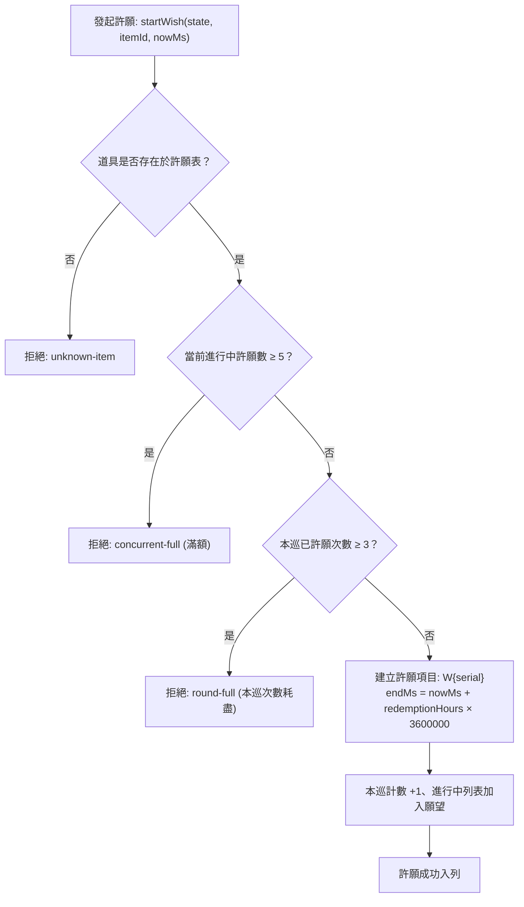

<!-- doc_id: doc_spec_0408 -->
# 許願池核心產量比率表與多輪償還週期規格書

> 本規格書為 3KLife 許願池系統免費許願軌、多巡開放週期、產量比率折算與加速卡縮期機制之唯一真相來源（Single Source of Truth）。
> 相關實作對齊：`assets/scripts/core/systems/WishPool.ts`、`AccelerateCard.ts`、`PlayerInventory.ts`。

---

## 1. 系統定位與核心機制

1. **時間換取資源之非課金培育軌**：
   - 許願池提供玩家透過時間等待免費獲取高價值養成道具（入學令、轉職令、延壽丹等）。
   - 運作架構為不可變狀態機，不依賴引擎渲染，可被客戶端與伺服器無縫回放校驗。
2. **多巡開放節奏（Daily Round Cycle）**：
   - 每日劃分為 **3 巡**：分別於 UTC+8 晨間 **06:00**（早巡）、正午 **12:00**（中巡）、傍晚 **18:00**（晚巡）重置開啟。
   - 深夜跨日緩衝：每日 00:00～06:00 歸屬於前一日之晚巡（第 3 巡），確保作息與結算平滑過渡。

---

## 2. 產量比率與償還時數全表（WISH_YIELD_TABLE）

許願產量以課金即買量（`fullAmount`）乘以產量比率（`yieldRate`）折算，且設有保底產量 $\ge 1$：

$$\text{wishAmount} = \max\left(1, \lfloor \text{fullAmount} \times \text{yieldRate} \rfloor\right)$$

| 道具名稱 | 道具識別碼（Item ID） | 課金即買基數 (`fullAmount`) | 產量比率 (`yieldRate`) | 許願產量 (`amount`) | 償還週期 (`redemptionHours`) |
|---|---|:---:|:---:|:---:|:---:|
| **補元散** | `item_vitality_pill` | 5 | 0.20 (20%) | **1** | **8 小時** |
| **求籤令** | `item_oracle_token` | 7 | 0.15 (15%) | **1** | **12 小時** |
| **入學令** | `item_admission_token` | 10 | 0.10 (10%) | **1** | **16 小時** |
| **虎符精粹** | `item_tally_essence` | 10 | 0.10 (10%) | **1** | **24 小時** |
| **轉職令** | `item_job_change_order` | 20 | 0.05 (5%) | **1** | **24 小時** |
| **延壽丹** | `item_longevity_pill` | 20 | 0.05 (5%) | **1** | **24 小時** |

---

## 3. 槽位約束與狀態流轉規則



### 3.1 槽位容量限制
1. **本巡許願上限（wishesPerRound）**：每巡固定最多發起 **3 項** 許願。換巡或跨日自動重置該巡次額度。
2. **全域並行上限（maxConcurrentWishes）**：所有巡次進行中許願項目累計最多 **5 個**。超出則拒絕發起，防範佇列溢出。

### 3.2 加速卡縮期機制（applySpeedCards）
- **加速卡效力**：每張加速卡固定縮減 **2 小時**（120 分鐘）等待時間。
- **單價**：每張加速卡定價 **5 精元**（月卡每日免費贈送 1 張）。
- **底線保底保護**：
  $$\text{endMs}' = \max\left(\text{startMs}, \text{endMs} - cards \times 2 \times 3,600,000\right)$$
  加速扣減後之結束時間絕對不早於發起時刻 `startMs`，嚴禁產生負值或倒流。
- **智慧張數計算（speedCardsNeeded）**：若剩餘時間低於持有加速卡總額，僅消耗足額張數，不浪費多餘卡片。

### 3.3 熟成與領取結算（claimReadyWishes）
- 條件：當前時間戳記 $\text{nowMs} \ge \text{endMs}$ 判定為熟成可領。
- 呼叫 `claimReadyWishes` 批次提領所有熟成項目，將道具派發至背包，並自進行中佇列移除。

---

## 4. 狀態契約與正規化驗證

```typescript
export interface ActiveWish {
    readonly wishId: string;
    readonly itemId: string;
    readonly amount: number;
    readonly startMs: number;
    readonly endMs: number;
    readonly speedCardsUsed: number;
}

export interface WishPoolState {
    readonly activeWishes: ActiveWish[];
    readonly day: string | null;           // 所屬日 YYYY-MM-DD (UTC+8)
    readonly roundWishes: number[];        // 長度 3，對應早/中/晚已用次數
    readonly nextSerial: number;
}

export function startWish(state: WishPoolState, itemId: string, nowMs: number):
    { ok: true; state: WishPoolState; wish: ActiveWish } | { ok: false; reason: WishStartReason };
export function applySpeedCards(state: WishPoolState, wishId: string, cards: number): WishPoolState;
export function claimReadyWishes(state: WishPoolState, nowMs: number):
    { state: WishPoolState; claimed: ActiveWish[] };
```
