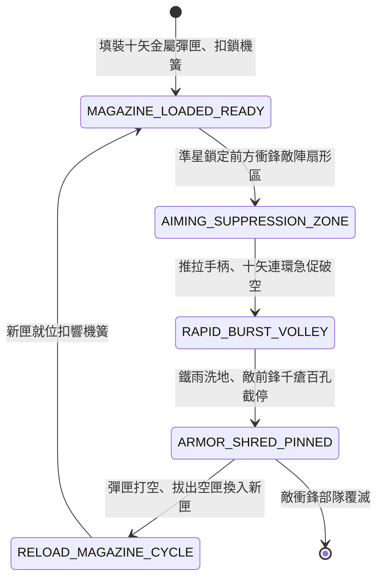

<!-- doc_id: doc_spec_0831 -->
# 3KLife 諸葛連弩十矢俱發機匣簧輪連射漫天鐵雨狀態機規格書

## 模組基本資訊
- **模組代號**：`ZHUGE-REPEATING-CROSSBOW01`
- **系統定位**：三國蜀漢高科技機關弩連射遠程火力壓制系統，負責元戎連弩裝匣、棘輪扳動十矢俱發、鐵鏃雨幕破甲壓制與彈匣冷卻填裝之完整狀態流。
- **架構依賴**：`BattleGridSystem`、`TroopTypeMovement`、`BattleDamageEngine`、`VFXBlockRegistry`。

---

## 核心設計概念
三國科技巔峰之「諸葛元戎弩」：「損益連弩，謂之元戎，以鐵為矢，矢長八寸，一弩十矢俱發」。諸葛亮精研機關之術，改進傳統手弩，於弩身之上加裝精木箭匣，內置棘輪與板機聯動機構。士卒只需反覆推拉上弦手柄，十支短鐵箭如流星傾瀉而出。三十步內鐵雨密集如幕，強大連續衝擊力能直接射穿皮甲與小盾，將敵軍衝鋒前鋒瞬間釘死於陣前。



---

## 狀態機定義與轉換條件

### 1. `MAGAZINE_LOADED_READY`（彈匣裝載狀態）
- **進入條件**：連弩兵背包儲備充足鐵箭匣，處於待機狀態。
- **行為表現**：
  - 彈匣滿載 10 發生鐵重箭，隨時可激發。
  - 射程為 1~3 格（中近距離致命壓制武器）。
- **轉換**：敵部隊進入射程扇形區 -> 轉移至 `AIMING_SUPPRESSION_ZONE`。

### 2. `AIMING_SUPPRESSION_ZONE`（扇形鎖定狀態）
- **行為表現**：
  - 瞄準鎖定前方 45 度扇形地格，收束散布圓。
  - 對正前方形成「鐵雨警戒線」。
- **轉換**：主將下達齊射指令或敵衝鋒踏入射程 -> 轉移至 `RAPID_BURST_VOLLEY`。

### 3. `RAPID_BURST_VOLLEY`（十矢連珠齊射狀態）
- **行為表現**：
  - 連弩兵快速推拉手柄，1 秒內連續射出 10 枚鐵矢（播放連續機關射擊音效）。
  - 單隊連弩兵形成「漫天鐵雨」彈幕特效，箭矢密度高達普通弓箭 5 倍。
- **轉換**：10 發箭矢全數離膛 -> 轉移至 `ARMOR_SHRED_PINNED`。

### 4. `ARMOR_SHRED_PINNED`（破甲釘死截停狀態）
- **行為表現**：
  - 承受密集鐵鏃短箭連續打擊，削扣敵部隊 400~750 點混合破甲傷害。
  - 附加「強行截停」效果：敵軍前鋒衝鋒速度即刻歸零，移動力扣減 3 格。
- **轉換**：目標部隊受重創或潰散 -> 轉移至 `RELOAD_MAGAZINE_CYCLE`。

### 5. `RELOAD_MAGAZINE_CYCLE`（換匣裝填狀態）
- **行為表現**：
  - 彈匣打空，士卒拇指按下退匣榫，拔除空木匣，自腰間拔出裝滿 10 矢之新匣卡入（耗時 1 回合）。
  - 裝填期間部隊無法反擊，防禦力微降 15%。
- **轉換**：新彈匣卡榫鎖緊響聲發出 -> 回歸 `MAGAZINE_LOADED_READY`。

---

## 數值公式與配置契約

```typescript
export interface ZhugeCrossbowConfig {
  unitId: string;
  arrowsPerSalvo: number;          // 單次連射箭矢數 (10)
  maxRangeGrids: number;           // 最大有效射程 (3格)
  singleBoltDamage: number;        // 單枚短鐵箭基礎傷害
  armorPenetrationRate: number;    // 無視護甲穿透比 (0.0 ~ 1.0)
  reloadTurnDuration: number;      // 換匣所需回合
  chargeStopPinRate: number;       // 截停敵軍衝鋒機率
}

export const ZHUGE_CROSSBOW_PRESETS: Record<string, ZhugeCrossbowConfig> = {
  SHU_YUANRONG_CROSSBOW: {
    unitId: 'CROSSBOW_YUANRONG_01',
    arrowsPerSalvo: 10,
    maxRangeGrids: 3,
    singleBoltDamage: 65,
    armorPenetrationRate: 0.40,
    reloadTurnDuration: 1,
    chargeStopPinRate: 0.90,
  }
};
```

---

## 單元測試與驗收標準
1. **十矢連續激發次數**：單次攻擊判定中，系統精確依序計算 10 次子彈道命中結算，彈藥消耗計數準確無溢出。
2. **近程衝鋒截停判定**：敵高速部隊踏入射程 2 格時，連弩齊射命中後 90% 觸發截停，移動力降為 0。
3. **換匣週期冷卻防呆**：發射完畢後部隊 100% 進入 1 回合裝填冷卻，裝填完畢前無法再次發動齊射。
