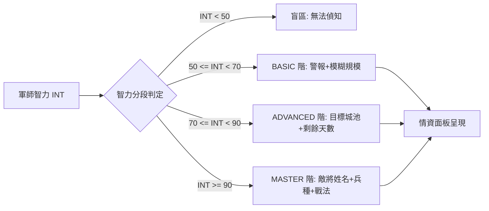

<!-- doc_id: doc_spec_0589 -->
# 軍師智力軍事動向偵知分段與情報頻寬演算法規格書

> 標記：Single Source of Truth（單一真相來源）  
> 涵蓋工作包：`RAI-15`  
> 狀態：正式發布 / 核心邏輯規格

---

## 1. 系統定位與架構

本模組規範國家勢力中「隨軍參謀 / 首席軍師（Chief Strategist）」的智力屬性（`INT`）對周邊敵國軍事動態的情報偵知頻寬（Intel Band）。透過軍師智謀等級的分段判定，決定大地圖世界沙盤與軍情速報中呈現之情資顆粒度（模糊預警 $\rightarrow$ 兵力規模 $\rightarrow$ 行軍路線 $\rightarrow$ 精確部隊編制與主力戰法）。



---

## 2. 情報頻寬分段判定模型（RAI-15）

### 2.1 智力階梯與情報頻寬定義
系統依軍師 `INT` 數值將情報頻寬劃分為四個階層：

| 階層等級 | 智力區間 | 頻寬代碼 | 可見情報內容 | 偽報干擾抵抗率 |
|:---:|:---:|:---:|:---|:---:|
| **BLIND** | $< 50$ | `INTEL_BLIND` | 僅在敵軍兵臨城下（距離 1 格）時觸發紅燈警報 | $0\%$ |
| **BASIC** | $50 \sim 69$ | `INTEL_BASIC` | 敵軍出征提示、大致兵力規模（小軍/中軍/大軍） | $30\%$ |
| **ADVANCED** | $70 \sim 89$ | `INTEL_ADVANCED` | 確切行軍目標城池、抵達剩餘季度/天數、總兵力數值 | $60\%$ |
| **MASTER** | $\ge 90$ | `INTEL_MASTER` | 主將/副將真實姓名、攜帶兵種、怒氣奧義與兵法配置 | $90\%$ |

### 2.2 核心計算函式與資料模型
```typescript
export type IntelBandLevel = 'BLIND' | 'BASIC' | 'ADVANCED' | 'MASTER';

export interface IMilitaryMovementIntel {
  readonly movementId: string;
  readonly originNationId: string;
  readonly targetCityId?: string;       // BASIC 不可見；ADVANCED 以上可見
  readonly estimatedTroopsText?: string;// BASIC 可見模糊文字（例如："五千至一萬"）
  readonly exactTroopCount?: number;    // ADVANCED 以上可見精確值
  readonly remainingDays?: number;      // ADVANCED 以上可見
  readonly commanderName?: string;      // MASTER 可見
  readonly troopBranchType?: string;    // MASTER 可見
  readonly equippedTactics?: readonly string[]; // MASTER 可見
}

export function resolveIntelBand(strategistInt: number): IntelBandLevel {
  if (strategistInt >= 90) return 'MASTER';
  if (strategistInt >= 70) return 'ADVANCED';
  if (strategistInt >= 50) return 'BASIC';
  return 'BLIND';
}

export function filterMovementIntelByBand(
  rawIntel: IMilitaryMovementIntel,
  band: IntelBandLevel
): Partial<IMilitaryMovementIntel> {
  switch (band) {
    case 'MASTER':
      return { ...rawIntel };
    case 'ADVANCED':
      return {
        movementId: rawIntel.movementId,
        originNationId: rawIntel.originNationId,
        targetCityId: rawIntel.targetCityId,
        exactTroopCount: rawIntel.exactTroopCount,
        remainingDays: rawIntel.remainingDays,
      };
    case 'BASIC':
      return {
        movementId: rawIntel.movementId,
        originNationId: rawIntel.originNationId,
        estimatedTroopsText: rawIntel.estimatedTroopsText,
      };
    case 'BLIND':
    default:
      return {
        movementId: rawIntel.movementId,
      };
  }
}
```

---

## 3. 偽報與反偵查對抗規則

當敵對勢力派遣擁有特質「兵不厭詐」或「虛張聲勢」之軍師時，進行雙方軍師智力對抗：
- **偽報成功率**：$\text{FeintRate} = \max(0.10, \min(0.80, (\text{EnemyInt} - \text{MyInt} + 20) \times 0.01))$。
- 偽報成功時，`ADVANCED` 級以下情報會將目標城池或兵力顯示為虛假目標（如虛增兵力 1.5 倍）；`MASTER` 級情報不受假情報欺瞞，直接看破虛實並提示「看破敵軍疑兵之計」。

---

## 4. 驗收與測試標準

1. **頻寬邊界值測試（TC-RAI-15-01）**：
   - 驗證 `INT` 49 返回 `BLIND`；50 返回 `BASIC`；69 返回 `BASIC`；70 返回 `ADVANCED`；89 返回 `ADVANCED`；90 返回 `MASTER`。
2. **情資過濾安全性（TC-RAI-15-02）**：
   - 驗證在 `BASIC` 頻寬下，返回的物件中 `targetCityId`、`commanderName` 與 `equippedTactics` 均為 `undefined`，杜絕記憶體洩漏。
3. **高智看破機制（TC-RAI-15-03）**：
   - 驗證 `INT >= 90` 的軍師在面對任何敵方偽報時，均強制標記 `isRevealed = true`。
