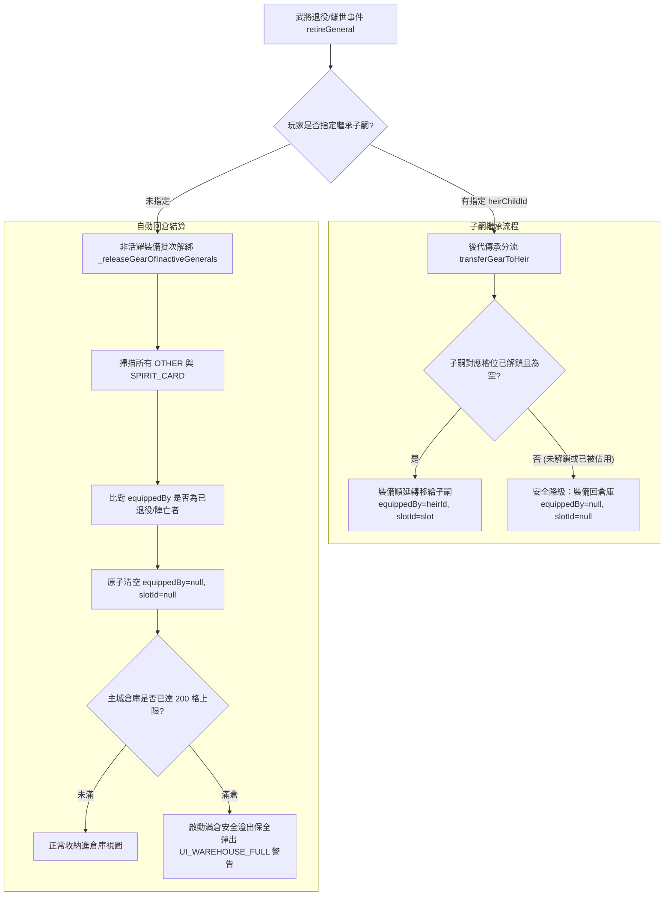

<!-- doc_id: doc_spec_0436 -->
# 退役武將裝備自動回倉與滿倉溢出處置規格書

## 1. 核心定位與職責範圍

本規格書定義武將生命週期轉換（年滿 65 歲功成退役或戰歿離世）時，其身上所穿戴一般裝備之自動回倉機制與滿倉溢出處置規範，對應 WBS **BAG-06**。
當武將脫離可出戰活耀名單轉為退役教官（`isMentorCard === true`）或陣亡（`status === 'dead'`）時，系統透過純邏輯生命週期服務執行解綁，確保重要裝備資產不隨角色離場而流失。
同時規範指定後代繼承（`transferGearToHeir`）優先路徑與主城倉庫滿倉時之溢出保全機制。

---

## 2. 退役裝備處置雙軌流程圖



---

## 3. 非活耀裝備自動釋放機制（`_releaseGearOfInactiveGenerals`）

### 3.1 活耀武將集合判定
系統建立當前仍具備出征資格之活耀名單白名單集合：
```typescript
const active = new Set(
    roster.filter((g) => g.status !== 'dead' && !g.isMentorCard).map((g) => g.id)
);
```

### 3.2 批次清空裝配標記
對物件庫中所有一般裝備（`Item_Type === 'OTHER'`）與英靈卡（`Item_Type === 'SPIRIT_CARD'`）進行掃描：
- 若裝備之 `equippedBy` 不在活耀集合中，系統將該物件更新為：
  - `equippedBy: null`
  - `slotId: null`
  - 若為英靈卡，額外重置 `isPrimary: null`。
- 回倉物品自動出現在主城倉庫面板中，供其他武將即刻調度。

---

## 4. 滿倉溢出保全與異常處理

### 4.1 零銷毀保全鐵律（Zero-Loss Invariant）
- **被動事件不丟裝**：武將退役與死亡為遊戲歷程的被動自然事件，**絕對禁止因倉庫已滿而自動銷毀或丟棄玩家裝備**。
- **溢出暫存狀態**：即使主城倉庫已達 200 格上限，退役解綁之裝備依然安全保留在統一物件庫中（`InventoryRecord`）。
- **主動行為攔截**：處於滿倉或超額狀態時，玩家無法再手動從武將身上主動卸下裝備至倉庫，亦無法從背包存入新物品（`storeIntoWarehouse` 回報 `full`），必須先進行裝備分解（`BAG-07`）或售出以釋放空間。
- **介面警告**：結算完成後，大廳畫面上方即時派發多語系警訊 `UI_WAREHOUSE_FULL`。

### 4.2 退役資產產出補充條款
- **退役不產虎符**：依核心規格（Q61=C，PROG-2-1020），虎符僅限於「戰死/陣亡」結算產出，武將壽終退役轉為教官時**嚴格禁止生成虎符卡**。
- **文職退役補給**：文職（SCHOLAR）或雙職能（DUAL_CLASS）武將退役時，系統固定贈送 1 份竹簡（`ITEM_BAMBOO_SLIP`，材料），直接撥入玩家背包。

---

## 5. 驗收標準與單元測試契約

1. **裝備不遺失檢核**：
   - 武將退役後，其原先穿戴之全部裝備必須 100% 存在於倉庫記錄中，屬性完全保留。
2. **子嗣繼承防覆蓋檢核**：
   - 當子嗣裝備槽已有更強裝備時，退役老將之裝備自動降級回倉，絕不覆蓋子嗣既有裝備。
3. **退役身分隔離檢核**：
   - 驗證退役轉為 `isMentorCard` 後，不可再參與出征編制（`SortieDeploy`），其裝備欄位在名冊中清空。
