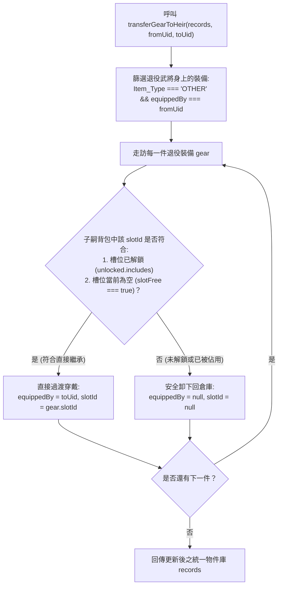

<!-- doc_id: doc_spec_0427 -->
# 退役武將裝備自動回庫與後代繼承轉移規格書

> 本規格書為 3KLife 武將退役裝備處置機制、後代直接繼承繼裝演算法與衝突防覆蓋安全回收原則之唯一真相來源（Single Source of Truth）。
> 相關實作對齊：`assets/scripts/core/systems/GearEquipFlow.ts`、`GeneralBackpack.ts`、`InventoryProjection.ts`。

---

## 1. 系統定位與傳承架構

1. **武將生命週期收尾與資產傳承（Asset Inheritance）**：
   - 武將達 60 歲退役（或重傷致仕）時，個人穿戴之裝備資產必須妥善處置，不得遺失或懸空。
   - 支援兩大處置路徑：
     - **指定後代繼承（Direct Heir Inheritance）**：將退役武將裝備直接順延過渡給指定繼承人。
     - **府庫自動回收（Auto Warehouse Return）**：若無指定後代，全套裝備自動解除綁定回到共用倉庫。
2. **嚴格的類型隔離邊界**：
   - 此處置流程僅針對常規一般裝備（`Item_Type: 'OTHER'`，如武器、防具、名馬等）。
   - 虎符（`TALLY`）與英靈卡（`SPIRIT_CARD`）各具備獨立世家傳承或陣亡回歸通道，絕不混入常規裝備轉移流程。

---

## 2. 後代裝備繼承轉移演算法（transferGearToHeir）



### 2.1 槽位相容性判定（keepSlot）
對於退役武將身上的任一裝備，子嗣繼承穿戴必須同時滿足以下三項條件：
$$\text{keepSlot} = \text{Boolean}(\text{slot}) \land \text{unlocked.includes}(\text{slot}) \land \text{slotFree}$$

- **`unlocked.includes(slot)`**：子嗣的背包該進階欄位必須已經解鎖。
- **`slotFree`**：子嗣該欄位當前不能穿戴有其他裝備。
- 若任一條件不滿足，裝備**絕不強行覆蓋**子嗣現有裝備，而是安全脫卸回到常規倉庫（`equippedBy: null, slotId: null`），確保玩家資產零風險。

---

## 3. 常規卸裝與回倉原子操作（unequipGear）

- 當退役武將無繼承人時，逐筆呼叫卸裝邏輯，將 `equippedBy` 與 `slotId` 清空為 `null`。
- 裝備回倉後，於背包視圖中立即呈現為未穿戴狀態，可自由供其他在職武將裝備或進行分解。

---

## 4. 介面型別契約

```typescript
export function unequipGear(
    records: readonly InventoryRecord[],
    generalUid: string,
    slotId: EquipSlot
): GearEquipResult;

export function transferGearToHeir(
    records: readonly InventoryRecord[],
    fromGeneralUid: string,
    toGeneralUid: string
): InventoryRecord[];
```

---

## 5. 驗收標準與測試用例

1. **繼承槽位無衝突穿戴**：
   - 退役武將穿戴青龍偃月刀（`WEAPON`），子嗣武器欄已解鎖且為空，執行後該刀之 `equippedBy` 正確變更為子嗣 UID。
2. **槽位佔用自動回倉防護**：
   - 若子嗣武器欄已裝備雌雄雙股劍，執行後青龍偃月刀之 `equippedBy` 與 `slotId` 均變為 `null`（退回倉庫），子嗣原武器維持不變。
