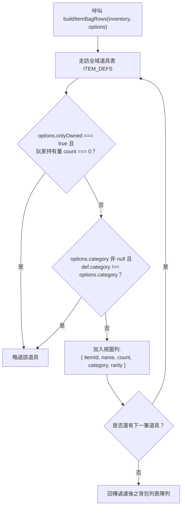
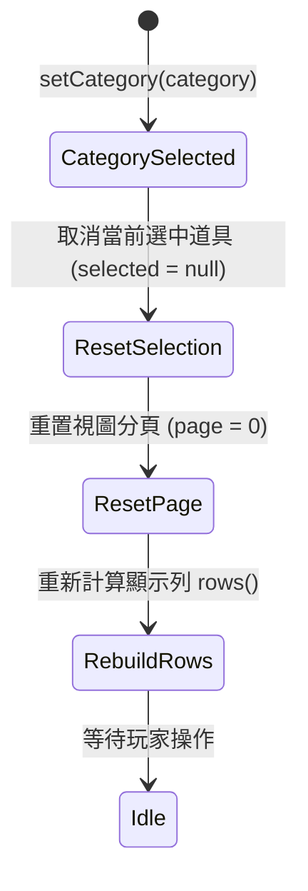

<!-- doc_id: doc_spec_0413 -->
# 道具五大分類與背包篩選列舉規格書

> 本規格書為 3KLife 道具五大功能分類（`ItemCategory`）、背包檢視列聚合與分類頁籤切換狀態機之唯一真相來源（Single Source of Truth）。
> 相關實作對齊：`assets/scripts/core/systems/ItemDef.ts`、`ItemBagView.ts`、`PlayerInventory.ts`、`ItemBagController.ts`。

---

## 1. 系統定位與分類架構

1. **五大核心功能分類（ItemCategory）**：
   - 全專案所有道具均必須歸屬於以下五大列舉分類之一，不允許無分類道具存在：
     - **`消耗品`**：具即時增益或消耗性機能之道具（如補元散、延壽丹、求籤令、加速卡、祈風令）。
     - **`材料`**：用於裝備鍛造、主城建設、教官傳授或虎符突破之素材（如竹簡、戰法筆記、虎符精華、石材、木材）。
     - **`特殊道具`**：身份轉換、名將傳承、系統解鎖等高階令旗憑據（如轉職令、試用券、歸宗令、傳道令）。
     - **`貨幣`**：具備全域購買力之流通代幣（如精元、結義點數）。
     - **`寶物`**：具備高昂價值、特殊詞條或傳家屬性之頂級寶物（如傳家寶物）。
2. **純資料驅動與 UI 表現解耦**：
   - 分類篩選為純函式過濾器（Predicate Filter），資料庫僅負責過濾輸出，不變更底層庫存。

---

## 2. 背包視圖列聚合演算法（buildItemBagRows）



### 2.1 篩選參數規則
- **`category` 條件**：
  - 若指定為有效分類字串，僅保留符合該分類之道具列。
  - 若為 `null` 或未提供（`undefined`），則預設展示全部分類道具。
- **`onlyOwned` 條件**：
  - 若為 `true`，僅保留玩家當前持有量 $> 0$ 之道具。
  - 若為 `false` 或未提供，則列出該分類全量道具（未持有者數量標記為 0）。

---

## 3. 背包控制器分頁狀態機（ItemBagController）

當玩家於背包介面點擊分頁頁籤時，控制流程如下：



1. **取消選取保護**：切換分頁時，自動將選取索引重置，避免焦點殘留於其他分類之無效槽位。
2. **分頁歸零機制**：不論前一分類停留在第幾頁，切換分類後一律強制回到第 0 頁（第一頁）。

---

## 4. 介面型別契約

```typescript
export type ItemCategory = '消耗品' | '材料' | '特殊道具' | '貨幣' | '寶物';

export interface ItemBagRow {
    readonly itemId: string;
    readonly name: string;
    readonly count: number;
    readonly category: ItemCategory;
    readonly rarity: number;
}

export interface ItemBagViewOptions {
    readonly category?: ItemCategory | null;
    readonly onlyOwned?: boolean;
}

export function buildItemBagRows(
    inventory: PlayerInventory,
    options?: ItemBagViewOptions
): readonly ItemBagRow[];
```

---

## 5. 驗收標準

1. **分類篩選完整性**：
   - 篩選條件 `category: '材料'` 且 `onlyOwned: true` 時，回傳清單僅包含材料道具，其他分類道具一律剔除。
2. **全域恢復**：
   - 將 `category` 傳入 `null` 時，回傳長度完整恢復為全域道具總數。
