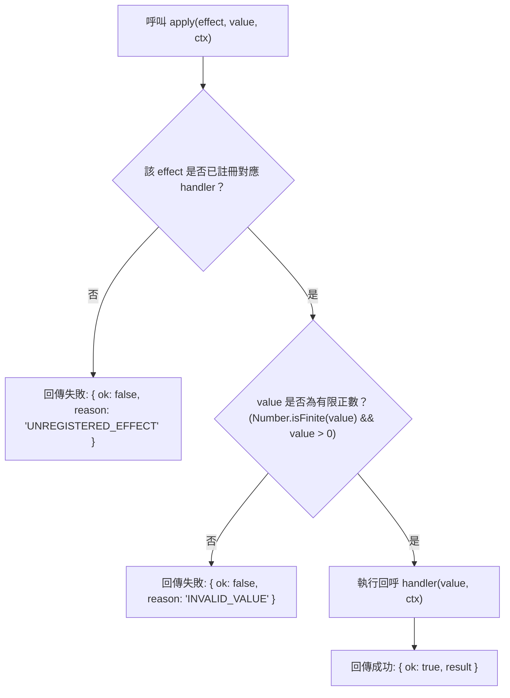

<!-- doc_id: doc_spec_0414 -->
# 道具使用效果引擎與功能分派分流規格書

> 本規格書為 3KLife 道具使用效果派發引擎（`ItemEffectDispatcher`）、六大核心效果枚舉與錯誤安全機制之唯一真相來源（Single Source of Truth）。
> 相關實作對齊：`assets/scripts/core/systems/ItemEffectDispatcher.ts`、`FertilityBoost.ts`、`ItemRefreshEffect.ts`、`VitalityPill.ts`。

---

## 1. 系統定位與架構設計

1. **依賴反轉與分派解耦（Dependency Inversion）**：
   - 道具系統僅定義效果類型（`ItemEffectType`）與作用數值（`Effect_Value`），不直接改動武將數值、戰場狀態或存檔。
   - 透過依賴注入（Dependency Injection）向 `ItemEffectDispatcher` 註冊處理回呼，將精力、受孕、刷新等邏輯委派給具體的專業子系統。
   - Unity 概念對照：相當於 `ItemActionService`，由各系統的 Manager 向中央事件匯流排註冊處置函式，ItemSO 僅持有 Action ID。
2. **錯誤安全防護（Fail-Safe Design）**：
   - 當觸發未註冊或不支援的效果類型時，回傳標準拒絕結果，嚴禁拋出例外（No-Throw），防止前端崩潰。

---

## 2. 六大核心效果枚舉矩陣（ITEM_EFFECT_TYPES）

| 效果列舉碼 (`ItemEffectType`) | 對應道具範例 | 數值含義 (`value`) | 委派處理子系統 |
|---|---|:---:|---|
| **`RESTORE_VITALITY`** | 補元散 (+50)、高級補元散 (+100) | 回復之精力點數 | 精力管理系統（`PlayerVitality`） |
| **`BOOST_CONCEPTION`** | 安胎藥 | 提升之受孕倍率（如 1.5） | 結緣與子嗣系統（`FertilityBoost`） |
| **`UNLOCK_TRAINING`** | 入學令 | 解鎖之學府層級代碼 | 書院育才系統（`AcademyNurture`） |
| **`REFRESH`** | 刷新券 | 刷新目標池代碼（1:傭兵, 2:地牢） | 傭兵/迷宮系統（`ItemRefreshEffect`） |
| **`ORACLE`** | 求籤令 | 消耗枚數（固定 1） | 名士預言占卜系統（`OracleSystem`） |
| **`EQUIP`** | 傳家寶物 | 賦予之裝備識別碼 | 武將裝備系統（`EquipmentSystem`） |

---

## 3. 效果派發狀態機與防護檢驗



### 3.1 數值合法性審查（INVALID_VALUE）
- 作用數值 `value` 必須為嚴格大於 0 之有限數值。
- 若傳入 $\le 0$、`NaN`、`Infinity` 或未定義型別，引擎直接拒絕且絕對不呼叫處理函式，避免產生髒資料。

### 3.2 類型安全保障（isItemEffectType）
- 提供純函式守衛，驗證傳入之字串是否隸屬於受管效果類型集合。

---

## 4. 介面型別契約

```typescript
export const ITEM_EFFECT_TYPES = [
    'RESTORE_VITALITY',
    'BOOST_CONCEPTION',
    'UNLOCK_TRAINING',
    'REFRESH',
    'ORACLE',
    'EQUIP',
] as const;

export type ItemEffectType = (typeof ITEM_EFFECT_TYPES)[number];
export type ItemEffectRejectReason = 'UNREGISTERED_EFFECT' | 'INVALID_VALUE';
export type ItemEffectResult<R> =
    | { readonly ok: true; readonly result: R }
    | { readonly ok: false; readonly reason: ItemEffectRejectReason };

export type ItemEffectHandler<C, R> = (value: number, ctx: C) => R;

export interface ItemEffectDispatcher<C, R> {
    apply(effect: ItemEffectType, value: number, ctx: C): ItemEffectResult<R>;
}

export function createItemEffectDispatcher<C, R>(
    handlers: Partial<Record<ItemEffectType, ItemEffectHandler<C, R>>>
): ItemEffectDispatcher<C, R>;
```

---

## 5. 驗收標準

1. **未註冊容錯性**：建立無 handler 註冊之派發器，呼叫任意效果一律安全回傳 `{ ok: false, reason: 'UNREGISTERED_EFFECT' }`。
2. **零與負數攔截**：傳入 `value = 0` 或 `value = -10` 時，安全回傳 `{ ok: false, reason: 'INVALID_VALUE' }`。
