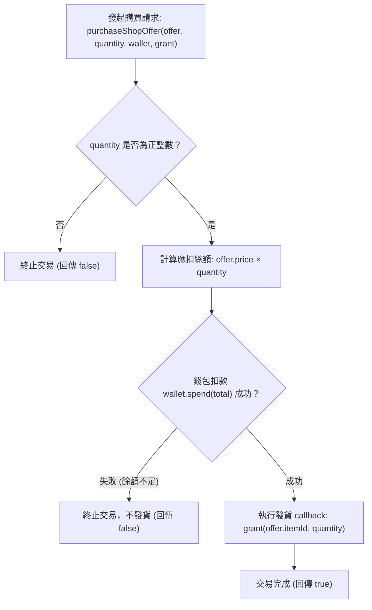

<!-- doc_id: doc_spec_0407 -->
# 道具精元定價表與購買流程數值規格書

> 本規格書為 3KLife 百寶閣商城道具精元定價、餘額檢驗與扣款發貨流程之唯一真相來源（Single Source of Truth）。
> 相關實作對齊：`assets/scripts/core/systems/ItemShopPricing.ts`、`ItemDef.ts`、`PlayerInventory.ts`。

---

## 1. 系統定位與架構原則

1. **純邏輯與無副作用（Pure Logic & Side-Effect Free）**：
   - 商店定價表、餘額判斷與交易流程契約抽離於獨立無相依模組，不直接操作遊戲引擎（Cocos Creator `cc`）或全域狀態。
   - Unity 概念對照：相當於獨立於 UI 的 `ItemShopPricingSO` 價格配置與靜態交易仲裁器，按鈕元件僅讀取報價表，嚴禁在 UI 或 Prefab 腳本中硬編碼數值。
2. **扣款先於發貨（Spend-Before-Grant Guarantee）**：
   - 購買流程嚴格遵循「先扣貨幣、驗證扣款成功、再派發道具」原則，杜絕因發貨失敗或中斷導致的經濟漏洞。
   - 數量必須為正整數（$quantity \in \mathbb{Z}^+$），任何非有限數字、負數、零或非整數一律回傳失敗並拒絕交易。

---

## 2. 百寶閣道具定價全表（Item Shop Offers）

百寶閣道具定價以稀缺貨幣「精元」（`currency: 'gem'`）結算，全域固定不可變報價表如下：

| 道具名稱 | 道具識別碼（Item ID） | 貨幣類別 | 單價（精元） | 遊戲功能定位 |
|---|---|:---:|:---:|---|
| **補元散** | `item_vitality_pill` | 精元 (`gem`) | **10** | 基礎精力回復道具（回復 50 點精力） |
| **高級補元散** | `item_premium_vitality_pill` | 精元 (`gem`) | **25** | 高階精力回復道具（回復 100 點精力） |
| **求籤令** | `item_oracle_token` | 精元 (`gem`) | **15** | 名士占卜抽籤道具（解鎖專屬籤文與天命提示） |
| **入學令** | `item_admission_token` | 精元 (`gem`) | **20** | 頂級書院（如潁川書院）入學培育憑據 |
| **轉職令** | `item_job_change_order` | 精元 (`gem`) | **50** | 武將職業流派轉換憑證（轉移門派與適性） |
| **延壽丹** | `item_longevity_pill` | 精元 (`gem`) | **100** | 延展武將壽命上限，抵抗老邁退役機制 |

---

## 3. 購買檢驗與交易狀態機



### 3.1 餘額支付能力判斷（canAffordOffer）
- 判斷公式：
  $$\text{canAfford} = \text{Number.isFinite}(balance) \land (balance \ge offer.price)$$
- 若餘額為 `NaN`、`Infinity` 或負數，一律視為不足，確保型別安全。

### 3.2 道具報價檢索（findShopOffer）
- 依據傳入之 `itemId` 於 `ITEM_SHOP_OFFERS` 列表中檢索：
  - 若存在，回傳唯讀報價物件 `Readonly<ShopOffer>`。
  - 若未於百寶閣上架販售，一律回傳 `null`，UI 應自動隱藏購買按鈕或呈現非賣品警示。

---

## 4. 介面型別契約

```typescript
export interface ShopOffer {
    readonly itemId: string;
    readonly currency: 'gem';
    readonly price: number;
}

export interface ShopWallet {
    spend(amount: number): boolean;
}

export function canAffordOffer(offer: Readonly<ShopOffer>, balance: number): boolean;
export function findShopOffer(itemId: string): Readonly<ShopOffer> | null;
export function purchaseShopOffer(
    offer: Readonly<ShopOffer>,
    quantity: number,
    wallet: ShopWallet,
    grant: (itemId: string, quantity: number) => Promise<void> | void
): Promise<boolean>;
```

---

## 5. 驗收標準與測試用例對齊

1. **定價全表完備性**：
   - 驗證 `ITEM_SHOP_OFFERS` 包含 6 款核心道具，單價分別為 10, 25, 15, 20, 50, 100 精元。
2. **扣款原子性驗收**：
   - 當錢包餘額不足以支付總額時，`wallet.spend` 回傳 `false`，`grant` 回呼函式完全不被觸發。
   - 當傳入非法數量（0、-1、1.5、NaN）時，扣款與發貨均不執行。
