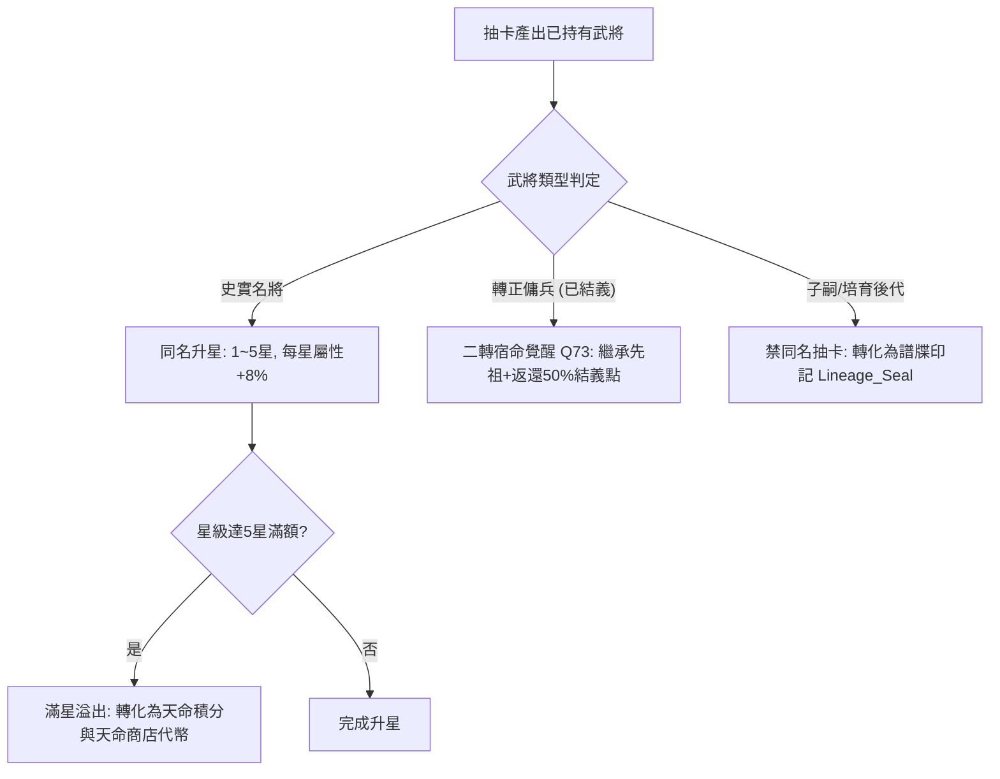

# 重複卡同名升星傭兵二轉與譜牒印記子孫晉升規格書

<!-- doc_id: doc_spec_0617 -->

> 本規格書依據 WBS `GCH-13`（重複卡連動：同名卡升星、傭兵二轉 Q73、譜牒印記子孫升星）制定，為轉蛋重複產出分流與跨世代升星連動之單一真相來源（Single Source of Truth）。
> 核心約束：無副作用純邏輯架構、史實名將同名 1~5 星階梯、傭兵轉正後同名二轉宿命覺醒、子嗣禁抽卡升星強制走譜牒印記、全繁體中文台灣慣用術語。

---

## 1. 業務定位與重複卡三重分流狀態機

轉蛋抽卡獲得已持有武將卡時，依據武將類型（史實名將、轉正傭兵、自定義子嗣）執行嚴格分流處理：



---

## 2. 三大核心機制詳細規則

### 2.1 史實名將同名升星（1~5 星）
- **升星消耗**：抽到同名卡立即提升 1 星（基礎 1 星 $\rightarrow$ 最高 5 星）。
- **數值加成**：每提升 1 星，該名將所有戰鬥五維基礎值永久 $+8\%$，5 星滿星時累計加成 $+32\%$。
- **溢出轉化**：當武將已達 5 星滿星時，再次抽到自動轉化為「結義點數 $\times 100$」與「天命神石 $\times 1$」。

### 2.2 轉正傭兵自動轉生突破（Q73 與 MERC-09 裁決定案）
- **前提條件**：傭兵已達成 60 點好感並完成「結義轉正（`IS_SWORN_BROTHER = true`）」，初始 0 轉基準單項五維上限為 `100`。
- **同名自動突破效果（不跳復生重練／血脈灌注分流彈窗）**：
  1. 結義轉正後再次抽到同名卡，直接觸發自動轉生突破，**每轉單項五維上限 `+5`（`+5%`）**（1 轉 `105`、2 轉 `110`、3 轉 `115`、4 轉 `120`、最高 5 轉 `125` 即 `+25%`）。
  2. 抽卡突破台詞動態顯示新上限（一般武將台詞不變），詳見 `doc_spec_0653`。
  3. 返還其當初結義消耗費用之 $50\%$ 點數，直接注入玩家國庫。

### 2.3 自定義子嗣與譜牒印記（Lineage Seal）
- **禁抽卡原則**：培育子嗣與後代武將為玩家專屬生成，卡池中絕不直接掉落子嗣卡。
- **譜牒印記升星**：玩家在抽卡或名將退役時獲得「譜牒印記（`Lineage_Seal`）」。
- **子嗣晉升公式**：消耗 $N_{\text{seal}} = \text{CurrentStar} \times 2$ 個譜牒印記，使指定子嗣星級 $+1$（最高 5 星）。

---

## 3. 資料模型與純邏輯介面

```typescript
export type GeneralType = 'HISTORICAL' | 'MERCENARY' | 'CHILD_LINEAGE';

export interface IDuplicateProcessInput {
    readonly generalId: string;
    readonly generalType: GeneralType;
    readonly currentStar: number; // 1..5
    readonly isSwornBrother: boolean;
    readonly swornCostPaid: number;
}

export interface IDuplicateProcessResult {
    readonly actionTaken: 'STAR_UP' | 'REBIRTH_STAGE_2' | 'LINEAGE_SEAL_CONVERT' | 'OVERFLOW_CURRENCY';
    readonly nextStar: number;
    readonly refundedBondPoints: number;
    readonly grantedLineageSeals: number;
    readonly grantedDestinyStones: number;
}

export function processDuplicateGeneral(input: IDuplicateProcessInput): IDuplicateProcessResult {
    if (input.generalType === 'CHILD_LINEAGE') {
        return {
            actionTaken: 'LINEAGE_SEAL_CONVERT',
            nextStar: input.currentStar,
            refundedBondPoints: 0,
            grantedLineageSeals: 2,
            grantedDestinyStones: 0,
        };
    }

    if (input.generalType === 'MERCENARY' && input.isSwornBrother) {
        return {
            actionTaken: 'REBIRTH_STAGE_2',
            nextStar: Math.min(5, input.currentStar + 1),
            refundedBondPoints: Math.floor(input.swornCostPaid * 0.50),
            grantedLineageSeals: 0,
            grantedDestinyStones: 0,
        };
    }

    // 史實名將升星
    if (input.currentStar < 5) {
        return {
            actionTaken: 'STAR_UP',
            nextStar: input.currentStar + 1,
            refundedBondPoints: 0,
            grantedLineageSeals: 0,
            grantedDestinyStones: 0,
        };
    }

    // 滿星溢出
    return {
        actionTaken: 'OVERFLOW_CURRENCY',
        nextStar: 5,
        refundedBondPoints: 100,
        grantedLineageSeals: 0,
        grantedDestinyStones: 1,
    };
}
```

---

## 4. 驗收測試案例（Test Cases）

| 測試編號 | 測試情境 | 輸入條件 | 預期輸出 |
|---|---|---|---|
| `TC-DUP-01` | 史實名將 1 星抽到同名升 2 星 | 趙雲 1 星，史實名將 | `actionTaken='STAR_UP'`, `nextStar=2` |
| `TC-DUP-02` | 史實名將 5 星滿額抽到溢出 | 關羽 5 星，再次抽中 | `actionTaken='OVERFLOW_CURRENCY'`, 獲 100 結義點 + 1 天命神石 |
| `TC-DUP-03` | 已結義傭兵二轉宿命覺醒 | 結義傭兵，付費 600 點，再次抽中 | `actionTaken='REBIRTH_STAGE_2'`, 退還 300 結義點 (50%) |
| `TC-DUP-04` | 子嗣轉化為譜牒印記 | 子嗣武將重複判定 | `actionTaken='LINEAGE_SEAL_CONVERT'`, 獲得 2 個譜牒印記 |
