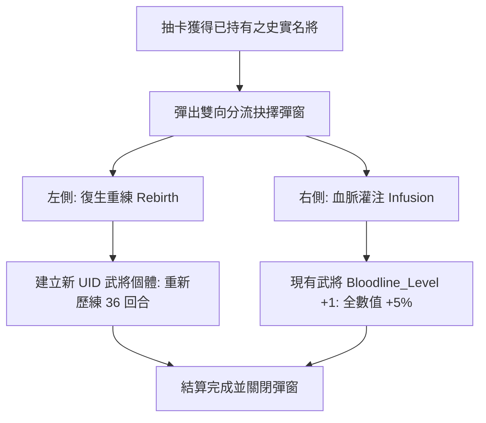

<!-- doc_id: doc_spec_0649 -->
# 重複名將分流彈窗UI契約與復生重練灌注雙向選擇規格書

> **規格代碼**：`DUP-01`
> **版本**：v1.0 (Single Source of Truth)
> **狀態**：正式定案 (Approved)
> **檔案大小限制**：嚴格 <6144 bytes

---

## 1. 系統定位與架構

本規格確立抽卡或結緣產出「已持有史實名將」時，彈出之「重複名將分流（Duplicate Hero Routing）」彈窗視覺佈局、雙向分流選擇契約與批次處置邏輯。
徹底終結將重複卡暴力折算為廉價碎片的落後設計，賦予玩家深度策略自主權。



---

## 2. 雙向分流抉擇卡片佈局契約

```typescript
export type DuplicateRoutingChoice = "REBIRTH_RETRAIN" | "BLOODLINE_INFUSION";

export interface DuplicatePopupPayload {
  generalId: string;
  generalName: string;
  portraitPath: string;
  currentBloodlineLevel: number;
  currentRebirthCount: number; // 0~5 轉
  batchTotalCount: number;     // 批次抽卡中重複總數
}
```

| 介面欄位 | 左側：復生重練 (`REBIRTH`) | 右側：血脈灌注 (`INFUSION`) |
|---|---|---|
| **核心按鈕** | `btn_confirm_rebirth` | `btn_confirm_infusion` (高亮推薦) |
| **機制說明** | 重獲新生！產生全新 UID 本體，可重新指派教官、走訪新戰法路線。 | 融魂歸一！不增新人，既有主將血脈等級 $+1$，全能力永久突破提升。 |
| **數值回報** | 保留原先祖英靈卡，轉生次數 $+1$（最高 5 轉，滿轉補償結義點）。 | 全屬性 $+5\%$、虎符經驗 $+150$、宗族聲望 $+50$，並寫入 `INFUSION_RECORD`。 |
| **視覺特效** | 鳳凰涅槃青焰火環動畫 | 金龍歸宗入體金光光柱動畫 |

---

## 3. 十連抽批次處置與安全防護

1. **批次處理按鈕（Batch Action Bar）**：
   - 底部常駐提供「一鍵全量灌注（`BTN_BATCH_INFUSION_ALL`）」，方便追求極限養成之重度玩家快速收口。
   - 勾選「不再提示本期重複卡」僅在當前會話有效，重啟遊戲後恢復彈窗審查。
2. **原子事務確認（Transaction Safety）**：
   - 選擇任一分流後，系統立即派發 `ON_DUPLICATE_GENERAL_ROUTED` 事件，完成本機存檔寫入與 Server 快照同步，嚴禁扣除重複卡卻未給予相應收益。
