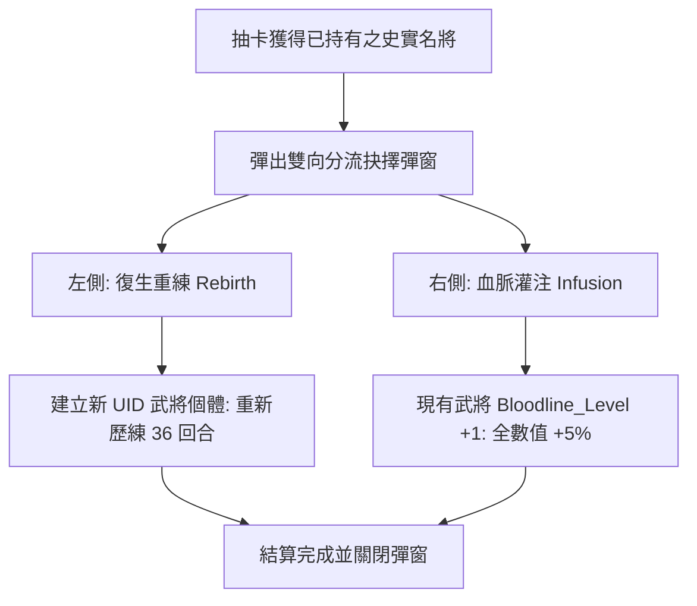

<!-- doc_id: doc_spec_0649 -->
# 重複名將分流彈窗UI契約與復生重練灌注雙向選擇規格書

> **規格代碼**：`DUP-01`
> **版本**：v1.0 (Single Source of Truth)
> **狀態**：正式定案 (Approved)
> **檔案大小限制**：嚴格 <6144 bytes

---

## 0. 使用者 2026-11-22 裁決：改為「三選一」（取代下方雙向分流）

- 彈窗標題「**宿命牽引・名將重逢**」，改為**三選一**：復生重練／升星／血脈灌注。原本只有兩個選項的雙向分流（§1～§2）作廢，以本節為準。
- **版面照第一版草稿**：`Design System 3/ui_kits/gacha/duplicate-popup.html`（1920×1080，疊在轉蛋結果畫面上；左側重逢名將與狀態章，右側三張選項卡，底列為批次沿用）。
- **升星推薦標籤**：當「升星」能讓同名卡集滿而升星時，在升星卡上顯示「推薦」標籤（原血脈灌注的「高亮推薦」改依此條件）。
- **史小境吐槽**：彈窗副標下方固定有一格史小境頭像加吐槽氣泡，台詞依武將／重逢次數取自文案庫（草稿例：「又是子龍？你們這緣分，月老看了都要排隊加號。」）。
- 血脈灌注卡在「未裝配英靈卡」時按鈕呈灰並顯示「未裝配英靈卡，無法灌注」；批次沿用（底列「本次抽卡批次預設沿用此選擇」）與「本次十連還有 N 位重複名將待處理」保留。
- 升星卡的集卡進度與星級門檻，以 `doc_spec_0005`（同名武將系統）為準。

## 1. 系統定位與架構（舊版雙向，已被 §0 取代）

本規格確立抽卡或結緣產出「已持有史實名將」時，彈出之「重複名將分流（Duplicate Hero Routing）」彈窗視覺佈局、雙向分流選擇契約與批次處置邏輯。
徹底終結將重複卡暴力折算為廉價碎片的落後設計，賦予玩家深度策略自主權。



---

## 2. 雙向分流抉擇卡片佈局契約

```typescript
export type DuplicateRoutingChoice = "REBIRTH_RETRAIN" | "BLOODLINE_INFUSION";

export interface DuplicatePopupPayload {
  generalId: string;
  generalName: string;
  portraitPath: string;
  currentBloodlineLevel: number;
  currentRebirthCount: number; // 0~5 轉
  batchTotalCount: number;     // 批次抽卡中重複總數
}
```

| 介面欄位 | 左側：復生重練 (`REBIRTH`) | 右側：血脈灌注 (`INFUSION`) |
|---|---|---|
| **核心按鈕** | `btn_confirm_rebirth` | `btn_confirm_infusion` (高亮推薦) |
| **機制說明** | 重獲新生！產生全新 UID 本體，可重新指派教官、走訪新戰法路線。 | 融魂歸一！不增新人，既有主將血脈等級 $+1$，全能力永久突破提升。 |
| **數值回報** | 保留原先祖英靈卡，轉生次數 $+1$（最高 5 轉，滿轉補償結義點）。 | 全屬性 $+5\%$、虎符經驗 $+150$、宗族聲望 $+50$，並寫入 `INFUSION_RECORD`。 |
| **視覺特效** | 鳳凰涅槃青焰火環動畫 | 金龍歸宗入體金光光柱動畫 |

---

## 3. 十連抽批次處置與安全防護

1. **批次處理按鈕（Batch Action Bar）**：
   - 底部常駐提供「一鍵全量灌注（`BTN_BATCH_INFUSION_ALL`）」，方便追求極限養成之重度玩家快速收口。
   - 勾選「不再提示本期重複卡」僅在當前會話有效，重啟遊戲後恢復彈窗審查。
2. **原子事務確認（Transaction Safety）**：
   - 選擇任一分流後，系統立即派發 `ON_DUPLICATE_GENERAL_ROUTED` 事件，完成本機存檔寫入與 Server 快照同步，嚴禁扣除重複卡卻未給予相應收益。

## 變更記錄

- 2026-11-22：新增 §0，由雙向分流改為三選一（復生重練／升星／血脈灌注），含升星推薦標籤與史小境吐槽，版面照 `Design System 3/ui_kits/gacha/duplicate-popup.html` 第一版（使用者 2026-11-22 裁決）。任務卡 PROG-2-9733。
