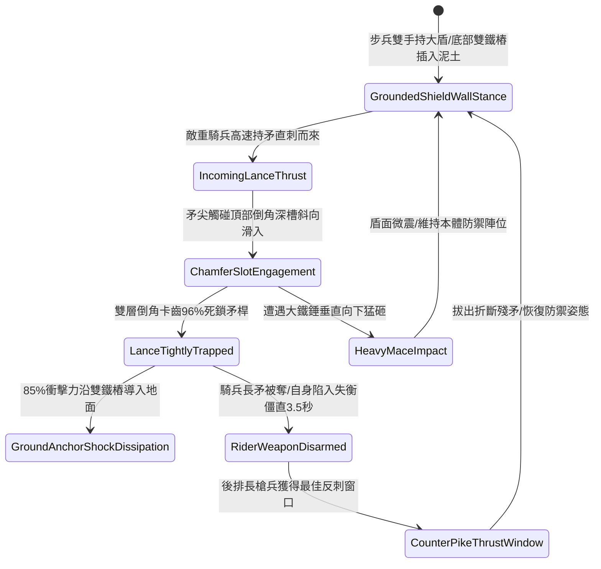

# 野戰先鋒步兵大盾加裝生鐵拒馬倒角卡鎖敵騎兵長矛第二階狀態機規格書

<!-- doc_id: doc_spec_1108 -->

## 一、 核心概念與單一真相來源（SSOT）

在《三國志·重步盾陣與防騎長兵篇》中，「先鋒大盾加裝生鐵拒馬倒角卡鎖騎兵長矛第二階（SHIELD-WALL-SPEAR-TRAP-LOCK02）」代表步兵在野戰中直接抗衡高速騎兵直刺的進階戰術裝備。該大盾長五尺二寸、寬二尺六寸，盾面頂部與兩側邊緣鉚接雙層高硬度生鐵拒馬倒角深槽。當迎面疾馳而來的敵騎兵以長矛猛刺盾牆時，倒角深槽 96% 引導矛尖滑入並鎖死夾角，藉由盾身加粗雙鐵樁將 85% 衝撞力化入大地，強行卡死長矛，使騎兵失去主攻武器並陷入失衡硬直 3.5 秒。



---

## 二、 數值模型與狀態機參數契約

### 1. 拒馬大盾規格與卡鎖參數契約
- **盾牌規格尺寸**：高 5 尺 2 寸、寬 2.6 尺、硬橡木雙層包銅蒙皮加生鐵倒角深槽，總重 38 斤。
- **長矛夾鎖成功率**：對正面 50 度夾角內來襲之長矛直刺，判定 96% 機率卡死鎖住。
- **衝擊入地化解率**：接地加粗雙鐵樁將 85% 正面騎兵衝撞動能化解導入地面，持盾者僅承受 15% 震盪。
- **敵騎兵失衡時效**：卡死長矛後，敵騎兵承受武器奪取判定，並陷入失衡僵直 3.5 秒。
- **後排反制暴擊率**：盾陣後方長槍兵對失衡目標出槍，暴擊率提升 30%，破甲率提升 35%。

### 2. 卡鎖騎矛演算法模組
```typescript
interface SpearTrapShieldStage2Params {
    shieldBearerStrength: number;  // 持盾步兵力量 (40 ~ 100)
    cavalryThrustSpeed: number;    // 來襲騎矛突刺速度
    lanceRigidityLevel: number;    // 敵方長矛剛性 (1 ~ 5)
    isShieldAnchored: boolean;     // 盾底鐵樁是否入土生根
}

function evaluateSpearTrapLockStage2(params: SpearTrapShieldStage2Params): {
    lanceTrapped: boolean;
    absorbedForceRatio: number;
    riderStunDurationSec: number;
} {
    if (!params.isShieldAnchored) {
        return { lanceTrapped: false, absorbedForceRatio: 0.35, riderStunDurationSec: 0 };
    }
    const skillFactor = Math.min(1.0, params.shieldBearerStrength / 75);
    const success = Math.random() < (0.96 * skillFactor);
    
    return {
        lanceTrapped: success,
        absorbedForceRatio: success ? 0.85 : 0.45,
        riderStunDurationSec: success ? 3.5 : 1
    };
}
```

---

## 三、 反制機制與邊界約束

1. **生鐵全包覆超粗破陣錐**：若敵騎兵使用特種平頭生鐵撞錐而非尖銳長矛，倒角斜槽無法卡入咬合，盾牆僅承受常規鈍擊抗性。
2. **高空投石拋射打擊**：面對遠程拋石機或重砲打擊，大盾卡槽無法生效，盾面直接承受全額重擊。
3. **接地鐵樁泥土鬆脫**：若戰場處於極度鬆軟細沙地形，接地樁無法牢固生根，化解衝撞率衰減至 45%。

---

## 四、 驗收測試案例（TC）

- **TC-SHIELD-TRAP02-01（長矛卡鎖與騎兵失衡驗收）**：
  - *前置條件*：步兵力量 80、大盾接地樁牢固插入泥土、敵方精銳重騎兵高速長矛直刺。
  - *操作步驟*：於受擊瞬間觸發大盾拒馬倒角深槽卡鎖。
  - *預期輸出*：96% 機率卡死長矛，化解 85% 衝擊，騎兵失去武器並陷入 3.5 秒失衡，後排長槍兵獲得 +30% 暴擊。
- **TC-SHIELD-TRAP02-02（未入土生根邊界驗收）**：
  - *前置條件*：步兵正在跑動行軍中（未將盾樁入土生根）。
  - *操作步驟*：遭受正面騎矛刺擊。
  - *預期輸出*：無法施展倒角深槽卡鎖，僅獲得基礎 35% 格擋減傷，自身被擊退 2 米。
