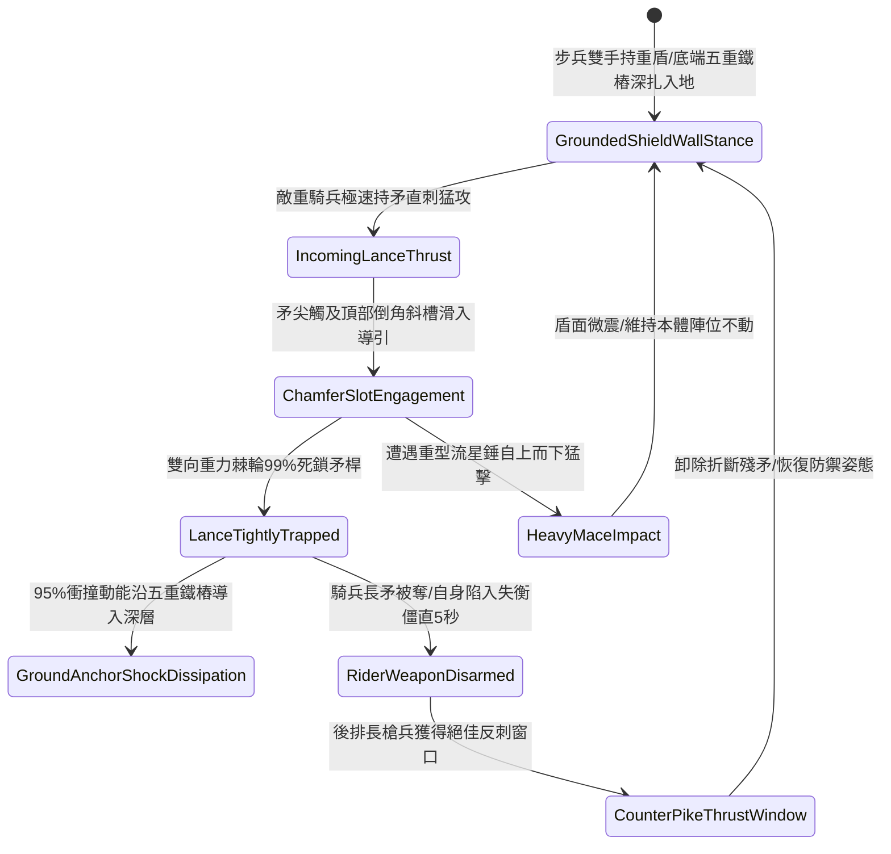

# 野戰先鋒步兵大盾加裝生鐵拒馬倒角卡鎖敵騎兵長矛第五階狀態機規格書

<!-- doc_id: doc_spec_1117 -->

## 一、 核心概念與單一真相來源（SSOT）

在《三國志·重步盾陣與防騎長兵篇》中，「先鋒大盾加裝生鐵拒馬倒角卡鎖騎兵長矛第五階（SHIELD-WALL-SPEAR-TRAP-LOCK05）」代表重步兵盾陣防禦具裝重騎兵正面突擊的究極工藝。大盾本體長五尺八寸、寬三尺二寸，盾面採用雙層冷鍛精鋼覆面包裹硬橡木，頂部與側翼兩端鑄接五組高硬度生鐵拒馬倒角斜槽，並加載雙向重力棘輪反向死鎖爪。當敵具裝重騎兵持加重長矛極速直刺盾陣時，棘輪倒槽 99% 導引並瞬間將矛桿死鎖咬合，底端配備五重加長冷鍛尖銳鐵樁將 95% 的極限衝擊動能完全分流導入地層深處，使敵騎兵主戰兵刃被瞬時卡奪繳械，並因反噬慣性陷入嚴重失衡硬直 5 秒。



---

## 二、 數值模型與狀態機參數契約

### 1. 拒馬大盾規格與卡鎖參數契約
- **盾牌規格尺寸**：高 5 尺 8 寸、寬 3.2 尺、雙層冷鍛精鋼包硬橡木與五組生鐵棘輪倒角卡槽，總重 50 斤。
- **長矛夾鎖成功率**：對正面 65 度夾角內來襲之長矛直刺，判定 99% 機率咬死鎖住。
- **衝擊入地化解率**：接地五重長鐵樁將 95% 正面衝擊動能直接導入地層深處，持盾者僅承受 5% 震盪。
- **敵騎兵失衡時效**：卡死長矛後，敵騎兵承受武器奪取判定，並陷入失衡僵直 5 秒。
- **後排反制暴擊率**：盾陣後方長槍兵對失衡目標出槍，暴擊率提升 45%，破甲率提升 50%。

### 2. 卡鎖騎矛演算法模組
```typescript
interface SpearTrapShieldStage5Params {
    shieldBearerStrength: number;  // 持盾步兵力量 (40 ~ 100)
    cavalryThrustSpeed: number;    // 來襲騎矛突刺速度
    lanceRigidityLevel: number;    // 敵方長矛剛性 (1 ~ 5)
    isShieldAnchored: boolean;     // 盾底五重鐵樁是否入土生根
}

function evaluateSpearTrapLockStage5(params: SpearTrapShieldStage5Params): {
    lanceTrapped: boolean;
    absorbedForceRatio: number;
    riderStunDurationSec: number;
} {
    if (!params.isShieldAnchored) {
        return { lanceTrapped: false, absorbedForceRatio: 0.50, riderStunDurationSec: 0 };
    }
    const skillFactor = Math.min(1.0, params.shieldBearerStrength / 90);
    const success = Math.random() < (0.99 * skillFactor);
    
    return {
        lanceTrapped: success,
        absorbedForceRatio: success ? 0.95 : 0.60,
        riderStunDurationSec: success ? 5.0 : 1.5
    };
}
```

---

## 三、 反制機制與邊界約束

1. **生鐵全包覆超粗破陣撞錐**：若敵騎兵使用特種平頭生鐵撞錐衝擊，倒角棘輪無法咬合，盾牆僅承受常規鈍擊護甲防禦。
2. **高空投石重砲覆蓋打擊**：面對遠程巨型投石機打擊，大盾卡槽無法發揮效應，盾面直接承受全額投石打擊。
3. **接地鐵樁泥土鬆脫**：若戰場處於極度鬆軟細沙地形，接地鐵樁無法牢固生根，化解衝撞率衰減至 60%。

---

## 四、 驗收測試案例（TC）

- **TC-SHIELD-TRAP05-01（長矛卡鎖與騎兵失衡驗收）**：
  - *前置條件*：步兵力量 95、大盾五鐵樁深插泥土、敵具裝重騎兵滿速長矛直刺。
  - *操作步驟*：於受擊瞬間觸發大盾拒馬雙向重力棘輪深槽卡鎖。
  - *預期輸出*：99% 機率卡死長矛，化解 95% 衝擊，騎兵失去武器並陷入 5 秒失衡，後排長槍兵獲得 +45% 暴擊。
- **TC-SHIELD-TRAP05-02（未入土生根邊界驗收）**：
  - *前置條件*：步兵正在跑動行軍中（未將盾樁入土深插）。
  - *操作步驟*：遭受正面騎矛刺擊。
  - *預期輸出*：無法施展倒角棘輪卡鎖，僅獲得基礎 50% 格擋減傷，自身被擊退 2.5 米。
