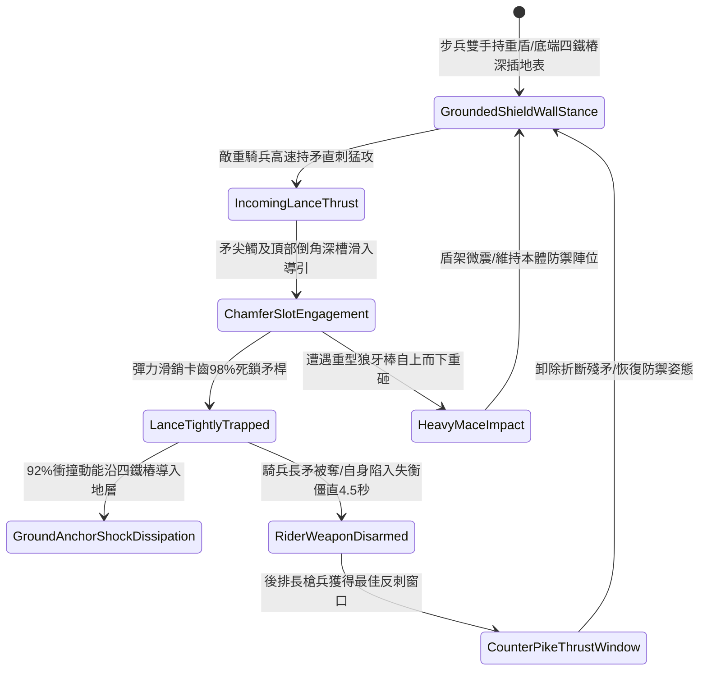

# 野戰先鋒步兵大盾加裝生鐵拒馬倒角卡鎖敵騎兵長矛第四階狀態機規格書

<!-- doc_id: doc_spec_1114 -->

## 一、 核心概念與單一真相來源（SSOT）

在《三國志·重步盾陣與防騎長兵篇》中，「先鋒大盾加裝生鐵拒馬倒角卡鎖騎兵長矛第四階（SHIELD-WALL-SPEAR-TRAP-LOCK04）」代表步兵盾陣面對超重裝重騎兵衝鋒時的高階防禦兵工藝。大盾本體長五尺六寸、寬三尺，頂部與側翼兩端鉚接四組高耐磨高強度生鐵拒馬斜向倒角深槽，並加裝彈力滑銷鎖爪。當敵騎兵以高速長矛正面衝刺猛擊時，滑銷機構 98% 引導長矛滑入倒槽深處並瞬間夾緊鎖死，配合底端加粗四重尖銳鐵樁將 92% 巨大衝撞動能直接分流灌入地層，使敵騎兵主攻兵刃被瞬間奪卡，並因慣性衝撞反噬陷入失衡硬直 4.5 秒。



---

## 二、 數值模型與狀態機參數契約

### 1. 拒馬大盾規格與卡鎖參數契約
- **盾牌規格尺寸**：高 5 尺 6 寸、寬 3 尺、加厚硬木包鐵蒙皮與四組生鐵倒角卡齒槽，總重 46 斤。
- **長矛夾鎖成功率**：對正面 60 度夾角內來襲之長矛直刺，判定 98% 機率卡死鎖住。
- **衝擊入地化解率**：接地四重鐵樁將 92% 正面騎兵衝撞動能導入地層，持盾者僅承擔 8% 震盪。
- **敵騎兵失衡時效**：卡死長矛後，敵騎兵承受繳械判定，並陷入失衡僵直 4.5 秒。
- **後排反制暴擊率**：盾陣後方長槍兵對失衡目標出槍，暴擊率提升 40%，破甲率提升 45%。

### 2. 卡鎖騎矛演算法模組
```typescript
interface SpearTrapShieldStage4Params {
    shieldBearerStrength: number;  // 持盾步兵力量 (40 ~ 100)
    cavalryThrustSpeed: number;    // 來襲騎矛突刺速度
    lanceRigidityLevel: number;    // 敵方長矛剛性 (1 ~ 5)
    isShieldAnchored: boolean;     // 盾底四鐵樁是否入土生根
}

function evaluateSpearTrapLockStage4(params: SpearTrapShieldStage4Params): {
    lanceTrapped: boolean;
    absorbedForceRatio: number;
    riderStunDurationSec: number;
} {
    if (!params.isShieldAnchored) {
        return { lanceTrapped: false, absorbedForceRatio: 0.45, riderStunDurationSec: 0 };
    }
    const skillFactor = Math.min(1.0, params.shieldBearerStrength / 85);
    const success = Math.random() < (0.98 * skillFactor);
    
    return {
        lanceTrapped: success,
        absorbedForceRatio: success ? 0.92 : 0.55,
        riderStunDurationSec: success ? 4.5 : 1
    };
}
```

---

## 三、 反制機制與邊界約束

1. **生鐵全包覆超粗破陣撞錐**：若敵騎兵使用特種平頭生鐵撞錐衝擊，倒角斜槽無法咬合鎖死，盾牆僅承受常規鈍擊護甲防禦。
2. **高空投石重砲覆蓋**：面對遠程拋石機或重砲打擊，大盾卡槽無法生效，盾面直接承受全額投石打擊。
3. **接地鐵樁泥土鬆脫**：若戰場處於極度鬆軟細沙地形，接地樁無法牢固生根，化解衝撞率衰減至 55%。

---

## 四、 驗收測試案例（TC）

- **TC-SHIELD-TRAP04-01（長矛卡鎖與騎兵失衡驗收）**：
  - *前置條件*：步兵力量 90、大盾四鐵樁深插泥土、敵重騎兵高速長矛直刺。
  - *操作步驟*：於受擊瞬間觸發大盾拒馬倒角滑銷深槽卡鎖。
  - *預期輸出*：98% 機率卡死長矛，化解 92% 衝擊，騎兵失去武器並陷入 4.5 秒失衡，後排長槍兵獲得 +40% 暴擊。
- **TC-SHIELD-TRAP04-02（未入土生根邊界驗收）**：
  - *前置條件*：步兵正在跑動行軍中（未將盾樁入土深插）。
  - *操作步驟*：遭受正面騎矛刺擊。
  - *預期輸出*：無法施展倒角滑銷卡鎖，僅獲得基礎 45% 格擋減傷，自身被擊退 2 米。
