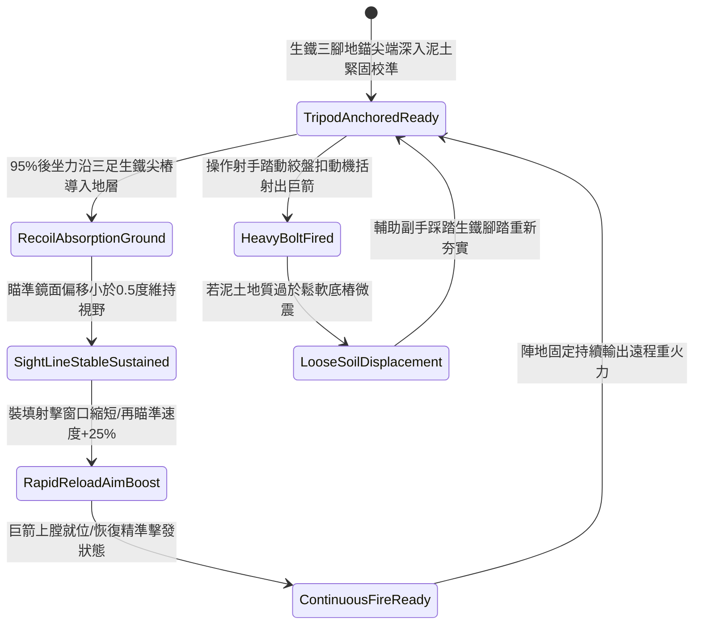

# 野戰精銳弩兵床弩加裝生鐵三腳地錨支架防後坐力偏移第一階狀態機規格書

<!-- doc_id: doc_spec_1120 -->

## 一、 核心概念與單一真相來源（SSOT）

在《三國志·重步兵遠程軍械與床弩戰術篇》中，「野戰精銳弩兵床弩加裝生鐵三腳地錨支架第一階（HEAVY-CROSSBOW-TRIPOD-STABILIZER01）」代表野戰陣地部署重型床弩時的精準射擊穩定系統。該支架採用冷鍛生鐵打造三足外張三腳架，底端各鑄造一道一尺長尖銳生鐵地樁扎入泥土，頂部以旋轉球臼緊固床弩主樑。當床弩擊發粗重踏張巨箭時，三腳地錨 95% 將強大的發射後坐力垂直導入地底，將瞄準鏡面跳動位移控制在 0.5 度以內，並使次發連續裝填瞄準速度提升 25%，對遠距密集敵陣保持高效火力覆蓋。



---

## 二、 數值模型與狀態機參數契約

### 1. 床弩三腳穩定支架參數契約
- **支架規格尺寸**：高 4 尺、外張足距 5 尺，冷鍛生鐵管壁厚 5 分，總重量 85 斤。
- **生鐵地樁長度**：三足尖端各附 1 尺長螺旋防退尖樁，生根深度 1 尺。
- **後坐力吸收率**：發射瞬間，95% 機率將巨箭反衝動能垂直分流至地面。
- **瞄準角跳動抑制**：射擊瞬間俯仰角與偏航角跳動誤差小於 0.5 度（未安裝支架時為 4.5 度）。
- **射速與命中加成**：連續射擊時裝填再瞄準耗時縮減 25%，百步外命中率提升 20%。

### 2. 支架穩定性演算法模組
```typescript
interface CrossbowTripodStage1Params {
    soilFirmnessLevel: number;     // 地面堅實係數 (0.0: 鬆沙 ~ 1.0: 堅土)
    boltImpactKickback: number;    // 弩箭擊發後坐力 (牛頓)
    isTripodAnchored: boolean;     // 三足地樁是否踩踏入土
    crewOperatorStrength: number;  // 弩手組平均力量
}

function evaluateCrossbowTripodStage1(params: CrossbowTripodStage1Params): {
    stabilityMaintained: boolean;
    aimDisplacementDegrees: number;
    reloadTimeBonusPct: number;
} {
    if (!params.isTripodAnchored || params.soilFirmnessLevel < 0.3) {
        return { stabilityMaintained: false, aimDisplacementDegrees: 3.5, reloadTimeBonusPct: 0 };
    }
    const success = Math.random() < 0.95;
    
    return {
        stabilityMaintained: success,
        aimDisplacementDegrees: success ? 0.4 : 1.8,
        reloadTimeBonusPct: success ? 25 : 5
    };
}
```

---

## 三、 反制機制與邊界約束

1. **極度鬆軟細沙地形**：在鬆散沙漠或極深淤泥中，地樁無法提供垂直支撐力，後坐力化解率衰減至 40%。
2. **騎兵高速繞後側襲**：三腳支架展開後整體重量較沉，面對敵騎兵從兩翼快速迂迴時，轉向調轉弩身需耗時 6 秒。
3. **近身肉搏衝撞掀翻**：敵步兵若突破正面盾陣突入近身，以重盾猛撞三腳架側足，有 30% 機率破壞地錨平穩。

---

## 四、 驗收測試案例（TC）

- **TC-XBOW-TRIPOD01-01（巨箭連發穩定性驗收）**：
  - *前置條件*：堅實泥土地質、三足地錨踩踏生根、操作射手力量合格。
  - *操作步驟*：連續發射三枚重型踏張破甲巨箭。
  - *預期輸出*：95% 機率穩定吸收後坐力，瞄準鏡跳動小於 0.5 度，裝填瞄準速度提升 25%，精度保持平穩。
- **TC-XBOW-TRIPOD01-02（地樁未入土邊界驗收）**：
  - *前置條件*：弩機架設於堅硬青石板路面（地樁無法刺入）。
  - *操作步驟*：直接扣動機括發射。
  - *預期輸出*：三腳架產生後移跳動，瞄準角度偏轉 3.5 度，再瞄準加成歸零。
