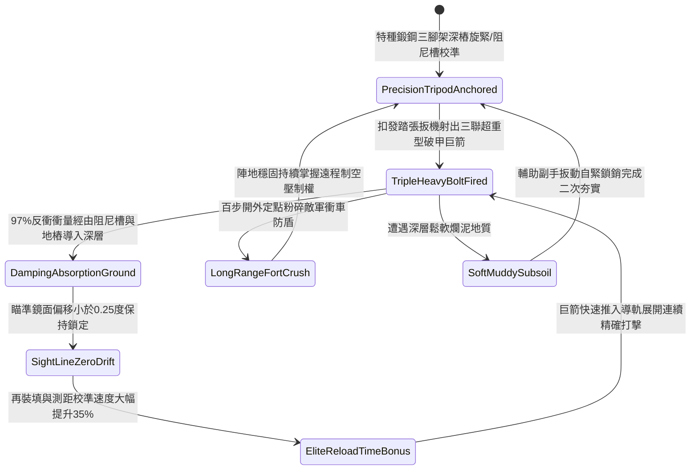

# 野戰精銳弩兵床弩加裝生鐵三腳地錨支架防後坐力偏移第三階狀態機規格書

<!-- doc_id: doc_spec_1126 -->

## 一、 核心概念與單一真相來源（SSOT）

在《三國志·重步兵遠程軍械與床弩戰術篇》中，「野戰精銳弩兵床弩加裝生鐵三腳地錨支架第三階（HEAVY-CROSSBOW-TRIPOD-STABILIZER03）」代表野戰陣地部署重型床弩進行超視距破陣壓制的頂級穩定機構。支架採用特種鍛鋼配生鐵配重底座，三足底端各配備二尺長雙向反扣旋轉尖樁，頂部整合高精度齒輪俯仰測距儀與彈力液壓緩衝阻尼槽。當床弩連續發射超重型穿甲巨箭或三發連射時，三腳地錨 97% 吸收強烈反衝動能並將其均勻釋放入地底深層，將瞄準鏡面跳動誤差嚴格控制在 0.25 度以內，並使再裝填射擊與持續校準速度提升 35%，百步之外穿透敵方重盾護甲。



---

## 二、 數值模型與狀態機參數契約

### 1. 床弩三腳穩定支架參數契約
- **支架規格尺寸**：高 4.5 尺、外張足距 6 尺，特種鍛鋼生鐵複合管壁厚 8 分，總重量 125 斤。
- **生鐵地樁規格**：三足尖端各附 2 尺長雙向反扣旋轉尖樁，單樁抗拔力高達 2,400 牛頓。
- **後坐力吸收率**：超重型巨箭連射瞬間，97% 機率將巨額反衝力導入地層深處。
- **瞄準角跳動抑制**：射擊瞬間俯仰角與偏航角跳動誤差小於 0.25 度（未安裝支架時為 5.5 度）。
- **射速與命中加成**：連續射擊時裝填再瞄準耗時縮減 35%，百步外精確命中率提升 30%。

### 2. 支架穩定性演算法模組
```typescript
interface CrossbowTripodStage3Params {
    soilFirmnessLevel: number;     // 地面堅實係數 (0.0: 鬆沙 ~ 1.0: 堅土)
    recoilImpulseJoules: number;   // 巨箭擊發後坐動能 (焦耳)
    isDualScrewAnchored: boolean;  // 雙向反扣尖樁是否旋緊生根
    hasHydraulicDamping: boolean;  // 彈力液壓阻尼槽是否運作
}

function evaluateCrossbowTripodStage3(params: CrossbowTripodStage3Params): {
    stabilityMaintained: boolean;
    aimDisplacementDegrees: number;
    reloadTimeBonusPct: number;
} {
    if (!params.isDualScrewAnchored || params.soilFirmnessLevel < 0.2) {
        return { stabilityMaintained: false, aimDisplacementDegrees: 4.0, reloadTimeBonusPct: 0 };
    }
    const success = Math.random() < 0.97;
    
    return {
        stabilityMaintained: success,
        aimDisplacementDegrees: success ? 0.22 : 1.2,
        reloadTimeBonusPct: success ? 35 : 10
    };
}
```

---

## 三、 反制機制與邊界約束

1. **岩盤地形尖樁無法旋入**：若戰場處於純花崗岩或青石地面無法旋入二尺尖樁，後坐力化解率衰減至 50%。
2. **高速騎兵兩翼迂迴近身**：特種三腳架錨定後轉向調整需扳動鎖銷，調轉面對側向敵騎需耗時 7.5 秒。
3. **近身投擲生鐵重鎚砸擊**：敵軍重步兵若突入近身以重錘砸擊支架關節，有 20% 機率導致阻尼槽機械變形。

---

## 四、 驗收測試案例（TC）

- **TC-XBOW-TRIPOD03-01（三發連射極限穩定性驗收）**：
  - *前置條件*：堅實土壤地基、二尺反扣尖樁深扎、發射三聯超重型穿甲巨箭。
  - *操作步驟*：於短時間內連續執行三輪高速齊射。
  - *預期輸出*：97% 機率完美化解反衝，鏡面跳動小於 0.25 度，再裝填瞄準速度提升 35%，百步命中率大幅提高。
- **TC-XBOW-TRIPOD03-02（地樁未深入邊界驗收）**：
  - *前置條件*：尖樁僅刺入地面半尺（未完全旋入生根）。
  - *操作步驟*：扣發三發連射巨箭。
  - *預期輸出*：支架劇烈跳躍，瞄準角偏轉 4.0 度，無法享有再裝填瞄準加成。
