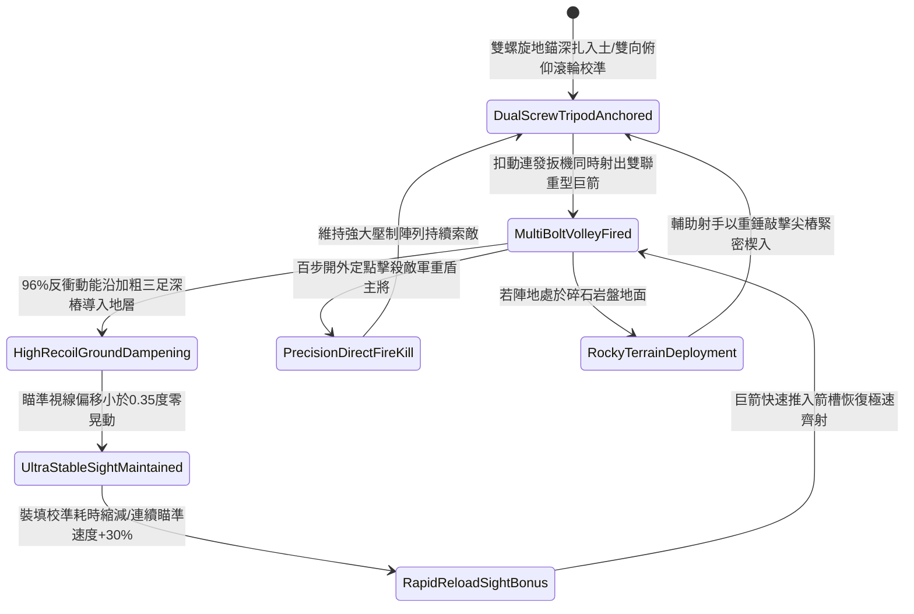

# 野戰精銳弩兵床弩加裝生鐵三腳地錨支架防後坐力偏移第二階狀態機規格書

<!-- doc_id: doc_spec_1123 -->

## 一、 核心概念與單一真相來源（SSOT）

在《三國志·重步兵遠程軍械與床弩戰術篇》中，「野戰精銳弩兵床弩加裝生鐵三腳地錨支架第二階（HEAVY-CROSSBOW-TRIPOD-STABILIZER02）」代表野戰陣地遠程壓制火力向重型連發穩定系統的演進。該三腳架採用加粗高碳冷鍛生鐵打造，三足底端各配備一尺五寸雙螺旋防拔生鐵尖樁，頂部改進為雙向重力微調俯仰滾輪與自鎖卡榫。當床弩連續擊發雙聯或三聯重型破甲巨箭時，加固三腳支架 96% 承接強勁反衝動能並將其直接壓入地層深處，將瞄準鏡跳動偏移壓制在 0.35 度以內，並使再裝填與持續瞄準校驗速度提升 30%，維持超遠距離極高精準度。



---

## 二、 數值模型與狀態機參數契約

### 1. 床弩三腳穩定支架參數契約
- **支架規格尺寸**：高 4.2 尺、外張足距 5.5 尺，高碳生鐵管壁加厚至 7 分，總重量 105 斤。
- **螺旋地樁規格**：三足尖端各附 1.5 尺雙螺旋防拔尖樁，深扎泥土具備抗拔力 1,800 牛頓。
- **後坐力吸收率**：多發巨箭連射瞬間，96% 機率將巨額反衝力導入地表土層。
- **瞄準角跳動抑制**：射擊瞬間俯仰角與偏航角跳動誤差小於 0.35 度（未安裝支架時為 5.0 度）。
- **射速與命中加成**：連續射擊時裝填再瞄準耗時縮減 30%，百步外精確命中率提升 25%。

### 2. 支架穩定性演算法模組
```typescript
interface CrossbowTripodStage2Params {
    soilFirmnessLevel: number;     // 地面堅實係數 (0.0: 鬆沙 ~ 1.0: 堅土)
    multiBoltRecoilForce: number;  // 多發巨箭連射後坐力 (牛頓)
    isDualScrewAnchored: boolean;  // 雙螺旋地樁是否深入土壤
    crewTrainedLevel: number;      // 弩手組訓練等級 (1 ~ 5)
}

function evaluateCrossbowTripodStage2(params: CrossbowTripodStage2Params): {
    stabilityMaintained: boolean;
    aimDisplacementDegrees: number;
    reloadTimeBonusPct: number;
} {
    if (!params.isDualScrewAnchored || params.soilFirmnessLevel < 0.25) {
        return { stabilityMaintained: false, aimDisplacementDegrees: 3.8, reloadTimeBonusPct: 0 };
    }
    const skillMultiplier = Math.min(1.0, 0.8 + (params.crewTrainedLevel * 0.05));
    const success = Math.random() < (0.96 * skillMultiplier);
    
    return {
        stabilityMaintained: success,
        aimDisplacementDegrees: success ? 0.3 : 1.5,
        reloadTimeBonusPct: success ? 30 : 8
    };
}
```

---

## 三、 反制機制與邊界約束

1. **岩石硬化地面無法下樁**：若戰場處於純堅硬花崗石或城磚鋪面，地樁無法旋入，後坐力化解率衰減至 45%。
2. **騎兵高速繞後側翼突襲**：重型雙螺旋支架展開後重心穩固但轉向遲緩，面對敵騎兵側翼包抄時調轉需耗時 7 秒。
3. **近身投擲重石劇烈震盪**：敵投石車若近距離在三腳架側向五步內著彈，強烈震波有 25% 機率震鬆螺旋地樁。

---

## 四、 驗收測試案例（TC）

- **TC-XBOW-TRIPOD02-01（雙聯巨箭連射穩定性驗收）**：
  - *前置條件*：堅實泥土環境、雙螺旋地樁深入 1.5 尺、發射雙聯重型破甲巨箭。
  - *操作步驟*：於短時間內連續執行兩輪雙聯齊射。
  - *預期輸出*：96% 機率平穩吸收後坐力，瞄準視線跳動小於 0.35 度，再瞄準速度提升 30%，命中率大幅增強。
- **TC-XBOW-TRIPOD02-02（未旋入地樁邊界驗收）**：
  - *前置條件*：螺旋地樁僅接觸地表（未深入旋緊）。
  - *操作步驟*：強行扣機發射多聯巨箭。
  - *預期輸出*：三腳架產生劇烈跳起震顫，瞄準角度偏移 3.8 度，無法享有再裝填瞄準速度加成。
