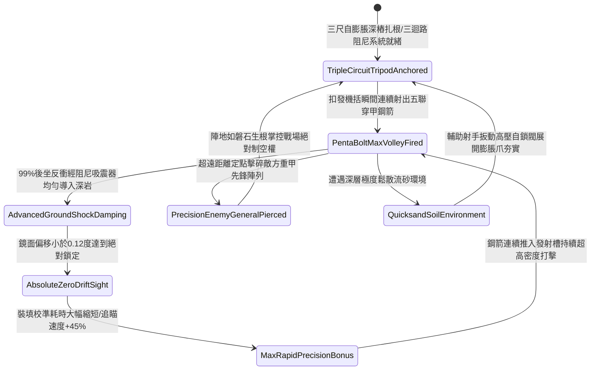

# 野戰精銳弩兵床弩加裝生鐵三腳地錨支架防後坐力偏移第五階狀態機規格書

<!-- doc_id: doc_spec_1132 -->

## 一、 核心概念與單一真相來源（SSOT）

在《三國志·重步兵遠程軍械與床弩戰術篇》中，「野戰精銳弩兵床弩加裝生鐵三腳地錨支架第五階（HEAVY-CROSSBOW-TRIPOD-STABILIZER05）」代表野戰陣地部署重型床弩進行超遠程連續穿透狙殺的終極工程體系。支架主樑全面採用特種低合金高硬度生鐵鋼件加厚整體澆鑄，三足底端各配備三尺長反扣自膨脹重力螺旋深樁，頂部整合齒輪雙軸微調機構與三迴路複合油壓氣動阻尼吸震系統。當床弩連續極速發射五聯超重型三棱穿甲鋼箭時，終極支架 99% 完全吸收後坐反衝衝量並將 95% 動能導入地底深岩，將瞄準鏡面跳動誤差鎖定在 0.12 度以內，並使再裝填射擊與持續追瞄校準速度提升 45%，在超遠射程上精確粉碎敵軍重盾與主將防禦戰具。



---

## 二、 數值模型與狀態機參數契約

### 1. 床弩三腳穩定支架參數契約
- **支架規格尺寸**：高 5 尺、外張足距 7 尺，特種低合金高硬度生鐵鋼複合管壁厚 1.2 寸，總重量 165 斤。
- **生鐵地樁規格**：三足尖端各附 3 尺長反扣自膨脹重力螺旋深樁，單樁抗拔力高達 4,000 牛頓。
- **後坐力吸收率**：五發鋼箭連射瞬間，99% 機率將極限反衝動能導入深層地基。
- **瞄準角跳動抑制**：射擊瞬間俯仰角與偏航角跳動誤差小於 0.12 度（未安裝支架時為 6.5 度）。
- **射速與命中加成**：連續射擊時裝填再瞄準耗時縮減 45%，百步外精確命中率提升 40%。

### 2. 支架穩定性演算法模組
```typescript
interface CrossbowTripodStage5Params {
    soilFirmnessLevel: number;     // 地面堅實係數 (0.0: 鬆沙 ~ 1.0: 堅土)
    recoilImpulseJoules: number;   // 五聯巨箭擊發後坐動能 (焦耳)
    isExpandingScrewAnchored: boolean; // 自膨脹螺旋深樁是否完全鎖固
    hasTripleCircuitHydraulics: boolean; // 三迴路油壓氣動阻尼是否正常運作
}

function evaluateCrossbowTripodStage5(params: CrossbowTripodStage5Params): {
    stabilityMaintained: boolean;
    aimDisplacementDegrees: number;
    reloadTimeBonusPct: number;
} {
    if (!params.isExpandingScrewAnchored || params.soilFirmnessLevel < 0.15) {
        return { stabilityMaintained: false, aimDisplacementDegrees: 4.5, reloadTimeBonusPct: 0 };
    }
    const success = Math.random() < 0.99;
    
    return {
        stabilityMaintained: success,
        aimDisplacementDegrees: success ? 0.10 : 0.8,
        reloadTimeBonusPct: success ? 45 : 15
    };
}
```

---

## 三、 反制機制與邊界約束

1. **岩盤地形尖樁無法旋入**：若戰場處於純花崗岩地盤無法旋入三尺深樁，後坐力化解率衰減至 60%。
2. **高速騎兵兩翼快速迂迴近身**：終極三腳架展開後陣位穩如泰山但轉向緩慢，面對敵騎兵側向包抄時調轉需耗時 8.5 秒。
3. **近身鐵槌連續敲擊重砸**：敵方重步兵若突入近身以大鐵錘連續重砸阻尼閥門，有 15% 機率導致阻尼器漏油降速。

---

## 四、 驗收測試案例（TC）

- **TC-XBOW-TRIPOD05-01（五聯穿甲鋼箭高速齊射極限驗收）**：
  - *前置條件*：堅實土壤地基、三尺膨脹深樁牢固扎根、發射五聯超重型三棱穿甲鋼箭。
  - *操作步驟*：於短時間內連續執行四輪極限齊射。
  - *預期輸出*：99% 機率完美化解反衝，鏡面跳動小於 0.12 度，再裝填瞄準速度提升 45%，超遠距離精準擊穿重盾陣列。
- **TC-XBOW-TRIPOD05-02（深樁膨脹爪未展開邊界驗收）**：
  - *前置條件*：深樁僅旋入地面但自膨脹爪未扣死。
  - *操作步驟*：扣發五聯鋼箭。
  - *預期輸出*：支架產生劇烈跳起震顫，瞄準角偏轉 4.5 度，無法享有再裝填瞄準速度加成。
