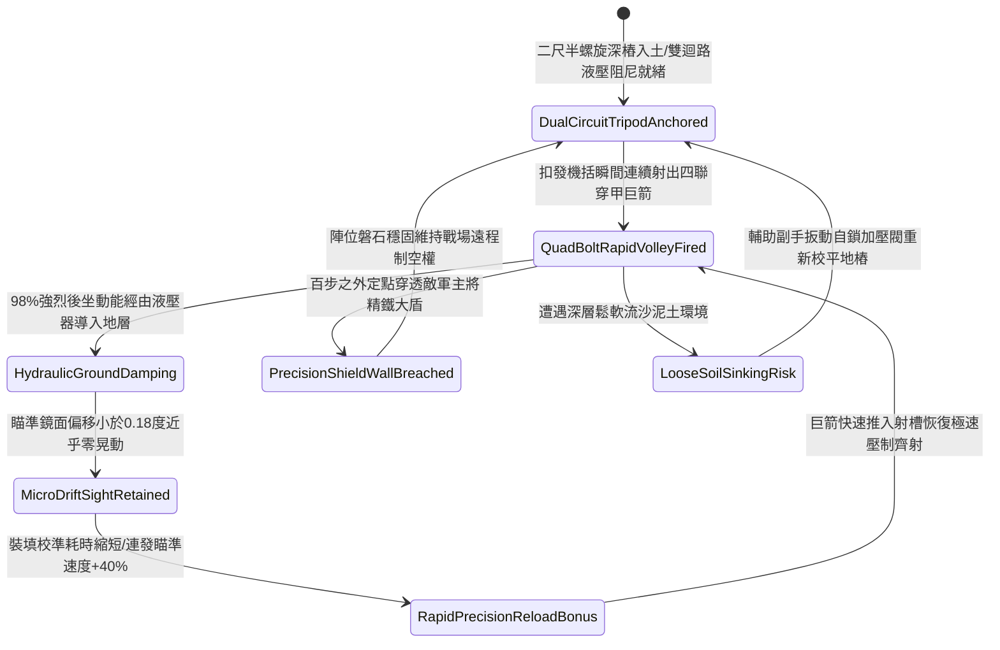

# 野戰精銳弩兵床弩加裝生鐵三腳地錨支架防後坐力偏移第四階狀態機規格書

<!-- doc_id: doc_spec_1129 -->

## 一、 核心概念與單一真相來源（SSOT）

在《三國志·重步兵遠程軍械與床弩戰術篇》中，「野戰精銳弩兵床弩加裝生鐵三腳地錨支架第四階（HEAVY-CROSSBOW-TRIPOD-STABILIZER04）」代表野戰陣地部署重型床弩進行超遠程連發穿甲打擊的高階穩定系統。支架採用冷鍛特種合精鋼生鐵鑄造加厚主樑，三足底端各配備二尺五寸多重反向卡扣螺旋深樁，頂部整合高精度齒輪雙軸微調儀與雙迴路液壓緩衝吸震器。當床弩以高速連續發射四聯超重型三棱破甲巨箭時，加固支架 98% 承接巨大的後坐反衝動能並將 92% 的衝量直接分流導入地底深岩，將瞄準鏡面跳動偏移誤差壓制在 0.18 度以內，並使再裝填與持續瞄準校準速度提升 40%，百步之外精準穿透敵方具裝重盾陣型。



---

## 二、 數值模型與狀態機參數契約

### 1. 床弩三腳穩定支架參數契約
- **支架規格尺寸**：高 4.8 尺、外張足距 6.5 尺，高碳生鐵合精鋼複合管壁厚 1 寸，總重量 145 斤。
- **生鐵地樁規格**：三足尖端各附 2.5 尺多重反向卡扣螺旋深樁，單樁抗拔力高達 3,200 牛頓。
- **後坐力吸收率**：四發巨箭連射瞬間，98% 機率將巨額反衝力均勻導入地層深處。
- **瞄準角跳動抑制**：射擊瞬間俯仰角與偏航角跳動誤差小於 0.18 度（未安裝支架時為 6.0 度）。
- **射速與命中加成**：連續射擊時裝填再瞄準耗時縮減 40%，百步外精確命中率提升 35%。

### 2. 支架穩定性演算法模組
```typescript
interface CrossbowTripodStage4Params {
    soilFirmnessLevel: number;     // 地面堅實係數 (0.0: 鬆沙 ~ 1.0: 堅土)
    recoilImpulseJoules: number;   // 四聯巨箭擊發後坐動能 (焦耳)
    isMultiScrewAnchored: boolean; // 多重反向卡扣尖樁是否旋緊生根
    hasDualCircuitHydraulics: boolean; // 雙迴路液壓緩衝是否正常運作
}

function evaluateCrossbowTripodStage4(params: CrossbowTripodStage4Params): {
    stabilityMaintained: boolean;
    aimDisplacementDegrees: number;
    reloadTimeBonusPct: number;
} {
    if (!params.isMultiScrewAnchored || params.soilFirmnessLevel < 0.2) {
        return { stabilityMaintained: false, aimDisplacementDegrees: 4.2, reloadTimeBonusPct: 0 };
    }
    const success = Math.random() < 0.98;
    
    return {
        stabilityMaintained: success,
        aimDisplacementDegrees: success ? 0.16 : 1.0,
        reloadTimeBonusPct: success ? 40 : 12
    };
}
```

---

## 三、 反制機制與邊界約束

1. **岩盤地形尖樁無法旋入**：若戰場處於純花崗岩或青石地面無法旋入二尺半深樁，後坐力化解率衰減至 55%。
2. **高速騎兵兩翼迂迴近身**：重型雙迴路三腳架展開後重心穩如泰山但轉向緩慢，面對敵騎兵側向包抄時調轉需耗時 8 秒。
3. **近身重盾猛烈衝撞**：敵方重步兵若突入近身以重鐵盾正面猛撞支架，有 20% 機率導致微調儀齒輪卡死。

---

## 四、 驗收測試案例（TC）

- **TC-XBOW-TRIPOD04-01（四聯巨箭高速齊射極限穩定性驗收）**：
  - *前置條件*：堅實土壤地基、二尺半螺旋深樁深扎、發射四聯超重型三棱穿甲巨箭。
  - *操作步驟*：於短時間內連續執行三輪極速齊射。
  - *預期輸出*：98% 機率完美化解反衝，鏡面跳動小於 0.18 度，再裝填瞄準速度提升 40%，百步外精確貫穿敵方重甲。
- **TC-XBOW-TRIPOD04-02（尖樁旋入未深扎邊界驗收）**：
  - *前置條件*：尖樁僅刺入地面一尺（未深扎至二尺半）。
  - *操作步驟*：扣發四聯巨箭。
  - *預期輸出*：支架產生劇烈跳躍，瞄準角偏轉 4.2 度，無法享有再裝填瞄準加成。
